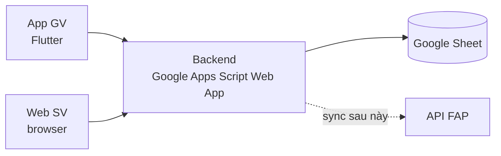

[← Mục lục](README.md)

# 01 · Kiến trúc tổng thể hệ thống

Có hai client: app Flutter của giảng viên, và một trang web nhẹ cho sinh viên. Cả hai đều **không nói chuyện trực tiếp với Google Sheet** — không có cách nào làm việc đó an toàn từ client. Ở giữa là một Backend nhẹ đóng vai trò "cổng API", đồng thời tự phục vụ luôn trang web cho SV nên không cần host thêm ở đâu khác.

## Lựa chọn: Google Apps Script Web App vừa làm BFF, vừa phục vụ trang web SV

Với 2 tuần và một nhóm sinh viên, dựng và host một server riêng (Node/NestJS...) tốn thời gian cho hạ tầng thay vì tính năng. Apps Script triển khai như một Web App có HTTPS endpoint miễn phí, chạy dưới quyền chủ sở hữu Sheet, và `UrlFetchApp` gọi ra ngoài được — tức là sau này gọi thẳng API của FAP từ chính chỗ này.

Cùng một deploy: hàm `doGet(e)` vừa trả JSON cho app GV, vừa trả một trang HTML (qua `HtmlService`) khi URL có `?page=checkin` — đây chính là "web" mà SV mở ra khi quét QR.

## Vì sao sinh viên không cần cài app?

SV quét bằng camera có sẵn của điện thoại (không cần scanner riêng trong app), giảm hẳn rào cản cài đặt — quan trọng vì đây là bên đông người dùng nhất. Trang web cũng tự chạy được trên mọi thiết bị có trình duyệt, kể cả khi SV lỡ dùng máy tính thay vì điện thoại.

## Vì sao không dùng Firebase / server riêng ngay từ đầu?

Vẫn là lựa chọn tốt cho lâu dài (xem [10 · Định hướng mở rộng](10-dinh-huong-mo-rong.md)), nhưng cần thời gian dựng Cloud Functions, quy tắc bảo mật, và một CSDL khác — không cần thiết khi đề bài đã chỉ định Google Sheet và thời hạn chỉ 2 tuần.

Điểm mấu chốt để không "mắc kẹt" với Sheet:
- Toàn bộ truy cập dữ liệu ở app GV đi qua **Repository** ([04](04-kien-truc-app-va-web.md)).
- Mọi tích hợp trường ngoài đi qua **SyncService**.

→ đổi hạ tầng phía sau không sửa app hay trang web.

[→ 02 Luồng điểm danh QR](02-luong-diem-danh-qr.md)
