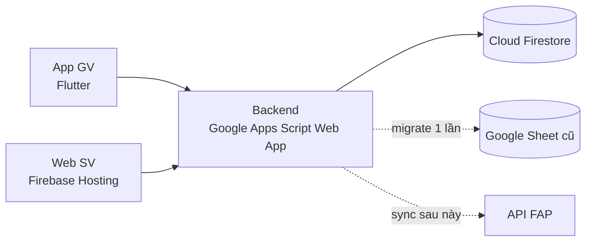
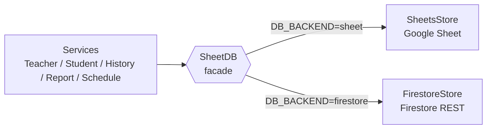

[← Mục lục](README.md)

# 01 · Kiến trúc tổng thể hệ thống

Có hai client: app Flutter của giảng viên, và một trang web nhẹ cho sinh viên. Cả hai đều **không nói chuyện trực tiếp với cơ sở dữ liệu** — không có cách nào làm việc đó an toàn từ client. Ở giữa là một Backend nhẹ (Google Apps Script Web App) đóng vai trò "cổng API" (BFF); dữ liệu nằm trong **Cloud Firestore**, còn trang web sinh viên được host trên **Firebase Hosting**.

| Thành phần | Công nghệ | Nơi chạy | Vai trò |
|---|---|---|---|
| App Giảng viên | Flutter (MVVM) | Máy giảng viên (Android/iOS/Windows…) | Đăng nhập, mở phiên, hiện QR xoay 60 giây, roster, lịch sử, báo cáo. **Không** deploy lên Firebase. |
| Trang check-in Sinh viên | HTML/CSS/JS thuần (`checkin-web/`) | Firebase Hosting | Sinh viên quét QR, đăng nhập Google, gửi `/checkin`. |
| Backend | Google Apps Script Web App (`apps-script/`) | Google | Xác thực, kiểm tra IP, ghi điểm danh, lịch sử, báo cáo; `SyncService` (FAP). Đã tách khỏi việc phục vụ HTML. |
| Cơ sở dữ liệu | Cloud Firestore | Firebase | Nguồn dữ liệu vận hành. Rules chặn mọi truy cập từ client. |
| Dữ liệu nguồn cũ | Google Sheet | Google Drive | Chỉ còn để migrate và làm bản lưu ([03](03-du-lieu-firestore.md)). |

## Trạng thái triển khai

| Hạng mục | Trạng thái |
|---|---|
| Trang SV trên Firebase Hosting | Đã deploy (`scripts/deploy.ps1`). |
| QR của sinh viên | **Chưa chuyển**: QR vẫn trỏ trang check-in do Apps Script phục vụ; trang Hosting chạy song song. Cách chuyển: [deploy-firebase.md §6](deploy-firebase.md#6-chuyển-qr-của-sinh-viên-sang-hosting-chưa-làm). |
| Cơ sở dữ liệu | Code đã hỗ trợ cả hai. Mặc định vẫn là Google Sheet (`DB_BACKEND=sheet`); chuyển sang Firestore sau khi chạy migrate + `setDbBackend('firestore')` ([deploy-firebase.md §10](deploy-firebase.md#10-chuyển-db-sang-firestore)). Kiểm tra bằng `getBackendInfo` → `dbBackend`. |
| Backend | Vẫn là Apps Script; chưa port sang Cloud Functions. |

## Lựa chọn: Apps Script làm BFF, Firestore làm CSDL, Hosting cho trang SV

**Apps Script vẫn là cổng API.** Với một nhóm sinh viên, Web App có HTTPS endpoint miễn phí, chạy dưới quyền chủ script và `UrlFetchApp` gọi ra ngoài được — tức là gọi Firestore REST hôm nay và gọi API FAP sau này đều từ cùng chỗ. Toàn bộ 30 action, URL `/exec`, app GV và trang SV **không đổi** khi đổi CSDL.

**Apps Script không còn phục vụ trang web cho sinh viên.** Trước đây `doGet(e)` trả HTML qua `HtmlService` khi có `?page=checkin`. Trang đó giờ là `checkin-web/` host trên Firebase Hosting (origin riêng, đăng nhập Google chuẩn, không bị iframe sandbox của Apps Script). Nhánh `?page=checkin` và `apps-script/index.html` được giữ làm đường lui cho tới khi QR chuyển hẳn sang Hosting.

**Firestore thay Google Sheet vì** Sheet không có giao dịch thật (nhiều SV quét cùng lúc dễ ghi trùng), đọc cả bảng mỗi lần gọi, và chậm dần khi số dòng tăng. Firestore cho khóa tài liệu tự nhiên `{sessionId}_{rollNumber}` — ghi trùng bị từ chối ngay ở CSDL — và truy vấn theo điều kiện thay vì đọc toàn bộ.

## Lớp truy cập dữ liệu: `SheetDB` là cửa duy nhất

Mọi service (`TeacherService`, `StudentService`, `AttendanceHistoryService`, `ReportService`, `ScheduleService`…) chỉ gọi 5 hàm của `SheetDB`: `getRowsAsObjects`, `insertRow`, `updateRow`, `ensureSheet`, `ensureColumns`. `SheetDB` chọn store theo Script Property `DB_BACKEND`:

Nhờ vậy đổi CSDL không sửa service, app hay trang web, và **quay lại Sheet chỉ cần đổi một cờ** (lưu ý: dữ liệu ghi sau cutover không được chép ngược về Sheet). `getRowsAsObjects` nhận thêm "gợi ý lọc" (`{field: value}`) để Firestore chỉ đọc đúng tài liệu cần; Sheet bỏ qua gợi ý này.

## Vì sao sinh viên không cần cài app?

SV quét bằng camera có sẵn của điện thoại (không cần scanner riêng trong app), giảm hẳn rào cản cài đặt — quan trọng vì đây là bên đông người dùng nhất. Trang web cũng tự chạy được trên mọi thiết bị có trình duyệt, kể cả khi SV lỡ dùng máy tính thay vì điện thoại.

## Vì sao chưa port backend sang Cloud Functions?

Đó vẫn là hướng dài hạn (xem [10 · Định hướng mở rộng](10-dinh-huong-mo-rong.md)) nhưng cần viết lại 30 action bằng Node + Admin SDK, đổi URL API (ảnh hưởng app GV và trang SV), và bật gói Blaze. Chuyển CSDL trước cho lợi ích lớn nhất (chống ghi trùng, truy vấn nhanh) với rủi ro thấp nhất; Apps Script có giới hạn cần biết ở [09](09-rui-ro-va-gioi-han.md) (quota `UrlFetchApp`, thời gian chạy tối đa 6 phút/lần).

Điểm mấu chốt để không bị "mắc kẹt" vào một hạ tầng:
- Toàn bộ truy cập dữ liệu của backend đi qua **`SheetDB`**; app GV đi qua **Repository** ([04](04-kien-truc-app-va-web.md)).
- Mọi tích hợp trường ngoài đi qua **SyncService**.

→ đổi hạ tầng phía sau không sửa app hay trang web.

[→ 02 Luồng điểm danh QR](02-luong-diem-danh-qr.md)
