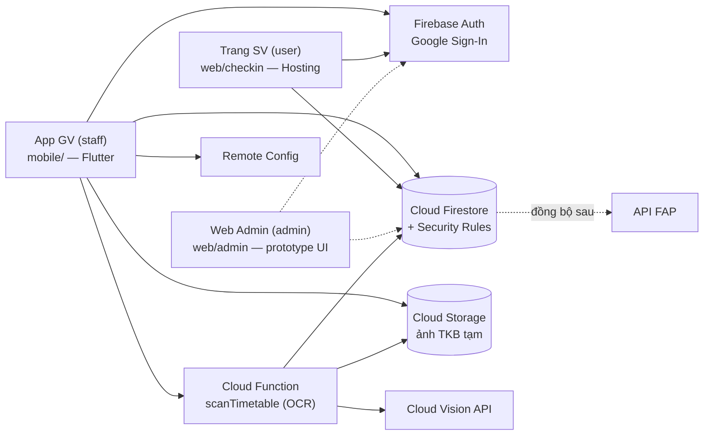

[← Mục lục](README.md)

# 01 · Kiến trúc tổng thể hệ thống

Toàn bộ backend và cơ sở dữ liệu là **Firebase**. Không còn máy chủ trung gian: app giảng viên và trang điểm danh của sinh viên nói chuyện **trực tiếp** với Cloud Firestore bằng Firebase SDK, và **Security Rules** (`deny by default`) quyết định ai được đọc/ghi gì. Phần việc duy nhất cần máy chủ — OCR ảnh thời khóa biểu — là một Cloud Function.

## Các thành phần

| Thành phần | Công nghệ | Thư mục | Vai trò |
|---|---|---|---|
| App Giảng viên | Flutter (MVVM) | [`mobile/`](../mobile) | Đăng nhập, mở phiên, hiện QR xoay 60 giây, roster, lịch sử, báo cáo, import TKB. **Không** deploy lên Firebase. |
| Mã dùng chung | Dart package `fapcheckin_core` | [`packages/core/`](../packages/core) | Model, Repository Firestore, design system/theme — dùng lại cho Web Admin. |
| Trang điểm danh SV | HTML + Firebase JS SDK | [`web/checkin/`](../web/checkin) | SV quét QR → đăng nhập Google → ghi `attendance_records`. Host trên Firebase Hosting. |
| Web Admin | (chưa triển khai) | [`web/admin/`](../web/admin) | Cấp tài khoản, quản lý lớp, duyệt `requests`, phát `announcements`. |
| Backend | Firestore + Security Rules, Auth, Storage, Remote Config, Hosting | [`firebase/`](../firebase), `firebase.json` | Nguồn dữ liệu duy nhất và nơi thực thi phân quyền. |
| Cloud Function | Node 22, `onCall` | [`firebase/functions/`](../firebase/functions) | `scanTimetable`: OCR ảnh thời khóa biểu (cần gói Blaze). |
| Test | `node:test` + Emulator | [`firebase/tests/`](../firebase/tests), [`e2e_test/`](../e2e_test) | Test Security Rules (allowed/denied theo role) và một luồng end-to-end. |

## Vì sao "Rules-first", không có backend riêng?

- **Ít thành phần phải vận hành.** Không máy chủ, không bảo trì quota như Apps Script; Firebase Auth cấp danh tính, Firestore lưu dữ liệu, Rules thi hành quyền.
- **Chống trùng ở tầng CSDL.** Bản ghi điểm danh có id `{sessionId}_{rollNumber}` và SV chỉ được `create` (không `update`) → quét lại không tạo bản ghi thứ hai, kể cả khi nhiều thiết bị quét cùng lúc.
- **Kiểm tra check-in nằm trong Rules.** QR đúng, phiên đang mở, SV có ghi danh, IP khớp (nếu bật), `status = Present`, `checkinTime = request.time`. Client không thể "tự khai" kết quả. Xem [02](02-luong-diem-danh-qr.md) và [08](08-security-rules.md).
- **Mọi thay đổi quy tắc đều có test** chạy trên Firebase Emulator (CI chạy mỗi lần push).

Đánh đổi: Rules chỉ trả `permission-denied`, không có mã lỗi chi tiết như `IP_MISMATCH` — trang SV tự suy ra lý do bằng cách đọc thêm những gì SV được phép đọc ([02](02-luong-diem-danh-qr.md#thông-báo-lỗi-cho-sinh-viên)). Phần tính toán nặng (báo cáo, lịch sử) chạy ở client bằng các truy vấn có lọc theo `teacherMemberCode`.

## Lớp truy cập dữ liệu: Repository

ViewModel của app **không biết** Firestore tồn tại — nó chỉ gọi Repository (trong `packages/core`). Repository trả `ApiResult<T>` (`ApiSuccess` | `ApiFailure(code, message)`), giữ nguyên các mã lỗi nghiệp vụ cũ (`FORBIDDEN`, `CONFLICT`, `SESSION_ALREADY_OPEN`…), nên View/ViewModel không đổi khi chuyển từ Apps Script sang Firebase. Mô tả từng Repository: [06](09-repository-api.md).

## Đồng bộ FAP

API chính thức của FAP "sẽ được cung cấp sau". Mọi tích hợp ngoài đi qua một điểm duy nhất (`TeacherRepository.syncToFap`, hiện là bản giữ chỗ chỉ đánh dấu `syncedToFap = true`). Khi có API thật, thay phần đó (hoặc chuyển sang Cloud Function theo lịch) mà không đụng schema hay UI.

## Vì sao sinh viên không cần cài app?

SV quét bằng camera có sẵn của điện thoại, trang web tự mở và điểm danh ngay nếu trình duyệt đã đăng nhập từ lần trước (Firebase Auth lưu phiên trong trình duyệt). Rào cản cài đặt gần như bằng không với bên đông người dùng nhất.

[→ 02 Luồng điểm danh QR](02-luong-diem-danh-qr.md)
