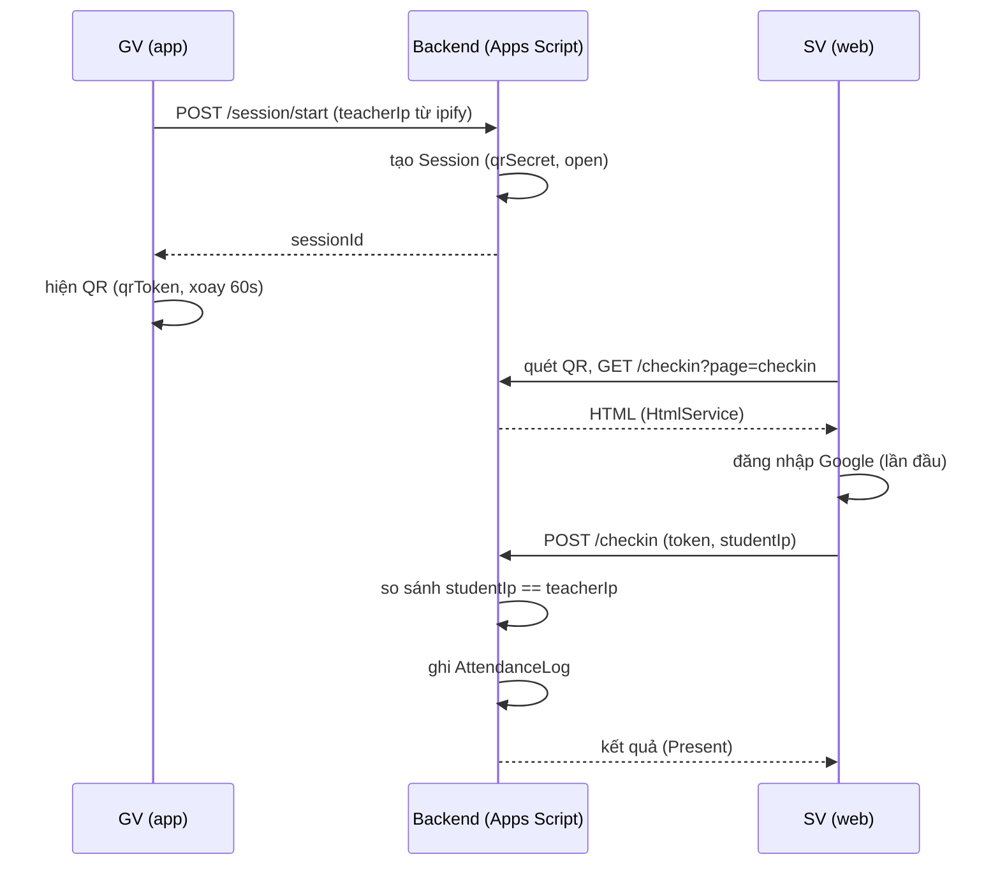

[← Mục lục](README.md)

# 02 · Luồng điểm danh bằng QR

Mã QR tự động xoay mỗi 60 giây trong khi phiên còn mở. "Gần lớp học" được xác nhận bằng địa chỉ IP mạng, không đụng tới GPS của máy.

## Sequence: Bắt đầu phiên → Quét → Kiểm tra IP → Ghi nhận

## Kiểm tra qua địa chỉ IP mạng

Lúc GV bấm "Điểm danh", app gọi một dịch vụ lấy IP công khai (ví dụ `api.ipify.org`) và gửi lên cùng `teacherIp`. Khi trang web SV gọi `/checkin`, nó cũng tự lấy IP công khai của chính mình rồi gửi kèm. Backend chỉ so sánh hai chuỗi IP — khác nhau thì từ chối, không cần bất kỳ quyền định vị nào từ trình duyệt hay thiết bị.

## Giới hạn cần biết

Đây là kiểm tra "cùng mạng Wi-Fi trường", **không phải** đo khoảng cách vật lý chính xác theo mét như GPS. Nếu cả toà nhà dùng chung một IP công khai (NAT chung), hai lớp khác phòng vẫn có thể trùng IP. Đổi lại: không xin quyền vị trí, không lo GPS sai lệch trong nhà, và triển khai đơn giản hơn nhiều trong 2 tuần. Xem thêm [09 · Rủi ro & giới hạn](09-rui-ro-va-gioi-han.md).

## Đăng nhập một lần, các lần sau tự động

SV mở trang lần đầu (từ QR) vẫn phải đăng nhập Google 1 lần; trang lưu một token phiên ngắn hạn vào `localStorage` của trình duyệt đó. Các buổi sau, quét QR mới mở đúng trình duyệt đã đăng nhập → trang tự gửi `/checkin` ngay khi tải xong, không cần bấm gì thêm — đúng tinh thần "đã đăng nhập thì tự điểm danh" của đề bài, chỉ đổi "app" thành "trình duyệt".

## Nếu mất mạng giữa lúc gửi /checkin

Trang hiện nút "Thử lại" và thông báo rõ lý do (mất mạng, không phải sai lớp). QR giữ nguyên trong một phút để sinh viên có đủ thời gian quét và đăng nhập Google.

[→ 03 Dữ liệu & cấu trúc Google Sheet](03-du-lieu-google-sheet.md)
