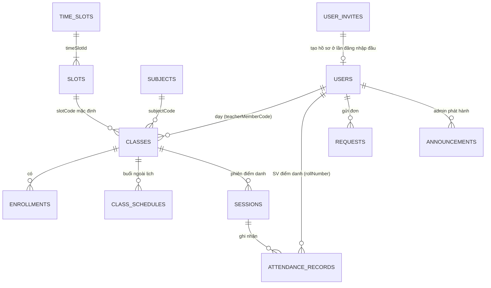

[← Mục lục](README.md)

# 03 · Dữ liệu & cấu trúc Firestore

Dữ liệu vận hành nằm trong **Cloud Firestore** (project `fapcheckin-3bn2di`). App giảng viên và trang SV đọc/ghi **trực tiếp** bằng Firebase SDK; quyền truy cập do [`firebase/firestore.rules`](../firebase/firestore.rules) quyết định (deny by default, kiểm tra role và trạng thái hợp lệ — xem [08](08-security-rules.md)). Không còn Google Sheet hay Apps Script.

| Hạng mục | Trạng thái |
|---|---|
| Schema collection + rules + indexes | Xong (`firebase/`) |
| Test Security Rules trên Emulator | Xong (`firebase/tests/`, 77 test) |
| Dữ liệu tham chiếu (slot/khung giờ) | `firebase/scripts/seed-reference.mjs` |
| Chuyển dữ liệu từ schema Apps Script cũ | `firebase/scripts/migrate-legacy.mjs` — **chủ project chạy tay**, xem [deploy-firebase.md](deploy-firebase.md#7-migrate-dữ-liệu-cũ) |

## 1. Sơ đồ thực thể (ERD)

Nguồn chuẩn: [db-erd.mermaid](db-erd.mermaid). Bản sao để đọc ngay:



## 2. Collections

| Collection | Document id | Nội dung chính | Ai ghi |
|---|---|---|---|
| `users` | `{uid}` (Firebase Auth) | `memberCode`, `fullName`, `email`, `role` (`user`\|`staff`\|`admin`), `rollNumber` (SV), `active`, `createdAt` | Tự tạo ở lần đăng nhập đầu (khớp invite); admin sửa |
| `user_invites` | `{email viết thường}` | `role`, `memberCode`, `fullName`, `rollNumber` — tài khoản được cấp trước | admin |
| `subjects` | `{subjectCode}` | `subjectName`, `credits` | admin |
| `timeSlots` | `A-1`, `A-2`, `P-1`, `P-2` | `period`, `slotInPeriod`, `daySlotNo`, `startTime`, `endTime` | seed / admin |
| `slots` | `A1`…`A6`, `P1`…`P6` | `timeSlotId`, `weekdays` | seed / admin |
| `classes` | `{classCode}` | `subjectCode`, `subjectName`, `credits`, `room`, `studentCount`, `teacherMemberCode` (rỗng = chưa có GV), `slotCode` | admin; GV chỉ được "nhận" lớp chưa có GV |
| `enrollments` | `{classCode}_{rollNumber}` | `classCode`, `rollNumber`, `teacherMemberCode`, `fullName`, `email` | admin |
| `class_schedules` | `{teacherMemberCode}_{requestId}` | buổi ngoài lịch: `classCode`, `scheduleDate`, `slotCode`, `room`, `lessonType`, `teachingMethod`, `note`, `status` | GV chủ lớp |
| `sessions` | tự sinh | `classCode`, `teacherMemberCode`, `sessionDate`, `slotCode`, `sessionStatus`, `qrSecret`, `ipCheck`, `teacherIp` | GV chủ lớp |
| `attendance_records` | `{sessionId}_{rollNumber}` | `status`, `checkinTime`, `networkVerificationResult`, `ipAddress`, `note`, `classCode`, `teacherMemberCode`, `syncedToFap`… | SV (create khi quét QR) · GV (chấm tay, đóng phiên) |
| `requests` | tự sinh | đơn sửa điểm danh / nghỉ phép: `type`, `authorUid`, `reason`, `status` (`pending`→`approved`\|`rejected`) | SV/GV tạo · admin duyệt |
| `announcements` | tự sinh | thông báo: `audience` (`all`\|`staff`\|`user`), `title`, `body`, `createdAt` | admin |

Quy ước kiểu dữ liệu: mã/khóa/phòng là **chuỗi** (kể cả `room` số như `303`); `credits`, `studentCount` là số; `syncedToFap`, `ipCheck`, `active` là boolean; ngày `yyyy-MM-dd`; giờ `HH:mm`; thời điểm (`checkinTime`, `createdAt`, `updatedAt`, `resolvedAt`) là `Timestamp` của Firestore (SDK tự đổi sang ISO 8601 cho model).

`networkVerificationResult`: `Match` (IP khớp), `Skipped` (phiên không kiểm tra IP), `Manual` (GV sửa tay), `AutoAbsent` (vắng tự sinh khi đóng phiên), `Mismatch` (dữ liệu cũ, không còn tạo mới).

### Vì sao quyền tính theo `memberCode`/`rollNumber`, không theo `uid`

Dữ liệu (lớp, phiên, ghi danh…) tồn tại trước khi người dùng đăng nhập lần đầu nên chưa biết `uid`. Hồ sơ `users/{uid}` giữ `memberCode` (GV) và `rollNumber` (SV); Rules đọc hồ sơ này một lần rồi so với trường trên tài liệu. Vì thế `teacherMemberCode` được lưu ở `enrollments`, `sessions`, `attendance_records`, `class_schedules` — một truy vấn `where('teacherMemberCode', '==', memberCode)` được Rules chấp nhận mà không cần `get()` từng dòng ([§7](#7-ghi-chú-thiết-kế)).

## 3. Quy tắc lịch: slot A/P

`A` = AM (sáng), `P` = PM (chiều). Mỗi ngày có 4 slot thường; **P đánh số nối tiếp sau A**. Slot học bù dùng lại đúng các slot này vào ngày bất kỳ (không có slot tối).

| Mã slot | Slot trong buổi | Slot hiển thị trong ngày | Ngày học (thứ 2 = Mon … thứ 7 = Sat) |
|---|---|---|---|
| A1 / P1 | 1 | 1 / 3 | thứ 2 + thứ 5 |
| A2 / P2 | 2 | 2 / 4 | thứ 2 + thứ 5 |
| A3 / P3 | 1 | 1 / 3 | thứ 3 + thứ 6 |
| A4 / P4 | 2 | 2 / 4 | thứ 3 + thứ 6 |
| A5 / P5 | 1 | 1 / 3 | thứ 4 + thứ 7 |
| A6 / P6 | 2 | 2 / 4 | thứ 4 + thứ 7 |

Giờ chỉ lưu ở `timeSlots` (4 tài liệu): `A-1` 07:00–09:15, `A-2` 09:30–11:45, `P-1` 12:30–14:45, `P-2` 15:00–17:15. Mã lẻ dùng khung `-1`, mã chẵn dùng khung `-2`. Mỗi tài liệu `slots` có thêm mảng `weekdays` (VD `A1` → `[2, 5]`).

## 4. Security Rules & Indexes

- [`firebase/firestore.rules`](../firebase/firestore.rules): từ chối mọi truy cập không khai báo; mỗi collection có `match` riêng kiểm tra `request.auth`, role và trạng thái hợp lệ. Ma trận role × collection và danh sách test: [08](08-security-rules.md).
- [`firebase/storage.rules`](../firebase/storage.rules): chỉ GV tải ảnh thời khóa biểu vào `timetable_scans/{uid}/…` (ảnh, < 10 MB).
- [`firebase/firestore.indexes.json`](../firebase/firestore.indexes.json): các composite index cho truy vấn có sắp xếp (xem [§7](#7-ghi-chú-thiết-kế)).
- Deploy: `./scripts/deploy.ps1 -Only firestore` ([deploy-firebase.md](deploy-firebase.md)).

## 5. Luồng dữ liệu chính

- **Mở phiên:** GV tạo `sessions` (`open`, `qrSecret`, `ipCheck`, `teacherIp` nếu bật) và đóng các phiên `open` cũ của cùng lớp trong một batch.
- **Xoay QR:** GV cập nhật `sessions.qrSecret` mỗi 60 giây.
- **SV điểm danh:** tạo `attendance_records/{sessionId}_{rollNumber}`; Rules kiểm tra QR, ghi danh, trạng thái phiên và IP ([02](02-luong-diem-danh-qr.md)).
- **Đóng phiên:** GV đặt `sessionStatus = closed` và tạo bản ghi **Absent** (`AutoAbsent`) cho SV có trong `enrollments` nhưng chưa có bản ghi — cùng một batch.
- **Sửa điểm danh:** GV ghi `status`, `note`, `updatedAt`, `updatedBy`, `networkVerificationResult = Manual`, `syncedToFap = false` trong transaction có so khớp `revision` (phát hiện xung đột).
- **Import thời khóa biểu:** ảnh → Storage → Cloud Function OCR → GV chọn lớp → cập nhật `classes.teacherMemberCode` (và `enrollments`) cùng batch ([07](07-timetable-ocr.md)).
- **Sync FAP:** `syncToFap` đọc bản ghi `syncedToFap == false`, đẩy lên FAP (chưa có API) rồi đặt `true`.

## 6. Khởi tạo dữ liệu

```bash
cd firebase
npm ci
node scripts/seed-reference.mjs            # 4 timeSlots + 12 slots
node scripts/seed-admin.mjs --email admin@fpt.edu.vn
```

Thêm `--emulator` để chạy với Firebase Emulator. Chi tiết: [deploy-firebase.md](deploy-firebase.md).

## 7. Ghi chú thiết kế

**Trường denormalize (có chủ đích)**

| Trường | Nằm ở | Lý do |
|---|---|---|
| `teacherMemberCode` | `enrollments`, `sessions`, `attendance_records`, `class_schedules` | Rules kiểm tra quyền bằng một so sánh trên chính tài liệu. Khi GV nhận lớp, app cập nhật `classes` và `enrollments` cùng một batch. |
| `classCode` | `attendance_records` | GV đọc lịch sử cả lớp bằng một truy vấn. |
| `fullName`, `email` | `enrollments` | Roster không cần đọc `users` (GV không có quyền đọc hồ sơ SV). |
| `subjectName`, `credits` | `classes` | Tránh join `subjects` ở client. |

**Lịch ngoài lịch**: lịch thường = `classes.slotCode` + `slots.weekdays`; `class_schedules` chỉ chứa buổi học bù/workshop/ôn tập, không lưu giờ (lấy từ slot → timeSlot). Phát hiện trùng lịch chỉ trong phạm vi lịch của chính giảng viên.

**Chỉ mục**: chỉ khai báo cho truy vấn có sắp xếp hoặc bất đẳng thức; truy vấn chỉ gồm điều kiện bằng nhau (kể cả `in`) không cần composite index.

**Ánh xạ từ schema Apps Script cũ** (script: `firebase/scripts/migrate-legacy.mjs`, quy trình: [deploy-firebase.md](deploy-firebase.md#7-migrate-dữ-liệu-cũ))

| Cũ | Mới |
|---|---|
| `users/{memberCode}` (`GV`/`SV`) | `user_invites/{email}` + `users/{uid}` (`staff`/`user`) |
| `classSections` + `subjects` | `classes` |
| `enrollments` | `enrollments` (+ `teacherMemberCode`, `fullName`, `email`) |
| `classSchedules` | `class_schedules` |
| `attendanceSessions` | `sessions` (+ `teacherMemberCode`; `ipCheck` luôn có) |
| `attendanceRecords` | `attendance_records` (+ `classCode`, `teacherMemberCode`; thời điểm là `Timestamp`) |
| — | `requests`, `announcements` (mới, cho Web Admin) |

[→ 04 Kiến trúc App Giảng viên & Trang Web Sinh viên](04-kien-truc-app-va-web.md)
