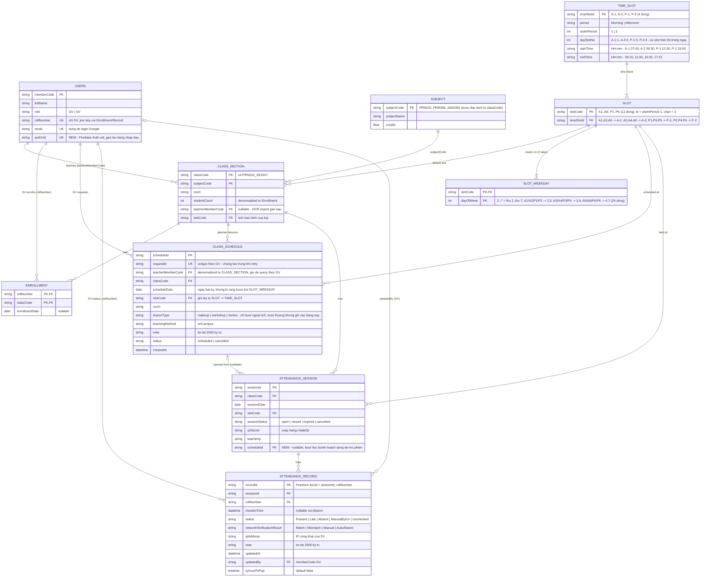

[← Mục lục](README.md)

# 03 · Dữ liệu & cấu trúc Firestore

Dữ liệu vận hành nằm trong **Cloud Firestore** (project Firebase của dự án). **Backend (Apps Script) là bên duy nhất đọc/ghi** — app GV và trang SV không bao giờ nói chuyện trực tiếp với Firestore; `firestore.rules` chặn toàn bộ truy cập từ client (`allow read, write: if false`), backend truy cập bằng IAM của chủ script. Google Sheet cũ chỉ còn là **nguồn dữ liệu để migrate** (xem [mục 7](#7-nguồn-dữ-liệu-cũ-google-sheet)).

| Trạng thái triển khai | |
|---|---|
| Thiết kế collection + rules + indexes | Xong (`firestore.rules`, `firestore.indexes.json`, ERD bên dưới) |
| Lớp truy cập `SheetDB` → `FirestoreStore` | Xong, chọn bằng cờ `DB_BACKEND` (`sheet` mặc định) |
| Migrate dữ liệu Sheet → Firestore | Có script (`Migrate.gs`), **chủ script chạy tay** — xem [deploy-firebase.md](deploy-firebase.md) |
| Cutover | Khi chạy `setDbBackend('firestore')`; kiểm tra bằng `getBackendInfo` → `dbBackend` |

## 1. Sơ đồ thực thể (ERD)

Nguồn chuẩn của sơ đồ là file [db-erd.mermaid](db-erd.mermaid); bản dưới đây là bản sao để đọc ngay trong tài liệu.

Ghi chú về ERD:
- `USERS.authUid` và `ATTENDANCE_SESSION.scheduleId` là **trường dành sẵn**, backend hiện chưa ghi (chưa dùng Firebase Auth; phiên điểm danh chưa nối với buổi học bù qua khóa).
- `SLOT`, `TIME_SLOT`, `SLOT_WEEKDAY` là dữ liệu **cố định theo quy tắc lịch** ở mục 3, do `seedSlots()` tạo, không sửa từ app.

## 2. Collection ↔ tab Sheet cũ

Backend vẫn gọi các "bảng" bằng tên cũ (`SheetDB.getRowsAsObjects('Enrollment')`…) nên toàn bộ service không phải đổi; `FirestoreStore` ánh xạ sang collection:

| Bảng (tên trong code) | Collection Firestore | Document id | Ghi chú |
|---|---|---|---|
| `Users` | `users` | `memberCode` | `role` = `GV` \| `SV`; `rollNumber`, `email` chỉ áp dụng cho SV. |
| `Class_Section` | `classSections` + `subjects` | `classCode` / `subjectCode` | `subjectName`, `credits` tách sang `subjects`; khi đọc được ghép lại nên response không đổi. `subjectCode` suy từ `classCode` (VD `PRN232_SE1917` → `PRN232`). |
| `Slot` | `slots` + `timeSlots` | `slotCode` / `timeSlotId` | Khi đọc ghép thành `{slotCode, period, startTime, endTime}` như cũ. **Chỉ đọc**: mọi ghi vào Slot bị bỏ qua. |
| `Enrollment` | `enrollments` | `{classCode}_{rollNumber}` | Chặn trùng ghi danh. |
| `Class_Schedule` | `classSchedules` | `scheduleId` | Buổi ngoài lịch (`makeup`, `workshop`, `review`); giờ lấy từ slot, không lưu `startTime/endTime`. |
| `Attendance_Session` | `attendanceSessions` | `sessionId` | `sessionStatus = open \| closed \| expired \| cancelled`. `teacherIp` và `qrSecret` sinh khi mở phiên. |
| `Attendance_Record` | `attendanceRecords` | `{sessionId}_{rollNumber}` | Mỗi SV một bản ghi mỗi phiên; ghi trùng bị Firestore từ chối (`DB_CONFLICT`) → API trả `ALREADY_CHECKED_IN`. Giữ thêm trường `recordId` (UUID) vì service tìm theo nó. |

Quy ước kiểu dữ liệu: mã/khóa/phòng là **chuỗi** (kể cả `room` số như `303`); `credits`, `studentCount` là số; `syncedToFap` là boolean; ngày `yyyy-MM-dd`; giờ `HH:mm`; thời điểm (`checkinTime`, `createdAt`, `updatedAt`) là chuỗi ISO 8601.

Trường bắt đầu bằng `_` (VD `_row` = thứ tự dòng khi import từ Sheet) là nội bộ, không trả ra API; thứ tự đọc là `_row` rồi đến thời điểm tạo, để các chỗ dựa vào "dòng mới nhất thắng" vẫn đúng.

## 3. Quy tắc lịch: slot A/P

`A` = AM (sáng), `P` = PM (chiều). Mỗi ngày có 4 slot thường; **P đánh số nối tiếp sau A**. Slot học bù dùng lại đúng các slot này vào ngày bất kỳ (không có slot tối).

| Mã slot | Slot trong buổi | Slot hiển thị trong ngày | Ngày học (thứ 2 = Mon … thứ 7 = Sat) |
|---|---|---|---|
| A1 / P1 | 1 | 1 / 3 | thứ 2 + thứ 5 |
| A2 / P2 | 2 | 2 / 4 | thứ 2 + thứ 5 |
| A3 / P3 | 1 | 1 / 3 | thứ 3 + thứ 6 |
| A4 / P4 | 2 | 2 / 4 | thứ 3 + thứ 6 |
| A5 / P5 | 1 | 1 / 3 | thứ 4 + thứ 7 |
| A6 / P6 | 2 | 2 / 4 | thứ 4 + thứ 7 |

Giờ chỉ lưu ở `timeSlots` (4 dòng): `A-1` 07:00–09:15, `A-2` 09:30–11:45, `P-1` 12:30–14:45, `P-2` 15:00–17:15. Mã lẻ (A1, A3, A5…) dùng khung `-1`, mã chẵn dùng khung `-2`. Mỗi document `slots` có thêm mảng `weekdays` (VD `A1` → `[2, 5]`) thay cho bảng `SLOT_WEEKDAY` của ERD.

## 4. Firestore rules & indexes

- [`firestore.rules`](../firestore.rules): từ chối mọi truy cập từ client SDK. Backend dùng token OAuth của chủ script (IAM, scope `datastore`), không đi qua rules. Chỉ nới rules khi client đọc trực tiếp Firestore, và phải kiểm tra `request.auth` + vai trò.
- [`firestore.indexes.json`](../firestore.indexes.json): 2 composite index — `attendanceSessions(classCode, sessionStatus)` và `classSchedules(teacherMemberCode, scheduleDate)`. Truy vấn chỉ có điều kiện bằng nhau trên nhiều trường (VD tìm phiên theo `qrSecret` + `sessionStatus`) không cần composite index.
- Deploy rules/indexes: `./scripts/deploy.ps1 -ProjectId <id> -Only firestore` ([hướng dẫn](deploy-firebase.md)).

## 5. Luồng dữ liệu chính

- **Mở phiên:** ghi `attendanceSessions` (`open`, `qrSecret`, `teacherIp`), tự đóng phiên `open` cũ của cùng lớp.
- **SV điểm danh:** tìm phiên theo `qrSecret` + `open`, kiểm tra `enrollments`, so IP, tạo `attendanceRecords/{sessionId}_{rollNumber}`.
- **Đóng phiên:** backend tự sinh bản ghi **Absent** (`networkVerificationResult = AutoAbsent`) cho SV có trong `enrollments` nhưng chưa có bản ghi ở phiên đó.
- **Sync FAP:** job `syncToFap` đọc các bản ghi `syncedToFap == false`, đẩy lên FAP rồi đặt `true`. Mọi chỉnh sửa tay hoặc điểm danh mới đặt lại `false`. (`syncedToFap` chỉ có ở bản ghi chính thức, không còn là cột "thêm tạm".)

## 6. Migrate & vận hành

Migrate một lần từ Sheet (`Migrate.gs`: `authorizeFirestore` → `seedSlots` → `migrateSheetsToFirestoreDryRun` → `migrateSheetsToFirestore` → `verifyMigration` → `setDbBackend('firestore')`) và quy trình rollback nằm ở [deploy-firebase.md](deploy-firebase.md#10-chuyển-db-sang-firestore). Ghi chú thiết kế và ánh xạ: [db-erd-notes.md](db-erd-notes.md).

## 7. Nguồn dữ liệu cũ (Google Sheet)

Trước đây dữ liệu nằm trong một Google Sheet, mỗi bảng là một tab (`Users`, `Class_Section`, `Slot`, `Enrollment`, `Class_Schedule`, `Attendance_Session`, `Attendance_Record`). Sheet vẫn còn nguyên và là backend mặc định (`DB_BACKEND=sheet`) cho tới khi cutover; sau đó nó chỉ là bản lưu, **không được ghi ngược**.

File [FAP-Checkin-Google-Sheet-Template.xlsx](assets/FAP-Checkin-Google-Sheet-Template.xlsx) (cục bộ, không đưa vào git) là bản mẫu/bản chụp cấu trúc tab cũ, kèm dữ liệu thật kỳ FA26 (8 lớp, ~220 người dùng, 282 dòng ghi danh).

> ⚠️ File đó chứa **họ tên và email thật của sinh viên (PII)** — cân nhắc trước khi chia sẻ hoặc commit. Các ô nền cam trong file là giả định/TODO chưa xác nhận (xem tab README của file). Khi migrate, `Migrate.gs` chuẩn hóa các lỗi dữ liệu đã biết (ngày lưu dạng số serial, `slotCode` dạng số, dòng điểm danh trùng, tab Slot cũ có mã P7–P9) và liệt kê chúng ở dạng cảnh báo.

[→ 04 Kiến trúc App Giảng viên & Trang Web Sinh viên](04-kien-truc-app-va-web.md)
