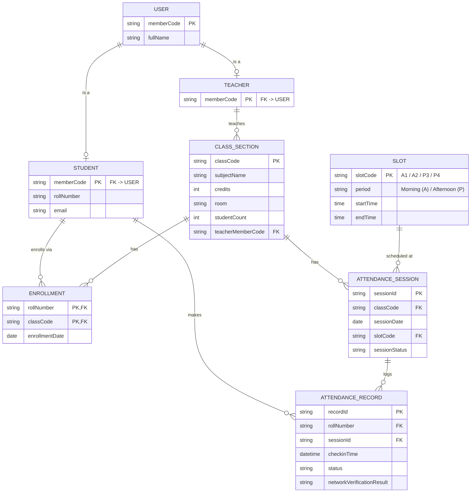

[← Mục lục](README.md)

# 03 · Dữ liệu & cấu trúc Google Sheet

Một file Sheet, mỗi bảng nghiệp vụ là một tab riêng. **Backend là bên duy nhất ghi trực tiếp** — app không bao giờ mở Sheets API. Dưới đây là sơ đồ thực thể liên kết (ERD) phản ánh cấu trúc dữ liệu:

Dựa trên ERD này, các thực thể sẽ được ánh xạ thành các tab trong Google Sheet tương ứng:

| Tab / Thực thể | Các cột dữ liệu (Schema) | Ghi chú |
|---|---|---|
| **Users** (Gộp USER, TEACHER, STUDENT) | `memberCode, fullName, role, rollNumber, email` | Để tối ưu số lượng tab trong Sheet, thông tin người dùng được gộp. Cột `role` phân biệt GV và SV. `rollNumber` và `email` chỉ áp dụng cho SV. |
| **Class_Section** | `classCode, subjectName, credits, room, studentCount, teacherMemberCode` | Quản lý thông tin lớp học và phân công giảng viên (`teacherMemberCode`). |
| **Slot** | `slotCode, period, startTime, endTime` | Quản lý khung giờ chuẩn (VD: A1, P3). |
| **Enrollment** | `rollNumber, classCode, enrollmentDate` | Danh sách sinh viên thuộc lớp, dùng để chặn SV quét nhầm phiên điểm danh của lớp khác. |
| **Attendance_Session** | `sessionId, classCode, sessionDate, slotCode, sessionStatus, qrSecret, teacherIp` | `sessionStatus = open \| closed \| expired`. `teacherIp` (IP công khai của GV) và `qrSecret` được sinh ra khi mở phiên để phục vụ xử lý xác thực. |
| **Attendance_Record** | `recordId, rollNumber, sessionId, checkinTime, status, networkVerificationResult` | Tương đương với AttendanceLog. `networkVerificationResult` lưu kết quả đối chiếu IP giữa SV và GV. |

> **Lưu ý**: Các bản ghi mang trạng thái **Absent** (vắng mặt) sẽ do backend tự sinh vào cuối buổi học bằng cách đối chiếu những sinh viên có trong `Enrollment` nhưng chưa có bản ghi check-in trong `Attendance_Record` tại session đó.

## Bộ Google Sheet

File 6 tab trên (header, dropdown validation theo `role`/`sessionStatus`/`status`, ghi chú từng cột): [FAP-Checkin-Google-Sheet-Template.xlsx](assets/FAP-Checkin-Google-Sheet-Template.xlsx) — import trực tiếp vào Google Sheets (File → Import → Replace/Insert new sheet(s)).

> ⚠️ **File này hiện chứa dữ liệu thật kỳ FA26** (không còn thuần là template rỗng): `Class_Section` (8 lớp), `Users` (219 SV + 1 GV, dedupe theo `memberCode`), `Enrollment` (282 dòng ghi danh) — lấy từ ảnh lịch dạy GV "PhuongLHK" + `FA26_Markbook.ods`. `Slot`/`Attendance_Session`/`Attendance_Record` vẫn giữ nguyên dòng mẫu rỗng. Các ô nền cam nhạt trong file là giả định/TODO cần xác nhận lại (xem cell comment) — chi tiết đầy đủ nằm ở tab **README** trong chính file. File chứa **họ tên và email thật của sinh viên (PII)** — cân nhắc trước khi commit lên git công khai hoặc chia sẻ.

> **Chênh lệch với ERD gốc ở trên**: file mẫu thêm cột `syncedToFap` (`TRUE`/`FALSE`) vào `Attendance_Record`. Lý do: [01](01-kien-truc-tong-the.md) và [09](09-rui-ro-va-gioi-han.md) mô tả một job đồng bộ đẩy dữ liệu lên FAP, và job đó "cần biết dòng nào chưa gửi" — nhưng ERD hiện tại không có chỗ lưu trạng thái này. Đã thêm tạm (đánh dấu nền vàng trong file, xem tab README) để không chặn thiết kế SyncService; **cần xác nhận lại** rồi cập nhật ERD phía trên cho khớp nếu đồng ý giữ cột này.

[→ 04 Kiến trúc App Giảng viên & Trang Web Sinh viên](04-kien-truc-app-va-web.md)
