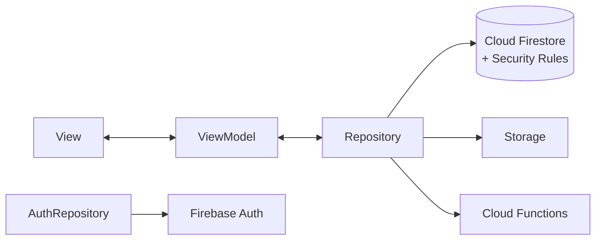

[← Mục lục](README.md)

# 04 · Cấu trúc monorepo, App Giảng viên & Trang Web Sinh viên

Chỉ app của giảng viên theo MVVM — trang web của sinh viên đơn giản đến mức không cần kiến trúc phân lớp riêng.

## 04.0 — Cấu trúc thư mục

```
fapcheckin/
├─ firebase.json, .firebaserc      # cấu hình Firebase (Hosting, Firestore, Storage, Remote Config, Functions, Emulators)
├─ packages/core/                  # Dart package `fapcheckin_core` — dùng chung cho mobile và Web Admin
│  └─ lib/
│     ├─ models/                   # UserModel, SessionModel, ClassSectionModel, ... (fromJson / fromFirestore)
│     ├─ repositories/             # Repository đọc/ghi Firestore (+ internal/ truy vấn dùng chung)
│     ├─ result/                   # ApiResult / ApiSuccess / ApiFailure, guardApi, ApiException
│     ├─ session/                  # CurrentUser (hồ sơ đang đăng nhập)
│     ├─ firebase/                 # tiện ích Timestamp -> JSON, ngày giờ giờ Việt Nam
│     ├─ theme/ constants/ responsive/   # design system
│     └─ utils/                    # json_values, history_excel (xuất .xlsx)
├─ mobile/                         # App Flutter cho GV (staff): lib/{app,viewmodels,views,core}, android/ ios/ windows/ ...
├─ web/
│  ├─ checkin/                     # Trang điểm danh SV (HTML + Firebase JS SDK), host trên Firebase Hosting
│  └─ admin/                       # Web Admin (React + Vite, UI prototype)
├─ firebase/
│  ├─ firestore.rules, storage.rules, firestore.indexes.json, remoteconfig.template.json
│  ├─ functions/                   # Cloud Functions: scanTimetable, reminders, feedback, syncToFap, aiAssistant, aiSpeak (src/*.js)
│  ├─ tests/                       # test Security Rules trên Emulator
│  └─ scripts/                     # seed-admin, seed-reference, migrate-legacy
├─ e2e_test/                       # luồng end-to-end trên Emulator
├─ scripts/deploy.ps1              # chạy test rules rồi firebase deploy
└─ docs/                           # tài liệu này
```

## 04.1 — App Giảng viên: Flutter, MVVM

Bốn lớp tách biệt; ViewModel **không biết** Firestore tồn tại — nó chỉ biết Repository (trong `packages/core`).



### Stack — thư viện chính

| Nhóm | Package | Vai trò |
|---|---|---|
| State (ViewModel) | `provider` | `ChangeNotifier` = ViewModel; View lắng nghe qua `Consumer`/`Selector`. |
| Firebase | `firebase_core`, `firebase_auth`, `cloud_firestore`, `firebase_storage`, `cloud_functions`, `firebase_remote_config` | Repository dùng trực tiếp; `firebase_analytics` + `firebase_crashlytics` chỉ bật trên Android/iOS. |
| Đăng nhập | `google_sign_in` (+ luồng OAuth riêng cho Windows/Linux) | Lấy Google ID token → `GoogleAuthProvider.credential` → Firebase Auth. |
| Sinh QR | `qr_flutter` | Vẽ QR từ URL `…/?s=<sessionId>&t=<qrSecret>&ic=<0\|1>`, làm mới theo `qr_refresh_seconds`. |
| Điều hướng | `go_router` | Giữa các màn của GV sau đăng nhập. |
| HTTP nhỏ | `dio` | Chỉ để lấy IP công khai (ipify) khi bật kiểm tra IP. |

### Cấu trúc `mobile/lib`

```
mobile/lib/
├─ main.dart                  # Firebase.initializeApp, Crashlytics, Remote Config
├─ firebase_options.dart      # sinh bởi `flutterfire configure`
├─ app/                       # MaterialApp, router, dựng Provider/Repository
├─ core/
│  ├─ config/                 # AuthConfig (OAuth client), AppConfig (URL trang check-in)
│  └─ services/               # google_auth_service, desktop_google_auth, ip_service, remote_settings, telemetry
├─ viewmodels/                # auth, dashboard, live_session, attendance_history, report
└─ views/                     # auth, main_screen, teacher/{dashboard,live_session,attendance_history,class_management,report,settings,schedule}
```

Model, Repository, theme dùng chung nằm ở [`packages/core/lib`](../packages/core/lib) và được import qua `package:fapcheckin_core/...`.

## 04.2 — Trang Web Điểm danh: Sinh viên

Không cần MVVM cho một trang chỉ làm đúng một việc: [`web/checkin/`](../web/checkin) gồm `index.html` (giao diện + CSS) và `app.js` (module ES, Firebase JS SDK qua CDN gstatic, phiên bản ghim). Cấu hình Firebase lấy từ `/__/firebase/init.json` do Hosting tự phục vụ nên không commit khóa nào.

| Thành phần | Vai trò |
|---|---|
| Firebase Auth (Google) | Nút "Đăng nhập bằng Google" (popup, tự chuyển sang redirect nếu bị chặn) — thay Google Identity Services cũ. |
| Firestore SDK | Đọc `user_invites`, `users`, `enrollments` của chính mình; tạo `attendance_records`. |
| ipify | Chỉ gọi khi QR có `ic=1` — không xin quyền định vị. |
| Phiên đăng nhập | Firebase Auth lưu trong trình duyệt → lần quét sau tự điểm danh. |

Chạy thử cục bộ với Emulator: `firebase emulators:start`, mở `http://localhost:5000/?s=<id>&t=<secret>&emulator=1`.
Deploy: `./scripts/deploy.ps1 -Only hosting` — xem [deploy-firebase.md](deploy-firebase.md).

## 04.3 — Web Admin

Chưa triển khai; [`web/admin/README.md`](../web/admin/README.md) mô tả chức năng, collection và quyền tương ứng. Vì `packages/core` đã chứa model, Repository, theme, Web Admin sẽ tái sử dụng và chỉ viết thêm các màn quản trị.

[→ 05 Xác thực & phân quyền](05-xac-thuc-va-phan-quyen.md)
