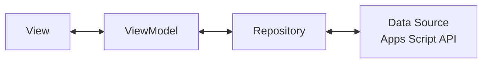

[← Mục lục](README.md)

# 04 · Kiến trúc App Giảng viên & Trang Web Sinh viên

Chỉ app của giảng viên theo MVVM — trang web của sinh viên đơn giản đến mức không cần một kiến trúc phân lớp riêng.

## 04.1 — App Giảng viên: Flutter, MVVM

Bốn lớp tách biệt rõ trách nhiệm; ViewModel **không biết** Sheet hay Apps Script tồn tại — nó chỉ biết Repository.



### Stack — thư viện chính (app GV)

| Nhóm | Package | Vai trò |
|---|---|---|
| State (ViewModel) | `provider` | `ChangeNotifier` = ViewModel; View "lắng nghe" qua `Consumer`/`Selector`. |
| Gọi API | `dio` | Interceptor tự đính kèm token phiên vào mỗi request tới BE. |
| Đăng nhập | `google_sign_in` | SSO bằng tài khoản Google của trường. |
| Sinh QR | `qr_flutter` | Vẽ QR từ URL chứa `qrToken`, làm mới mỗi 60 giây. |
| Lấy IP công khai | `http` (gọi ipify) | Lấy `teacherIp` lúc mở phiên để Backend đối chiếu với SV — không dùng `geolocator`/GPS. |
| Token an toàn | `flutter_secure_storage` | Lưu session token của GV, tách khỏi cache thường. |
| Biểu đồ | `fl_chart` | % chuyên cần theo môn, xem trong app GV. |
| Điều hướng | `go_router` | Điều hướng giữa các màn của GV sau đăng nhập. |

### Cấu trúc thư mục dự án (app GV)

```
lib/
├─ main.dart
├─ app/
│  ├─ app.dart                  // MaterialApp, theme sáng/tối
│  └─ router.dart               // go_router giữa các màn của GV
├─ core/
│  ├─ constants/
│  ├─ services/
│  │  ├─ api_service.dart       // Dio client + interceptor token
│  │  ├─ auth_service.dart      // google_sign_in, quản lý session
│  │  ├─ qr_service.dart        // timer 60 giây và mã hoá URL vào QR
│  │  └─ ip_service.dart        // gọi ipify lấy teacherIp
│  └─ utils/
├─ data/
│  ├─ models/
│  │  ├─ user_model.dart
│  │  ├─ class_model.dart
│  │  ├─ session_model.dart
│  │  └─ attendance_model.dart
│  └─ repositories/
│     ├─ auth_repository.dart
│     ├─ class_repository.dart
│     └─ attendance_repository.dart   // nơi duy nhất biết "nguồn dữ liệu" là gì
├─ viewmodels/
│  ├─ login_viewmodel.dart
│  ├─ teacher_session_viewmodel.dart  // tạo phiên, xoay QR 60 giây, roster real-time
│  └─ history_viewmodel.dart          // lịch sử điểm danh của lớp, thống kê
└─ views/
   ├─ auth/login_screen.dart
   └─ teacher/
      ├─ class_list_screen.dart
      ├─ start_session_screen.dart    // hiển thị QR xoay mỗi phút
      ├─ live_roster_screen.dart      // danh sách đã điểm danh + điểm danh tay
      └─ class_stats_screen.dart      // biểu đồ % chuyên cần
```

> Khung thư mục này đã được dựng sẵn trong repo (rỗng, giữ chỗ bằng `.gitkeep`) — xem [lib/](../lib).

## 04.2 — Trang Web Điểm danh: Sinh viên

Không cần MVVM cho một trang chỉ làm đúng một việc. Toàn bộ là HTML/CSS/JS thuần, được chính Backend (Apps Script) phục vụ nên không tốn thêm chi phí hosting hay deploy riêng.

```
apps-script/
├─ Code.gs
├─ index.html      // Toàn bộ logic giao diện Web, CSS, và JS được gộp gọn trong file này
└─ ... 

// Phục vụ bởi Backend: doGet(e) trả HtmlService khi có ?page=checkin&token=...
// (thay thế cho việc host một static site riêng ở thư mục checkin-web cũ)
```

| Thành phần | Vai trò |
|---|---|
| Google Identity Services (GIS) | Nút "Đăng nhập bằng Google" trên web, giới hạn theo domain trường — tương đương `google_sign_in` bên app. |
| Fetch API | Gọi `/checkin` tới Backend, không cần thư viện ngoài. |
| ipify (hoặc tương đương) | Trang tự lấy IP công khai của SV để gửi kèm — không xin quyền định vị. |
| localStorage | Lưu session token của trình duyệt để lần quét sau tự nhận diện, không cần đăng nhập lại. |

[→ 05 Xác thực & phân quyền](05-xac-thuc-va-phan-quyen.md)
