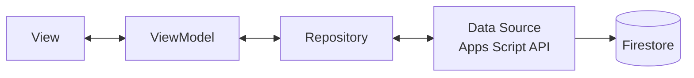

[← Mục lục](README.md)

# 04 · Kiến trúc App Giảng viên & Trang Web Sinh viên

Chỉ app của giảng viên theo MVVM — trang web của sinh viên đơn giản đến mức không cần một kiến trúc phân lớp riêng.

## 04.1 — App Giảng viên: Flutter, MVVM

Bốn lớp tách biệt rõ trách nhiệm; ViewModel **không biết** Firestore, Sheet hay Apps Script tồn tại — nó chỉ biết Repository.



App GV chỉ gọi API của Apps Script; việc CSDL phía sau là Firestore hay Google Sheet không ảnh hưởng app ([01](01-kien-truc-tong-the.md)). App GV là app Flutter cài trên máy giảng viên, **không** deploy lên Firebase Hosting.

### Stack — thư viện chính (app GV)

| Nhóm | Package | Vai trò |
|---|---|---|
| State (ViewModel) | `provider` | `ChangeNotifier` = ViewModel; View "lắng nghe" qua `Consumer`/`Selector`. |
| Gọi API | `dio` | Interceptor tự đính kèm token phiên vào mỗi request tới BE. |
| Đăng nhập | `google_sign_in` | SSO bằng tài khoản Google của trường. |
| Sinh QR | `qr_flutter` | Vẽ QR từ URL chứa `qrToken`, làm mới mỗi 60 giây. |
| Lấy IP công khai | `http` (gọi ipify) | **Chỉ khi GV tích "Kiểm tra IP mạng"** lúc mở phiên (mặc định không tích): lấy `teacherIp` để Backend đối chiếu với SV — không dùng `geolocator`/GPS. |
| Token an toàn | `flutter_secure_storage` | Lưu session token của GV, tách khỏi cache thường. |
| Biểu đồ | `fl_chart` | % chuyên cần theo môn, xem trong app GV. |
| Điều hướng | `go_router` | Điều hướng giữa các màn của GV sau đăng nhập. |

### Cấu trúc thư mục dự án (app GV)

```
lib/
├─ main.dart
├─ app/
│  ├─ app.dart                  // MaterialApp, theme sáng/tối
│  └─ router.dart               // go_router giữa các màn của GV
├─ core/
│  ├─ constants/
│  ├─ services/
│  │  ├─ api_service.dart       // Dio client + interceptor token
│  │  ├─ auth_service.dart      // google_sign_in, quản lý session
│  │  ├─ qr_service.dart        // timer 60 giây và mã hoá URL vào QR
│  │  └─ ip_service.dart        // gọi ipify lấy teacherIp (chỉ khi bật kiểm tra IP)
│  └─ utils/
├─ data/
│  ├─ models/
│  │  ├─ user_model.dart
│  │  ├─ class_model.dart
│  │  ├─ session_model.dart
│  │  └─ attendance_model.dart
│  └─ repositories/
│     ├─ auth_repository.dart
│     ├─ class_repository.dart
│     └─ attendance_repository.dart   // nơi duy nhất biết "nguồn dữ liệu" là gì
├─ viewmodels/
│  ├─ login_viewmodel.dart
│  ├─ teacher_session_viewmodel.dart  // tạo phiên, xoay QR 60 giây, roster real-time
│  └─ history_viewmodel.dart          // lịch sử điểm danh của lớp, thống kê
└─ views/
   ├─ auth/login_screen.dart
   └─ teacher/
      ├─ class_list_screen.dart
      ├─ start_session_screen.dart    // hiển thị QR xoay mỗi phút
      ├─ live_roster_screen.dart      // danh sách đã điểm danh + điểm danh tay
      └─ class_stats_screen.dart      // biểu đồ % chuyên cần
```

> Khung thư mục này đã được dựng sẵn trong repo (rỗng, giữ chỗ bằng `.gitkeep`) — xem [lib/](../lib).

## 04.2 — Trang Web Điểm danh: Sinh viên

Không cần MVVM cho một trang chỉ làm đúng một việc. Toàn bộ là HTML/CSS/JS thuần trong một file, **host trên Firebase Hosting** (gốc `/`, link dạng `https://<project>.web.app/?token=<qrToken>`) và gọi API của Backend Apps Script qua `BACKEND_URL`.

```
checkin-web/
└─ index.html      // Toàn bộ giao diện, CSS và JS của trang SV

scripts/deploy.ps1 // gom checkin-web/ → build/firebase-hosting, điền BACKEND_URL, firebase deploy
firebase.json      // cấu hình Hosting (mọi đường dẫn → index.html, no-cache)
```

Deploy: `./scripts/deploy.ps1 -ProjectId <id> -Only hosting` — xem [deploy-firebase.md](deploy-firebase.md). Script điền `BACKEND_URL` vào bản copy khi deploy, source `checkin-web/index.html` giữ nguyên `var BACKEND_URL = '';`.

> **Đường lui:** nhánh `doGet(e)` cũ (`?page=checkin`, render `apps-script/index.html` bằng `HtmlService`) vẫn còn trong backend. QR hiện vẫn trỏ về đó cho tới khi chuyển sang Hosting ([deploy-firebase.md §6](deploy-firebase.md#6-chuyển-qr-của-sinh-viên-sang-hosting-chưa-làm)). Trang chạy trong iframe sandbox của Apps Script phải đăng nhập Google bằng chế độ redirect; trang trên Hosting có origin riêng nên phải được thêm vào OAuth ([google-oauth-setup.md](google-oauth-setup.md)).

| Thành phần | Vai trò |
|---|---|
| Google Identity Services (GIS) | Nút "Đăng nhập bằng Google" trên web, giới hạn theo domain trường — tương đương `google_sign_in` bên app. |
| Fetch API | Gọi `checkin` tới Backend (`BACKEND_URL`), body `text/plain` để tránh preflight CORS; không cần thư viện ngoài. |
| ipify (hoặc tương đương) | Trang chỉ lấy IP công khai của SV khi phiên bật kiểm tra IP (backend trả `IP_REQUIRED`) — không xin quyền định vị. |
| localStorage | Lưu session token của trình duyệt để lần quét sau tự nhận diện, không cần đăng nhập lại. |

[→ 05 Xác thực & phân quyền](05-xac-thuc-va-phan-quyen.md)
