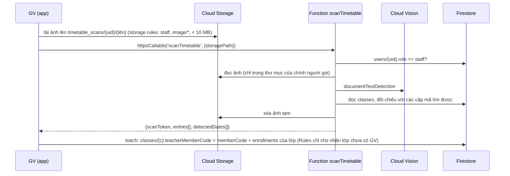

[← Mục lục](README.md)

# 11 · Import thời khóa biểu bằng ảnh (OCR)

Giảng viên chụp/tải ảnh thời khóa biểu (ví dụ ảnh chụp trang FAP). Hệ thống nhận dạng chữ, tìm các cặp mã lớp–môn (`SE1917-PRN232`), đối chiếu với collection `classes` và cho giảng viên chọn những lớp chưa có người phụ trách để **nhận lớp**.

Đây là tính năng duy nhất cần máy chủ, nên là Cloud Function duy nhất của dự án.



## Cấu hình (một lần)

1. Nâng project lên gói **Blaze** (Cloud Functions + Cloud Vision yêu cầu).
2. Bật **Cloud Vision API** của project (Google Cloud Console → APIs & Services).
3. `./scripts/deploy.ps1 -Only functions` (hoặc `firebase deploy --only functions`). Region: `asia-southeast1` — phải trùng `TimetableRepository.functionsRegion`.

Không có khóa nào phải cấu hình: Function dùng tài khoản dịch vụ mặc định của project.

## Hợp đồng của function

Input: `{ "storagePath": "timetable_scans/<uid>/<file>" }` — đường dẫn phải nằm trong thư mục của chính người gọi.

Output (cùng hình dạng cũ, app không đổi):

```json
{
  "scanToken": "uuid",
  "entries": [
    {
      "key": "SE1917|PRN232",
      "classCode": "SE1917",
      "subjectCode": "PRN232",
      "room": "602",
      "matchedClassCode": "PRN232_SE1917",
      "status": "available",
      "message": "Sẵn sàng thêm vào lớp."
    }
  ],
  "detectedDates": ["07/09", "13/09"]
}
```

`status`: `available` (chưa có GV, có thể nhận), `alreadyAssigned` (đã là của GV này), `conflict` (GV khác phụ trách), `ambiguous` (nhiều lớp trùng mã), `notFound`.

Lỗi trả về `HttpsError` với `details.code` giữ nguyên mã nghiệp vụ: `UNAUTHORIZED`, `FORBIDDEN`, `INVALID_IMAGE`, `IMAGE_TOO_LARGE`, `OCR_EMPTY`, `NO_TIMETABLE_ENTRIES`, `OCR_BUSY`, `OCR_NOT_CONFIGURED`, `OCR_UNAVAILABLE`.

## Nhận lớp

`TimetableRepository.importAssignments(scanToken, classCodes)` chỉ chấp nhận các lớp `available` của đúng lần quét đó (danh sách giữ trong bộ nhớ của app, thay cho cache backend cũ), kiểm tra lại toàn bộ lô rồi ghi một batch: `classes/{c}.teacherMemberCode` và `enrollments.teacherMemberCode` của lớp đó. Security Rules là hàng rào cuối: chỉ cho đổi `teacherMemberCode` từ `''` sang `memberCode` của chính GV, không đổi trường nào khác; nếu lớp vừa được GV khác nhận, batch bị từ chối và app báo `ASSIGNMENT_CONFLICT`.

## Dọn dẹp & riêng tư

Ảnh chỉ là dữ liệu tạm: Function xóa ngay sau khi xử lý (kể cả khi lỗi). Rules không cho client sửa/xóa, chỉ chủ file và admin đọc. Không lưu văn bản OCR.

## Kiểm thử

`cd firebase/functions && npm test` — parser, đối chiếu lớp và luồng `runScan` với Firestore/Storage/Vision giả (port từ test Apps Script cũ).
