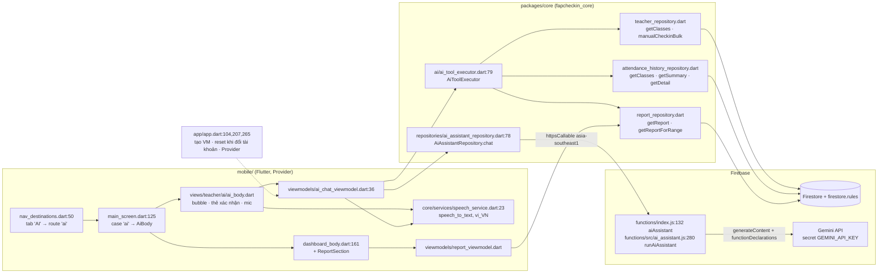
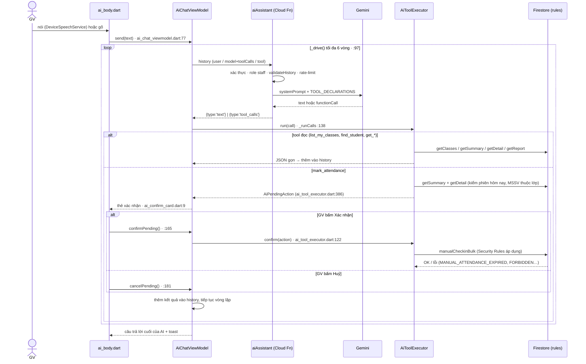

# Trợ lý AI cho giảng viên

Tab **AI** (thay tab "Báo cáo") là một khung chat — gõ hoặc nói — để giảng viên điểm danh, tra cứu và xem báo cáo chuyên cần bằng ngôn ngữ tự nhiên. Báo cáo chuyên cần cũ nay nằm cuối màn **Tổng quan**.

Nguyên tắc thiết kế:

- **Cloud Function chỉ là proxy tới Gemini** (giữ API key, kiểm quyền, giới hạn tần suất). Nó **không** đọc/ghi dữ liệu điểm danh.
- **App thực thi tool** bằng các repository sẵn có, dưới quyền của chính giảng viên → Security Rules vẫn là chốt chặn cuối.
- **Thao tác ghi luôn qua thẻ xác nhận.** Thẻ hiển thị MSSV, họ tên, lớp, slot, trạng thái cũ → mới lấy từ dữ liệu thật (không lấy từ lời model), vì nhận dạng giọng nói dễ nghe nhầm MSSV.
- Phạm vi bản này: điểm danh tay + tra cứu + báo cáo. Chưa mở/đóng phiên, chưa đọc câu trả lời bằng giọng nói.

## A. Kiến trúc



## B. Luồng "Điểm danh SV HE123456 lớp SWP391 slot 3"



## C. Báo cáo trong Tổng quan

```
DashboardBody (dashboard_body.dart)
 ├─ bottomContent: … UpcomingSessionsList → ReportSection   (:161)
 └─ RefreshIndicator.onRefresh = refreshAll (:34) = loadClasses + ReportViewModel.load(force: true)

ReportSection (views/teacher/report/report_section.dart:19)
 ├─ initState → ReportViewModel.load()
 ├─ ReportWeekSelector → showReportScopeBottomSheet → ReportViewModel.setRange
 ├─ ReportMiniKpiBar · ReportDailyChart · ReportSubjectSummary   (views/teacher/report/components/)
 └─ nút xuất Excel (buildHistoryWorkbook + downloadHistory)
```

Route cũ `bao-cao` vẫn hợp lệ và rơi về Tổng quan ([main_screen.dart:128](../mobile/lib/views/main_screen.dart)).

## D. Tool

Khai báo ở server ([ai_assistant.js:36](../firebase/functions/src/ai_assistant.js)), thực thi ở app ([ai_tool_executor.dart:98](../packages/core/lib/ai/ai_tool_executor.dart)). Hai bên phải khớp tên tool.

| Tool | Loại | Repository dùng |
|---|---|---|
| `list_my_classes` | đọc | `TeacherRepository.getClasses` |
| `find_student(query, classCode?)` | đọc | `AttendanceHistoryRepository.getClasses/getSummary` — theo MSSV hoặc tên không dấu |
| `get_session_attendance(classCode, date?, slotCode?)` | đọc | `getSummary` + `getDetail` |
| `get_attendance_stats(classCode)` | đọc | `getSummary` (% chuyên cần từng SV, thấp → cao) |
| `get_attendance_report(from?, to?)` | đọc | `ReportRepository.getReport/getReportForRange` |
| `mark_attendance(classCode, slotCode?, students[], note?)` | **ghi** | kiểm tra → thẻ xác nhận → `TeacherRepository.manualCheckinBulk` |

Điều kiện của `mark_attendance` (mỗi điều kiện trả lỗi có mã để model giải thích lại cho GV):

| Mã lỗi | Khi nào |
|---|---|
| `VALIDATION_ERROR` | thiếu lớp/SV, trạng thái ngoài `Present/Late/Absent/ManualByGV/Unchecked`, > 100 SV |
| `FORBIDDEN` | lớp không thuộc giảng viên |
| `NO_SESSION_TODAY` | hôm nay lớp (và slot) chưa có phiên — hướng dẫn mở ở Quản lý lớp |
| `AMBIGUOUS_SESSION` | nhiều buổi hôm nay, chưa nói slot |
| `STUDENT_NOT_ENROLLED` | có MSSV không thuộc lớp (không tạo thẻ xác nhận) |
| `MANUAL_ATTENDANCE_EXPIRED` | thẻ để treo qua 00:00 giờ VN rồi mới xác nhận |

> Kiểm tra "MSSV thuộc lớp" nằm ở **app** (cũng như ở `TeacherRepository` khi ghi) chứ **không** ở Security Rules — rules chỉ kiểm quyền sở hữu phiên/lớp, trạng thái hợp lệ, hạn điểm danh tay và tập trường cho phép.

## E. Bảo vệ ở server

[ai_assistant.js](../firebase/functions/src/ai_assistant.js): chỉ `staff`/`admin` đang hoạt động (`runAiAssistant`:280); history ≤ 30 tin, mỗi tin ≤ 1000 ký tự, kết quả tool ≤ 24 000 ký tự, tool lạ bị từ chối (`validateHistory`:158); tối đa 60 lượt / 10 phút / người (`checkRateLimit`:264, lưu ở `ai_usage/{uid}` — chỉ Admin SDK ghi được, rules mặc định chặn client); timeout Gemini 40 s; `maxInstances: 5`. Ngày giờ trong system prompt do server tính theo giờ Việt Nam, không tin client.

## F. Cấu hình & triển khai

```bash
firebase functions:secrets:set GEMINI_API_KEY      # bắt buộc trước khi deploy aiAssistant
# tuỳ chọn: GEMINI_MODEL (mặc định gemini-2.5-flash), GEMINI_API_BASE (e2e trỏ về Gemini giả)
```

Quyền micro: Android `RECORD_AUDIO` + `<queries>` RecognitionService ([AndroidManifest.xml](../mobile/android/app/src/main/AndroidManifest.xml)); iOS `NSMicrophoneUsageDescription` + `NSSpeechRecognitionUsageDescription` ([Info.plist](../mobile/ios/Runner/Info.plist)). Nhận dạng tiếng Việt cần thiết bị có gói giọng nói `vi-VN`; không có thì ô nhập vẫn dùng bình thường.

## G. Kiểm thử

| Lớp | File | Chạy |
|---|---|---|
| Function (unit) | [ai_assistant.test.js](../firebase/functions/test/ai_assistant.test.js) | `cd firebase/functions && npm test` |
| Executor trên Firestore giả | [ai_tool_executor_test.dart](../packages/core/test/ai_tool_executor_test.dart) | `cd packages/core && flutter test` |
| Luồng app đầu-cuối (MainScreen + VM + executor thật; Gemini/Firestore/micro giả) | [ai_assistant_flow_test.dart](../mobile/test/ai_assistant_flow_test.dart) | `cd mobile && flutter test test/ai_assistant_flow_test.dart` |
| Callable thật + Rules trên Emulator, Gemini giả | [ai_assistant.e2e.test.mjs](../e2e_test/ai_assistant.e2e.test.mjs), [fake_gemini.mjs](../e2e_test/support/fake_gemini.mjs), [run-ai-e2e.mjs](../e2e_test/run-ai-e2e.mjs) | `cd e2e_test && npm run test:ai` |

Chưa tự động hoá: nhận dạng giọng nói thật trên thiết bị, và gọi Gemini thật (cần key) — thử tay.
