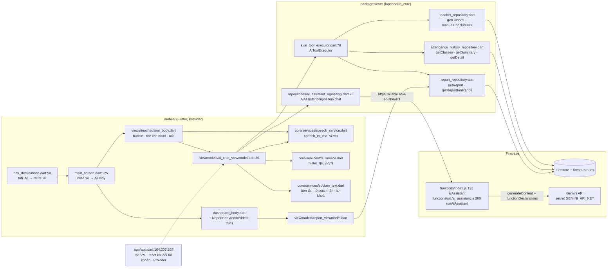
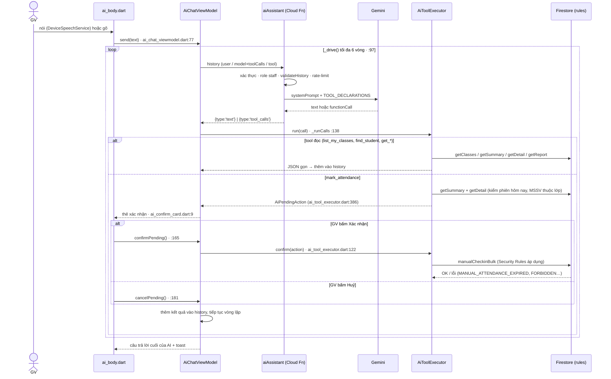

# Trợ lý AI cho giảng viên

Tab **AI** (thay tab "Báo cáo") là một khung chat — gõ hoặc nói — để giảng viên điểm danh, tra cứu và xem báo cáo chuyên cần bằng ngôn ngữ tự nhiên. Báo cáo chuyên cần cũ nay nằm cuối màn **Tổng quan**.

Nguyên tắc thiết kế:

- **Cloud Function chỉ là proxy tới Gemini** (giữ API key, kiểm quyền, giới hạn tần suất). Nó **không** đọc/ghi dữ liệu điểm danh.
- **App thực thi tool** bằng các repository sẵn có, dưới quyền của chính giảng viên → Security Rules vẫn là chốt chặn cuối.
- **Thao tác ghi luôn qua thẻ xác nhận.** Thẻ hiển thị MSSV, họ tên, lớp, slot, trạng thái cũ → mới lấy từ dữ liệu thật (không lấy từ lời model), vì nhận dạng giọng nói dễ nghe nhầm MSSV.
- Nguồn AI: Gemini (chính), Ollama local qua tunnel (dự phòng, đổi nhanh — mục H).
- Phạm vi bản này: điểm danh tay + tra cứu + báo cáo. Chưa mở/đóng phiên, đọc to tóm tắt ở chế độ Live (mục H–I).

## A. Kiến trúc



## B. Luồng "Điểm danh SV HE123456 lớp SWP391 slot 3"



## C. Báo cáo trong Tổng quan

```
DashboardBody (dashboard_body.dart)
 ├─ bottomContent: … UpcomingSessionsList → ReportBody(embedded: true)
 └─ RefreshIndicator.onRefresh = _refreshAll = loadClasses + ReportViewModel.load(force: true)

ReportBody (views/teacher/report/report_body.dart) — dùng chung: `embedded: true` khi nằm trong Tổng quan (không còn tab Báo cáo riêng)
 ├─ initState → ReportViewModel.load()
 ├─ ReportWeekSelector → showReportScopeBottomSheet → ReportViewModel.setRange
 ├─ ReportMiniKpiBar · ReportDailyChart · ReportSubjectSummary   (views/teacher/report/components/)
 └─ nút xuất Excel (buildHistoryWorkbook + downloadHistory)
```

Route cũ `bao-cao` vẫn hợp lệ và rơi về Tổng quan ([main_screen.dart:128](../mobile/lib/views/main_screen.dart)).

## D. Tool

Khai báo ở server ([ai_assistant.js:36](../firebase/functions/src/ai_assistant.js)), thực thi ở app ([ai_tool_executor.dart:98](../packages/core/lib/ai/ai_tool_executor.dart)). Hai bên phải khớp tên tool.

| Tool | Loại | Repository dùng |
|---|---|---|
| `list_my_classes` | đọc | `TeacherRepository.getClasses` |
| `find_student(query, classCode?)` | đọc | `AttendanceHistoryRepository.getClasses/getSummary` — theo MSSV hoặc tên không dấu |
| `get_session_attendance(classCode, date?, slotCode?)` | đọc | `getSummary` + `getDetail` |
| `get_attendance_stats(classCode)` | đọc | `getSummary` (% chuyên cần từng SV, thấp → cao) |
| `get_attendance_report(from?, to?)` | đọc | `ReportRepository.getReport/getReportForRange` |
| `mark_attendance(classCode, slotCode?, students[], note?)` | **ghi** | kiểm tra → thẻ xác nhận → `TeacherRepository.manualCheckinBulk` |

Điều kiện của `mark_attendance` (mỗi điều kiện trả lỗi có mã để model giải thích lại cho GV):

| Mã lỗi | Khi nào |
|---|---|
| `VALIDATION_ERROR` | thiếu lớp/SV, trạng thái ngoài `Present/Late/Absent/ManualByGV/Unchecked`, > 100 SV |
| `FORBIDDEN` | lớp không thuộc giảng viên |
| `NO_SESSION_TODAY` | hôm nay lớp (và slot) chưa có phiên — hướng dẫn mở ở Quản lý lớp |
| `AMBIGUOUS_SESSION` | nhiều buổi hôm nay, chưa nói slot |
| `STUDENT_NOT_ENROLLED` | có MSSV không thuộc lớp (không tạo thẻ xác nhận) |
| `MANUAL_ATTENDANCE_EXPIRED` | thẻ để treo qua 00:00 giờ VN rồi mới xác nhận |

> Kiểm tra "MSSV thuộc lớp" nằm ở **app** (cũng như ở `TeacherRepository` khi ghi) chứ **không** ở Security Rules — rules chỉ kiểm quyền sở hữu phiên/lớp, trạng thái hợp lệ, hạn điểm danh tay và tập trường cho phép.

## E. Bảo vệ ở server

[ai_assistant.js](../firebase/functions/src/ai_assistant.js): chỉ `staff`/`admin` đang hoạt động (`runAiAssistant`:280); history ≤ 30 tin, mỗi tin ≤ 1000 ký tự, kết quả tool ≤ 24 000 ký tự, tool lạ bị từ chối (`validateHistory`:158); tối đa 60 lượt / 10 phút / người (`checkRateLimit`:264, lưu ở `ai_usage/{uid}` — chỉ Admin SDK ghi được, rules mặc định chặn client); timeout Gemini 40 s; `maxInstances: 5`. Ngày giờ trong system prompt do server tính theo giờ Việt Nam, không tin client.

## F. Cấu hình & triển khai

```bash
firebase functions:secrets:set GEMINI_API_KEY      # bắt buộc trước khi deploy aiAssistant
# tuỳ chọn: GEMINI_MODEL (mặc định gemini-3.5-flash, dự phòng GEMINI_FALLBACK_MODEL = gemini-flash-lite-latest; Gemini bận 429/5xx được tự thử lại 3 lần), GEMINI_API_BASE (e2e trỏ về Gemini giả)
```

Quyền micro: Android `RECORD_AUDIO` + `<queries>` RecognitionService ([AndroidManifest.xml](../mobile/android/app/src/main/AndroidManifest.xml)); iOS `NSMicrophoneUsageDescription` + `NSSpeechRecognitionUsageDescription` ([Info.plist](../mobile/ios/Runner/Info.plist)). Nhận dạng tiếng Việt cần thiết bị có gói giọng nói `vi-VN`; không có thì ô nhập vẫn dùng bình thường.

## G. AI dự phòng (Ollama local) khi Gemini quá tải

Cloud Function chạy trên Google nên **không gọi được `localhost`**: Ollama chạy trong container ở máy demo và được mở ra qua **Cloudflare quick tunnel** (URL `https://<ngẫu-nhiên>.trycloudflare.com`). Hàm chọn nguồn ở **mỗi lượt** theo tài liệu Firestore `ai_config/provider` (chỉ Admin SDK đọc/ghi — client bị rules chặn vì URL tunnel là bí mật), nên đổi nguồn **không cần deploy**.

| `provider` | Hành vi |
|---|---|
| `auto` (mặc định) | Gemini trước (thử lại 3 lần + model dự phòng); vẫn lỗi/quá tải thì **tự sang Ollama** (cần URL). Phản hồi có `provider:"ollama", fallback:true` và tiêu đề tab AI hiện "Đang dùng AI dự phòng". |
| `ollama` | Chỉ Ollama — dùng khi biết Gemini đang sập, khỏi chờ thử lại. |
| `gemini` | Chỉ Gemini, không bao giờ sang Ollama. |

Lỗi người dùng/quyền/`AI_BLOCKED` **không** kích hoạt chuyển nguồn. Hai nguồn dùng chung định dạng tool nên app và executor không đổi.

Chuẩn bị một lần (cần Docker, Node, `gcloud auth application-default login`):
```powershell
./scripts/ai-fallback.ps1 up                 # bật Ollama + tunnel, tải model, tự ghi URL + chế độ auto vào Firestore
```
Trong buổi demo:
```powershell
./scripts/ai-fallback.ps1 switch ollama      # ép dùng Ollama NGAY (1 lệnh, vài giây, không deploy)
./scripts/ai-fallback.ps1 switch auto        # Gemini trước, lỗi thì sang Ollama
./scripts/ai-fallback.ps1 switch gemini      # chỉ Gemini
./scripts/ai-fallback.ps1 status             # xem cấu hình + container
./scripts/ai-fallback.ps1 down               # tắt container, trả về gemini
```
Hoặc sửa thẳng tài liệu `ai_config/provider` trong Firebase Console (`provider`, `ollamaUrl`, `ollamaModel`), hoặc `node firebase/scripts/set-ai-provider.mjs --provider ollama --url <tunnel>`.

Lưu ý:
- Model mặc định `qwen2.5:7b` (~4.7 GB, hỗ trợ tool-calling). Đổi bằng `-Model` hoặc `ollamaModel`. **Nên chạy thử trước demo**: CPU thì lượt đầu có thể 20–60 giây (hàm chờ tối đa 80 giây); có GPU NVIDIA thì bỏ comment khối `deploy` trong [docker-compose.yml](../ops/ollama/docker-compose.yml). Model nhỏ hiểu tiếng Việt và gọi tool kém hơn Gemini — vì vậy mọi lệnh ghi vẫn qua thẻ xác nhận.
- URL tunnel đổi mỗi lần khởi động tunnel và **ai có URL đều dùng được model** — chỉ bật khi demo, `down` sau đó.
- Biến môi trường thay thế (không dùng Firestore): `AI_PROVIDER`, `OLLAMA_BASE_URL`, `OLLAMA_MODEL` cho function.
- Kiểm thử: [ai_ollama.test.js](../firebase/functions/test/ai_ollama.test.js) (chọn nguồn, định dạng), e2e [ai_assistant.e2e.test.mjs](../e2e_test/ai_assistant.e2e.test.mjs) với Ollama giả ([fake_ollama.mjs](../e2e_test/support/fake_ollama.mjs)). Chưa chạy với Ollama thật trong repo này.

## H. Giọng nói & trợ lý Live (tiếng Việt)

Hai cách dùng giọng nói, cùng một bộ máy nghe/đọc ([ai_chat_viewmodel.dart](../mobile/lib/viewmodels/ai_chat_viewmodel.dart)):

| | **Mic** (nói một câu) | **Live** (hội thoại liên tục) |
|---|---|---|
| Bật | bấm nút mic | bấm nút Live (biểu tượng sóng âm; khi bật mic được ẩn) |
| Sau khi AI trả lời | đọc tóm tắt rồi **dừng** | đọc tóm tắt rồi **tự nghe tiếp** |
| Dừng | bấm mic lần nữa lúc đang nghe = *nói xong, gửi ngay* | bấm Live lần nữa, hoặc tự thoát (xem dưới) |

Nút loa ở tiêu đề bật/tắt **đọc to**. Chỉ đọc to khi lượt nhập là giọng nói (hoặc đang Live); gõ chữ thì không đọc.

```
bấm Live ─► NGHE ─(nói xong: im lặng ≥ sendDelay)─► tự gửi ─► XỬ LÝ (gọi AI, chạy tool đọc)
              ▲                                                    │
              │                          ┌─────────────────────────┤
              │                          ▼                         ▼
        (đọc xong)◄── ĐỌC tóm tắt ◄── trả lời cuối          tool ghi → thẻ xác nhận
                                                                   │
                                  ĐỌC thẻ ─► NGHE "xác nhận"/"huỷ" ┘ → ghi → AI tóm tắt kết quả → đọc → nghe tiếp
```

**Khi nào coi là "nói xong" (không cắt ngang câu).** Ứng dụng tự quyết định, **không** dựa vào "kết quả cuối" của bộ nhận dạng (Chrome và Android chốt ngay ở nhịp ngắt đầu tiên nên hay cắt giữa câu):
- Gom mọi đoạn nói liên tiếp trong một lượt; mỗi lần nghe được chữ mới thì đặt lại đồng hồ im lặng.
- Gửi khi im lặng đủ **`sendDelay` = 2 giây**; câu có vẻ chưa trọn (kết thúc bằng "lớp", "và", "slot", "MSSV", "của"…, hoặc dấu phẩy — `looksIncomplete`) thì chờ **`sendDelayIncomplete` = 3,5 giây**; câu trả lời xác nhận chờ **`confirmDelay` = 0,9 giây**.
- Bộ nhận dạng tự ngắt phiên giữa câu thì **mở lại và nối tiếp chữ** vào cùng lượt (tối đa `maxEngineRestarts` = 12 lần); bản chép tạm hiện trong ô nhập và xoá khi câu được gửi.
- Muốn gửi sớm: bấm mic lần nữa (`finishListeningNow`).

**Không nghe khi đang đọc** (tránh micro thu lại giọng máy): micro chỉ mở lại sau khi đọc xong.

**Xác nhận bằng giọng nói**: AI đọc tên, MSSV, trạng thái, lớp, slot (`confirmPrompt`) rồi nghe: *xác nhận / đồng ý / ok / được rồi / làm đi / chốt / đúng rồi / ghi đi* → ghi; *huỷ / thôi / không / bỏ / dừng lại* → huỷ (huỷ ưu tiên khi câu mơ hồ, "không sao" bị coi là chưa rõ). Nghe không rõ thì nhắc lại, sau `maxConfirmRetries` = 2 lần để thẻ chờ bấm tay và thoát Live. Nút Xác nhận/Huỷ dùng được bất cứ lúc nào; tiếng nói muộn của lượt cũ bị bỏ qua (không ghi hai lần).

**Giữ Live bền qua nhiều lượt.** Bộ nhận dạng dùng chung một bộ lắng nghe trạng thái nên sau khi mở lại micro nó hay bắn tín hiệu "đã dừng" **muộn của phiên trước**; nếu coi đó là người dùng im lặng thì hai lần liền Live tự thoát (triệu chứng "chỉ nói được một lần rồi về trạng thái thường"). Vì vậy: trong `engineWarmup` = 1,2 giây đầu của mỗi phiên nghe, tín hiệu dừng khi chưa nghe được gì bị coi là tín hiệu muộn → mở lại (tối đa `maxStaleSignals` = 6 lần), chỉ im lặng SAU mốc này mới tính; phiên cũ được huỷ hẳn trước khi mở phiên mới; lỗi **tạm thời** (busy, mạng chập chờn) được mở lại sau 0,5 giây, tối đa `maxTransientErrors` = 3 lần liên tiếp; chỉ lỗi **nghiêm trọng** (thiếu quyền micro, dịch vụ/ngôn ngữ không hỗ trợ) mới thoát ngay.

**Tự thoát Live** khi: im lặng `maxSilentTurns` = 2 lượt liên tiếp (mỗi lượt tối đa `noSpeechLimit` = 12 giây không tiếng), lỗi micro nghiêm trọng, bấm Live lần nữa, hoặc rời tab AI. Lỗi "không có tiếng/không khớp" của bộ nhận dạng chỉ tính là im lặng.

**Phần đọc.** Chat hiện đầy đủ, chỉ phần **tóm tắt** được đọc (`spokenSummary`: đoạn đầu, ≤ 2 câu, bỏ markdown/emoji, ≤ 240 ký tự). System prompt bắt AI mở đầu câu trả lời cuối bằng 1–2 câu tóm tắt rồi xuống dòng trống mới đến chi tiết.

### Đảm bảo tiếng Việt
([speech_service.dart](../mobile/lib/core/services/speech_service.dart), [tts_service.dart](../mobile/lib/core/services/tts_service.dart))
- **Nhận dạng**: chọn locale `vi_VN`/`vi-VN` của thiết bị; nếu danh sách locale rỗng hoặc không có tiếng Việt (Chrome thường rỗng) thì **vẫn ép** `vi-VN` (web) / `vi_VN` — không rơi về tiếng Anh mặc định.
- **Đọc (chính) — Google Cloud Text-to-Speech**: Cloud Function `aiSpeak` ([ai_speak.js](../firebase/functions/src/ai_speak.js)) tạo MP3 giọng `vi-VN-Neural2-A` (đổi bằng biến môi trường `TTS_VOICE`, ví dụ `vi-VN-Neural2-D` giọng nam, `vi-VN-Wavenet-A`); app phát bằng `audioplayers` ([cloud_tts_service.dart](../mobile/lib/core/services/cloud_tts_service.dart)). Giọng giống nhau trên web/điện thoại, không phụ thuộc máy có cài giọng hay không. Chỉ GV gọi được, nội dung ≤ 600 ký tự, 120 lượt/10 phút/người; câu đã đọc được cache 24 câu gần nhất.
- **Luôn chỉ MỘT giọng tại một thời điểm**: mỗi câu mới tắt hết âm thanh còn lại của cả hai nguồn trước khi đọc; giọng của máy chỉ lên tiếng khi giọng Google *chưa phát được* (lỗi trước khi phát — `AudioOutput.play` chỉ được ném lỗi trước khi bắt đầu phát, lỗi sau đó bị nuốt) và câu đó chưa bị thay thế/ngắt; trước khi giọng máy đọc, âm thanh đám mây được tắt chắc chắn. Sau khi đọc xong, app nghỉ `speechTail` = 0,6 giây rồi mới mở micro (loa còn vang không bị nhận nhầm thành người nói → Live không tự gửi lại câu AI vừa đọc).
- **Đọc (dự phòng) — giọng của máy** khi `aiSpeak` lỗi (API chưa bật, thiếu quyền, hết hạn mức, mất mạng): `FallbackTtsService` chuyển ngay sang giọng máy, hiện toast một lần và tạm bỏ qua đám mây 60 giây để các câu sau không phải chờ lại lỗi. Chạy `--dart-define=AI_TTS_DEVICE_ONLY=true` để chỉ dùng giọng máy. Giọng máy (tốc độ đặt theo nền tảng: web 1.0, Android/iOS 0.5): thử `vi-VN` rồi `vi_VN`, rồi **chờ danh sách giọng nạp xong** (trình duyệt nạp không đồng bộ, lần đầu thường rỗng — nếu không chờ sẽ rơi về giọng tiếng Anh) và chọn tường minh giọng tiếng Việt tốt nhất (`pickVietnameseVoice`: ưu tiên `vi-VN`, giọng **Google** > Natural/Neural/Online > Microsoft > còn lại, tránh giọng *compact*). Chrome có giọng "Google Tiếng Việt" (cần internet); Edge/Windows có giọng Microsoft Natural; Android dùng Google Text-to-speech. Không có giọng tiếng Việt thì vẫn đọc bằng giọng mặc định (có thể sai) **và hiện toast cảnh báo** — cài gói giọng nói Tiếng Việt trong cài đặt Text-to-speech/Voice của thiết bị.
- Android 11+: đã khai báo `<queries>` cho `TTS_SERVICE` và `RecognitionService` ([AndroidManifest.xml](../mobile/android/app/src/main/AndroidManifest.xml)); quyền `RECORD_AUDIO`. iOS: `NSMicrophoneUsageDescription`, `NSSpeechRecognitionUsageDescription`.

### Bật giọng Google Cloud TTS

```powershell
gcloud services enable texttospeech.googleapis.com --project ducminh-41459   # hoặc bật trong Console → APIs & Services
firebase deploy --only functions:aiSpeak --project ducminh-41459
```
Hàm xác thực với Google Cloud bằng **tài khoản dịch vụ của hàm** (không cần API key riêng); project cần billing (giọng Neural2 có hạn mức miễn phí hằng tháng, vượt thì tính phí theo số ký tự). Không thấy giọng Google (app báo "đang dùng giọng của máy") thì xem log: `firebase functions:log --only aiSpeak --project ducminh-41459 -n 15` — lỗi thường gặp là `PERMISSION_DENIED ... has not been used` (chưa bật API) hoặc tài khoản dịch vụ thiếu quyền.

### Độ bền của giọng đọc và micro trên trình duyệt

- **Mỗi câu một bộ phát âm thanh mới** (`AudioplayersOutput`): dùng lại một `AudioPlayer` cho nhiều câu liên tiếp làm lần phát thứ hai trở đi lỗi trên web, khiến câu đầu đọc bằng giọng Google còn câu sau rơi sang giọng của máy. Khi giọng Google thất bại, thông báo nêu **lý do cụ thể** (ví dụ `TTS_UNAVAILABLE: …`), và tạm bỏ qua đám mây `cooldown` = 20 giây.
- **"recognition has already started"** (Web Speech API chỉ cho một phiên nhận dạng tại một thời điểm, mà plugin báo "không còn nghe" sớm hơn thực tế): `DeviceSpeechService.start` huỷ phiên cũ, chờ 0,35 giây rồi thử lại tối đa `maxStartRetries` = 3 lần; nếu vẫn lỗi, ViewModel coi là lỗi tạm thời (mở lại sau 0,6 giây, tính chung vào `maxTransientErrors`) chứ không thoát Live.

### Lỗi giọng nói không bị nuốt
Lỗi micro/giọng đọc được đưa vào `voiceError` và hiện **toast** (kể cả khi phát sinh giữa chừng): thiếu quyền micro, giọng đọc báo lỗi, máy không có giọng tiếng Việt, hoặc **`flutter_tts`/`speech_to_text` chưa được nạp** (`MissingPluginException`). Plugin mới thêm vào `pubspec.yaml` **không nạp được bằng hot reload/hot restart**: phải dừng và chạy lại `flutter run` (Android cần build lại để áp dụng quyền/`<queries>`). Nếu nghe được nhưng không có tiếng đọc, kiểm tra toast này trước tiên.

### Nói/gửi thêm khi AI đang xử lý: gộp vào cùng ngữ cảnh

Bạn không phải chờ AI trả lời xong mới nói tiếp:
- **Mic và Live luôn nghe lúc AI đang xử lý**; dòng trạng thái ghi "Đang nghe thêm · AI đang xử lý, câu mới sẽ được gộp". Ở Live, gửi xong là nghe tiếp **ngay**, im lặng lúc AI còn đang chạy không bị tính để thoát Live. Mic thường (một lượt) bấm lúc đang xử lý cũng được.
- **Gộp**: yêu cầu mới huỷ lượt gọi AI đang chạy (kết quả về muộn bị bỏ), các tin đã gửi được giữ nguyên, rồi AI trả lời **chung một lần** cho tất cả yêu cầu (lượt sau thấy đủ `user, user…` trong ngữ cảnh) và chỉ đọc **một** câu trả lời.
- **Không nói đè lên bạn**: nếu AI trả lời đúng lúc bạn đang nói dở thì câu trả lời vẫn hiện trong chat nhưng **không đọc to**; phần bạn nói tiếp sau đó được gộp vào ngữ cảnh (lượt sau thấy `user, model, user`).
- **Đóng mic trước khi AI đọc** (và mở lại sau khi đọc xong + nghỉ `speechTail`) để loa không bị nhận nhầm thành người nói.
- **Đang ghi điểm danh hoặc đang chờ thẻ xác nhận** thì yêu cầu thêm **xếp hàng**: hiện ngay trong chat, dòng trạng thái báo "N yêu cầu đang chờ", và được gửi gộp sau khi ghi/xác nhận/huỷ xong (kết quả ghi đã nằm trong ngữ cảnh). Lúc chờ thẻ: gõ hoặc nói câu ngắn kiểu "xác nhận"/"huỷ" thì hiểu là quyết định; bấm mic = nói quyết định bằng giọng; câu khác xếp hàng.

## I. Ngắt AI giữa chừng

Khi AI đang **đọc** hoặc **xử lý**, nút gửi đổi thành nút **Dừng** (đỏ); chạm vào dòng trạng thái ("Đang đọc… · chạm để dừng") cũng ngắt được ([`AiChatViewModel.interrupt`](../mobile/lib/viewmodels/ai_chat_viewmodel.dart)):
- **Đang đọc**: cắt giọng ngay; ở Live thì tự nghe tiếp để nói câu mới.
- **Đang xử lý**: huỷ yêu cầu (kết quả về muộn bị bỏ qua), hiện "Đã dừng.", và **cắt history về điểm cuối cùng còn hợp lệ** (`_checkpoint`) để không còn `functionCall` mồ côi gây lỗi ở lượt sau.
- **Gõ/nói câu mới khi AI đang xử lý** → tự ngắt câu cũ rồi trả lời câu mới (không cần bấm Dừng).
- **Lệnh ghi điểm danh đang thực thi thì KHÔNG huỷ** (chỉ cắt giọng) để tránh ghi dở; sau khi ghi xong, history được chốt (`_checkpoint`) nên AI không "quên" là đã ghi.
- Chưa có "ngắt bằng giọng nói" lúc AI đang đọc (micro sẽ thu lại giọng máy): ngắt bằng nút/chạm.

## J. Kiểm thử

| Lớp | File | Chạy |
|---|---|---|
| Function (unit) | [ai_assistant.test.js](../firebase/functions/test/ai_assistant.test.js) | `cd firebase/functions && npm test` |
| Executor trên Firestore giả | [ai_tool_executor_test.dart](../packages/core/test/ai_tool_executor_test.dart) | `cd packages/core && flutter test` |
| Luồng app đầu-cuối (MainScreen + VM + executor thật; Gemini/Firestore/micro/loa giả): chat, xác nhận, **Live, câu dài, gom đoạn nói, ngắt AI, lỗi giọng đọc** | [ai_assistant_flow_test.dart](../mobile/test/ai_assistant_flow_test.dart) | `cd mobile && flutter test test/ai_assistant_flow_test.dart` |
| Giọng Google Cloud TTS + dự phòng giọng máy (cache, cooldown, ngắt khi đang chờ mạng) | [cloud_tts_test.dart](../mobile/test/cloud_tts_test.dart); function: [ai_speak.test.js](../firebase/functions/test/ai_speak.test.js); e2e quyền/đầu vào `aiSpeak` trong [ai_assistant.e2e.test.mjs](../e2e_test/ai_assistant.e2e.test.mjs) | `flutter test test/cloud_tts_test.dart`, `npm test`, `npm run test:ai` |
| Giọng tiếng Việt (locale STT/chọn giọng máy) + hàm thuần `spokenSummary`, `confirmPrompt`, `parseVoiceDecision`, `looksIncomplete` | [voice_vietnamese_test.dart](../mobile/test/voice_vietnamese_test.dart) | `cd mobile && flutter test test/voice_vietnamese_test.dart` |
| Callable thật + Rules trên Emulator, Gemini giả | [ai_assistant.e2e.test.mjs](../e2e_test/ai_assistant.e2e.test.mjs), [fake_gemini.mjs](../e2e_test/support/fake_gemini.mjs), [run-ai-e2e.mjs](../e2e_test/run-ai-e2e.mjs) | `cd e2e_test && npm run test:ai` |

Chưa tự động hoá: nhận dạng và giọng đọc tiếng Việt THẬT trên thiết bị/trình duyệt (độ chính xác, có nghe thấy tiếng hay không) và gọi Gemini/Ollama thật — thử tay trước buổi demo.
