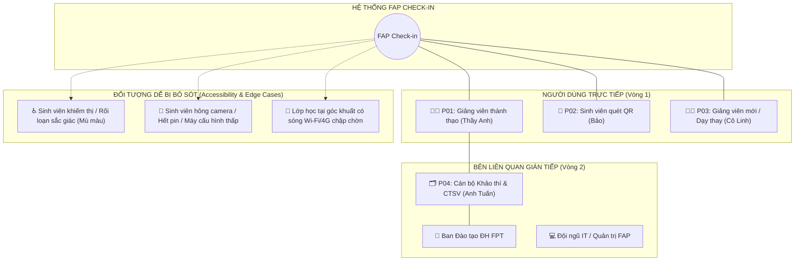

# BÁO CÁO TOÀN DIỆN: USER PERSONA & BRAINSTORMING DỰ ÁN FAP CHECK-IN
**Học phần:** PRM393 / PRM323 – Capstone Project · Đại học FPT (FPTU)  
**Quy chuẩn thực hiện:** Tuân thủ 100% Persona Guideline V1.0 (2026) & Chuẩn Nielsen Norman Group (NN/g)  
**Mốc đánh giá:** Milestone A (Discovery) & Milestone B (Validation & Design) · Gate G2 (100-Point Rubric)  
**Phiên bản tài liệu:** v2.0 · Ngày phát hành: 16/10/2026  

---

## MỤC LỤC TỔNG QUAN
1. [01. Nguyên tắc cốt lõi (Core Principles)](#01-nguyên-tắc-cốt-lõi-core-principles)
2. [02. Xác định số lượng & Phân cấp Persona](#02-xác-định-số-lượng--phân-cấp-persona)
3. [03. Quy trình Workshop Brainstorming 100 phút (Milestone A)](#03-quy-trình-workshop-brainstorming-100-phút-milestone-a)
   - [Stakeholder / User Map](#stakeholder--user-map-sơ-đồ-đồng-tâm)
   - [Bảng Brainstorming & Affinity Clustering Board](#affinity-clustering-board-gắn-nguồn-dữ-liệu)
4. [04. Persona Coverage Matrix (Ma trận bao phủ)](#04-persona-coverage-matrix)
5. [05. Bộ hồ sơ Persona chi tiết (12 trường cốt lõi + Optional Lab 2)](#05-bộ-hồ-sơ-persona-chi-tiết-12-trường-cốt-lõi)
   - [P01 · Primary Persona: Thầy Nguyễn Văn Anh (Giảng viên thao tác nhanh)](#p01--primary-persona-thầy-nguyễn-văn-anh)
   - [P02 · Secondary Persona: Bạn Trần Thị Bảo (Sinh viên check-in tức thì)](#p02--secondary-persona-bạn-trần-thị-bảo)
   - [P03 · Secondary Persona: Cô Lê Hoàng Linh (Giảng viên mới / Dạy thay)](#p03--secondary-persona-cô-lê-hoàng-linh)
   - [P04 · Supporting Persona: Anh Phạm Quốc Tuấn (Cán bộ Khảo thí / CTSV)](#p04--supporting-persona-anh-phạm-quốc-tuấn)
6. [06. Từ Proto-Persona đến Persona có căn cứ (Milestone B - Validation)](#06-từ-proto-persona-đến-persona-có-căn-cứ)
   - [Kế hoạch nghiên cứu định tính (Research Plan)](#kế-hoạch-nghiên-cứu-định-tính-research-plan)
   - [Bộ 6 câu hỏi phỏng vấn hành vi chuẩn NN/g](#bộ-6-câu-hỏi-phỏng-vấn-hành-vi-chuẩn-nng)
   - [Tổng hợp bằng chứng thực địa (Evidence Log) & Đạo đức nghiên cứu](#tổng-hợp-bằng-chứng-thực-địa-evidence-log)
7. [07. Scenarios, User Journey & Task Flow (Primary Persona)](#07-scenarios-user-journey--task-flow-của-primary-persona)
8. [08. Ma trận chuyển đổi: Persona → Need → UI Decision → Test Method](#08-ma-trận-chuyển-đổi-persona--need--ui-decision--test-method)
9. [09. Checklist tự đánh giá Persona (Rubric 100 điểm)](#09-checklist-tự-đánh-giá-persona-rubric-100-điểm)
10. [10. Tổng kết Hồ sơ bàn giao & Nguồn phương pháp luận](#10-tổng-kết-hồ-sơ-bàn-giao--nguồn-phương-pháp-luận)

---

## 01. Nguyên tắc cốt lõi (Core Principles)

Theo tôn chỉ của môn học PRM393 và chuẩn NN/g: **"Persona không phải bản lý lịch cá nhân"**. Persona trong dự án FAP Check-in không được xây dựng từ các mô tả nhân khẩu học bề nổi (như *"Nam, 21 tuổi, thích công nghệ"*), mà là mô hình đại diện cho **hành vi, bối cảnh thực tế tại giảng đường, rào cản thao tác và mục tiêu công việc**.

### 1.1. So sánh chuẩn mực thiết kế Persona
* **KHÔNG NÊN:** *"Thầy Nam, 35 tuổi, yêu công nghệ, thích giảng dạy bằng máy chiếu"* $\rightarrow$ Cách tiếp cận này vô nghĩa vì không giúp đội ngũ kỹ thuật ra quyết định thiết kế cụ thể nào trên giao diện app hay web.
* **NÊN:** *"Giảng viên dạy 4–5 ca liên tục/ngày, vừa nói vừa thao tác trên laptop kết nối máy chiếu, phòng học ồn ào 35 sinh viên, cần mở điểm danh trong 1-click và khóa sổ dưới 45 giây mà không bị sinh viên gửi ảnh QR qua Zalo điểm danh hộ"* $\rightarrow$ Xác định rõ ngữ cảnh, giới hạn nhận thức, rào cản và quyết định UI cần kiểm chứng.

### 1.2. Thử nghiệm "Nếu xóa Persona này?" (Kill-Persona Test)
Đội ngũ dự án luôn đặt câu hỏi kiểm tra tính sống còn của từng Persona:
* **Nếu xóa Primary Persona (Thầy Anh - Thao tác nhanh)?** Hệ thống sẽ mất đi kiến trúc màn hình chia đôi (Split Canvas 50/50), cơ chế làm mới Dynamic QR mỗi 5 giây, và mục tiêu hoàn thành điểm danh lớp học dưới 45 giây.
* **Nếu xóa Secondary Persona (Bảo - Sinh viên check-in tức thì)?** Hệ thống sẽ sai lầm khi ép sinh viên phải tải Native App từ App Store/Google Play, tạo ra rào cản cài đặt và làm nghẽn mạng nghiêm trọng.
* **Nếu xóa Secondary Persona (Cô Linh - Giáo viên mới / Dạy thay)?** Hệ thống sẽ thiếu Onboarding Checklist, khiến giảng viên mới bối rối trước cổng kết nối Google OAuth và chọn sai lớp học.
* **Nếu xóa Supporting Persona (Anh Tuấn - Khảo thí)?** Hệ thống sẽ bỏ quên tính năng cảnh báo vắng $>20\%$ (cấm thi) và xuất báo cáo đồng bộ lên Google Sheets/FAP.

### 1.3. Ba cấp độ phân định hiện trạng Persona
1. **Proto-Persona (Giả định ban đầu):** Hình thành từ kinh nghiệm học tập thực tế của các thành viên trong nhóm và các giả định sơ khởi tại buổi Workshop Discovery.
2. **Qualitative Persona (Chân dung định tính):** Đã và đang được hiệu chỉnh, bổ sung bằng chứng qua đợt phỏng vấn bán cấu trúc và quan sát thực địa tại 8 đối tượng người dùng ở ĐH FPT.
3. **Statistical Persona (Phân nhóm thống kê):** Định hướng phát triển khi FAP Check-in mở rộng thử nghiệm trên toàn viện đào tạo (Capstone Phase).

---

## 02. Xác định số lượng & Phân cấp Persona

FAP Check-in là một **hệ thống đa nhóm người dùng (Multi-role Educational System)** với các luồng công việc (workflows), thiết bị, quyền hạn và hoàn cảnh sử dụng hoàn toàn tách biệt. Đồ án xây dựng **Bộ 4 Persona (1 Primary, 2 Secondary, 1 Supporting)**:

| Mã | Tên đại diện | Phân loại | Tác vụ trọng tâm | Thiết bị & Ngữ cảnh | Khác biệt hành vi cốt lõi |
| :--- | :--- | :--- | :--- | :--- | :--- |
| **P01** | **Thầy Nguyễn Văn Anh** | **Primary** | Khởi tạo phiên, chiếu Dynamic QR, giám sát sĩ số real-time | Laptop Windows + Máy chiếu phòng học | Cần tốc độ tối đa trong buổi dạy; ưu tiên kiểm soát gian lận và giảm thiểu thao tác lặp. |
| **P02** | **Bạn Trần Thị Bảo** | **Secondary** | Quét QR bằng camera, nhận phản hồi trạng thái tức thì | Smartphone cá nhân, mạng 4G/Wi-Fi FPTU | Chỉ cần "quét là xong", từ chối cài thêm app; cần phản hồi xác thực thị giác rõ ràng. |
| **P03** | **Cô Lê Hoàng Linh** | **Secondary** | Chuẩn bị trước giờ dạy, đăng nhập Google, chọn lớp lạ | Laptop / iPad cá nhân | Cần sự tự tin, hướng dẫn từng bước phòng ngừa nhầm lẫn; ngược lại với P01 cần tốc độ. |
| **P04** | **Anh Phạm Quốc Tuấn** | **Supporting** | Kiểm tra tỷ lệ chuyên cần, lọc sinh viên vắng $>20\%$, đối soát | Desktop văn phòng, trình duyệt, Google Sheets | Không tham gia phiên điểm danh trực tiếp; quan tâm đến tính toàn vẹn dữ liệu và xuất báo cáo. |

### Giải trình điều kiện ngoại lệ (Vì sao P01 và P03 không thể gộp làm một?):
Mặc dù Thầy Anh (P01) và Cô Linh (P03) cùng mang chức danh "Giảng viên", nhưng mục tiêu, trở ngại và bối cảnh tâm lý của họ hoàn toàn đối lập:
* **Thầy Anh (P01)** là người dùng thành thạo, đã quen giao diện, đang chịu áp lực thời gian vào bài nên cần giao diện "Power-user" với phím tắt, 1-click mở phiên, loại bỏ mọi hộp thoại xác nhận thừa.
* **Cô Linh (P03)** là giảng viên mới nhận lớp hoặc dạy thay, mang tâm lý lo lắng làm gián đoạn buổi học, không biết lịch đã sync chưa, nên đòi hỏi hệ thống phải có bước Onboarding Check (trạng thái mạng, camera, tài khoản) và hướng dẫn phòng lỗi.
* *Kết luận:* Gộp hai đối tượng này sẽ tạo ra một UI nửa vời — vừa rườm rà với người thành thạo, vừa thiếu an toàn cho người mới.

---

## 03. Quy trình Workshop Brainstorming 100 phút (Milestone A)

Nhóm đã tổ chức buổi Workshop định vị chân dung người dùng theo quy trình **Double Diamond (Diverge $\rightarrow$ Cluster $\rightarrow$ Converge)** kéo dài 100 phút:

```
[00–10' Frame] ──> [10–25' List] ──> [25–40' Brainwrite] ──> [40–60' Affinity] ──> [60–75' Select] ──> [75–90' Draft] ──> [90–100' Research]
```

* **Giai đoạn 1 (00–10') · Frame the challenge:** Thống nhất phạm vi bài toán: *"Làm thế nào để giảng viên và sinh viên FPTU hoàn tất việc điểm danh chính xác trong vòng dưới 45 giây mà không làm gián đoạn bài giảng và không cần cài app?"*
* **Giai đoạn 2 (10–25') · List people & situations:** Lập danh sách mọi đối tượng tiếp xúc: Giảng viên full-time, giảng viên thỉnh giảng, sinh viên đi học đúng giờ, sinh viên quên điện thoại, phòng Khảo thí, ban Đào tạo.
* **Giai đoạn 3 (25–40') · Silent brainwriting:** Mỗi thành viên viết độc lập các ghi chú Post-it về nhu cầu, thói quen và ức chế (Pain Points) — tuân thủ nguyên tắc 1 ý = 1 ghi chú, không phán xét.
* **Giai đoạn 4 (40–60') · Affinity clustering:** Gom nhóm các thẻ ghi chú theo mẫu hình hành vi (Behaviors) và mục tiêu (Goals), tuyệt đối không phân nhóm theo độ tuổi hay giới tính.
* **Giai đoạn 5 (60–75') · Select segments:** Loại bỏ các nhóm trùng lặp, xác định phân khúc trọng tâm (Primary) và các phân khúc phụ trợ (Secondary/Supporting).
* **Giai đoạn 6 (75–90') · Draft proto-personas:** Điền thông tin vào mẫu 12 trường cốt lõi, gắn nhãn trạng thái ban đầu (`Assumed`).
* **Giai đoạn 7 (90–100') · Decide next research:** Xây dựng kế hoạch nghiên cứu thực địa (Research Backlog) để kiểm chứng các giả định rủi ro cao.
* **Giai đoạn 8 (Sau workshop) · Validate & revise:** Tiến hành phỏng vấn thực tế, thu thập bằng chứng để nâng cấp từ Proto-Persona lên Persona có căn cứ.

---

### Stakeholder / User Map (Sơ đồ đồng tâm)



> **Ghi chú đối tượng dễ bị bỏ sót:** Nhóm đặc biệt đưa nhóm sinh viên bị rối loạn sắc giác (Color Vision Deficiency - CVD) và sinh viên gặp sự cố thiết bị vào bản đồ người dùng để định hình các quyết định thiết kế: (1) Trạng thái điểm danh không được chỉ dùng màu xanh/đỏ mà phải kèm Icon và Nhãn chữ; (2) Phải có nút Điểm danh thủ công (Manual Fallback).

---

### Affinity Clustering Board (Gắn nguồn dữ liệu)

Bảng phân cụm hành vi từ buổi Brainstorming, được phân loại nguồn dữ liệu theo ký hiệu:
* `[O]` **Observed:** Bằng chứng thu được từ quan sát thực tế tại phòng học ĐH FPT.
* `[R]` **Reported:** Người dùng trực tiếp thuật lại trong các cuộc phỏng vấn.
* `[I]` **Inferred:** Nhóm nghiên cứu suy luận dựa trên logic và quy trình vận hành FAP.
* `[A]` **Assumed:** Giả định ban đầu của nhóm, bắt buộc phải kiểm chứng.

#### Cụm 1: ⚡ "Vào bài giảng ngay – Không lãng phí giờ học"
* Điểm danh thủ công gọi tên 35 SV trên FAP ngốn mất 7–10 phút đầu giờ mỗi ca `[O-01, R-01]`.
* GV dạy 4–5 ca liên tục/ngày, rất mệt mỏi khi phải lặp lại việc gọi tên `[R-02]`.
* Muốn mở phiên điểm danh ngay từ lịch dạy chỉ với 1 thao tác bấm chuột `[A-01]`.
* Mong muốn lớp 35 người hoàn tất quét mã trong chưa đầy 30 giây để bắt đầu giảng bài `[R-01]`.

#### Cụm 2: 🛡️ "Chống gian lận – Minh bạch dữ liệu điểm danh"
* SV ở phòng trọ / KTX nhờ bạn trong lớp chụp ảnh mã QR gửi qua Zalo/Messenger để quét hộ `[R-03, O-02]`.
* Màn hình FAP cũ có các nút "Attended / Absent" quá nhỏ, GV rất dễ click nhầm người `[R-01]`.
* GV cần một màn hình trực quan hiển thị danh sách sinh viên check-in nhảy lên theo thời gian thực `[A-02]`.
* Mã QR bắt buộc phải thay đổi liên tục (Dynamic Token) để vô hiệu hóa ảnh chụp gửi đi `[I-01]`.

#### Cụm 3: 📱 "Thao tác tức thì – Không rào cản cài đặt"
* Sinh viên cực kỳ bài xích việc phải tải thêm một ứng dụng lạ từ App Store chỉ để điểm danh 30 giây `[R-04, O-03]`.
* Mạng Wi-Fi phòng học thường xuyên bị nghẽn (choke) khi 40 người cùng truy cập ca 1 và ca 3 `[O-04]`.
* Sinh viên hoang mang không biết mình đã được hệ thống ghi nhận thành công hay chưa nếu web chỉ hiện trắng `[R-05]`.
* Cần hiển thị huy hiệu xác nhận to rõ, kèm chính xác thời gian và tên môn học để an tâm cất máy `[A-03]`.

#### Cụm 4: 🧭 "Hỗ trợ tình huống ngoại lệ & An toàn vận hành"
* Luôn có khoảng 1–2 sinh viên mỗi buổi gặp sự cố: hết pin, nứt camera, không vào được mạng `[O-02]`.
* Giảng viên dạy thay không nhớ rõ sinh viên và không biết phiên điểm danh cấu hình ở đâu `[R-06]`.
* Phòng Khảo thí cần dữ liệu đồng bộ chính xác để kịp thời cảnh báo sinh viên vắng quá 20% trước kỳ thi `[R-07]`.
* Dữ liệu phải có khả năng đồng bộ ngược về Google Sheets hoặc xuất file Excel chuẩn FAP `[I-02]`.

---

## 04. Persona Coverage Matrix

| Tiêu chí | P01 · Giảng viên thành thạo | P02 · Sinh viên check-in di động | P03 · Giảng viên mới / Dạy thay | P04 · Cán bộ Khảo thí / CTSV |
| :--- | :--- | :--- | :--- | :--- |
| **Archetype** | *Power Educator (Thao tác nhanh)* | *Frictionless Student (Check-in nhanh)* | *Novice / Substitute Instructor* | *Data Integrity Auditor* |
| **Phân cấp** | **Primary** | **Secondary** | **Secondary** | **Supporting** |
| **Tác vụ cốt lõi** | Mở phiên từ lịch, chiếu QR động, khóa sổ điểm danh | Dùng camera quét mã, nhận phản hồi xác nhận có mặt | Đăng nhập Google, kiểm tra danh sách lớp, mở phiên an toàn | Lọc tỷ lệ vắng $>20\%$, xuất dữ liệu đối soát FAP |
| **Thiết bị & Môi trường** | Laptop Windows nối máy chiếu, bục giảng phòng học | Smartphone Android/iOS cá nhân, mạng 4G/Wi-Fi | Laptop cá nhân, phòng học lạ hoặc máy bàn trường | Máy tính để bàn văn phòng, màn hình lớn, Google Sheets |
| **Rào cản chính** | Áp lực thời gian; màn hình máy chiếu làm giảm tương phản | Camera mờ, máy hết pin, Wi-Fi phòng học chập chờn | Chưa quen thao tác phần mềm; sợ cấu hình sai làm lỗi phiên | Dữ liệu từ các lớp gửi về không đồng nhất về định dạng |
| **Khác biệt thiết kế** | Layout chia đôi 50/50; QR đếm ngược 5s; phím tắt | Web PWA siêu nhẹ ($<500\text{KB}$); UI 3 yếu tố (Icon + Chữ + Màu) | Onboarding Guide 3 bước; hộp thoại xác nhận an toàn | Bộ lọc cảnh báo chuyên cần; nút xuất Google Sheets chuẩn |
| **Trạng thái Evidence** | **Qualitative** (Đã kiểm chứng qua T01, T02) | **Qualitative** (Đã kiểm chứng qua S01, S02, O01) | **Proto** (Cần kiểm chứng thêm qua T03) | **Proto** (Dựa trên phản ánh khảo thí AD01) |

---

## 05. Bộ hồ sơ Persona chi tiết (12 trường cốt lõi)

---

### P01 · PRIMARY PERSONA: Thầy Nguyễn Văn Anh
> *"Giảng viên Bộ môn Kỹ thuật Phần mềm – Ưu tiên tốc độ, kiểm soát lớp và dòng giảng dạy liên tục"*

```
┌────────────────────────────────────────────────────────────────────────────────────────┐
│ P01 · PRIMARY PERSONA · HỒ SƠ 12 TRƯỜNG CỐT LÕI (CHUẨN PRM393 / NN/g)                  │
├────────────────────────────────────────────────────────────────────────────────────────┤
│ 01. Identity & Archetype:                                                              │
│     Thầy Nguyễn Văn Anh – Giảng viên thao tác nhanh, giảng dạy nhiều ca thực hành.     │
│                                                                                        │
│ 02. Persona Priority:                                                                  │
│     PRIMARY PERSONA. Là người trực tiếp khởi tạo mọi phiên làm việc trong hệ thống.   │
│     Mọi quyết định về kiến trúc màn hình app Flutter đều xoay quanh hiệu suất của P01. │
│                                                                                        │
│ 03. Usage Context:                                                                     │
│     Tại bục giảng phòng Lab/phòng học ĐH FPT; đầu giờ học (7h30 sáng hoặc 12h30 trưa); │
│     Laptop cắm máy chiếu HDMI; lớp học 35 sinh viên đang ồn ào; sự chú ý bị chia sẻ   │
│     giữa việc chuẩn bị bài giảng và ổn định trật tự lớp.                               │
│                                                                                        │
│ 04. Goals (Kết quả mong muốn):                                                         │
│     • Bắt đầu buổi học đúng giờ, hoàn tất điểm danh lớp 35 SV trong dưới 45 giây.      │
│     • Đảm bảo 100% dữ liệu điểm danh là thật, triệt tiêu việc điểm danh hộ từ xa.     │
│     • Nắm bắt ngay sinh viên vắng nhiều để kịp thời nhắc nhở trước kỳ thi.            │
│                                                                                        │
│ 05. Job to Be Done (JTBD):                                                             │
│     "Khi bắt đầu ca dạy, tôi muốn kích hoạt điểm danh và ghi nhận sự có mặt của cả lớp │
│     chỉ bằng 1-2 click chuột, để tôi có thể tập trung trọn vẹn vào nội dung bài giảng  │
│     và hoàn toàn yên tâm rằng không có sinh viên nào gian lận."                        │
│                                                                                        │
│ 06. Current Behaviors:                                                                 │
│     Mở FAP trên trình duyệt $\rightarrow$ Đăng nhập Captcha $\rightarrow$ Click vào  │
│     từng sinh viên đọc tên $\rightarrow$ SV vắng thì click "Absent" $\rightarrow$ Lưu.│
│     Tần suất: 4–5 lần/ngày. Thường xuyên phải đếm lại sĩ số vì nghi ngờ điểm danh sót. │
│                                                                                        │
│ 07. Pain Points:                                                                       │
│     • Mất 7–10 phút đầu giờ quý giá, làm cháy giáo án bài giảng.                       │
│     • Nút bấm trên FAP quá nhỏ, dễ bấm nhầm giữa Attended và Absent.                   │
│     • Lo ngại sinh viên dùng mã QR tĩnh chụp ảnh gửi qua Zalo cho bạn ở nhà quét hộ.   │
│                                                                                        │
│ 08. Motivations:                                                                       │
│     Tốc độ thao tác cực nhanh, tính chính xác tuyệt đối, sự chủ động kiểm soát.        │
│                                                                                        │
│ 09. Constraints:                                                                       │
│     • Mạng Wi-Fi giảng đường nhiều lúc bị lag; máy chiếu có độ phân giải hạn chế.      │
│     • Không có quyền can thiệp trực tiếp vào database gốc của nhà trường.              │
│                                                                                        │
│ 10. Key Scenarios:                                                                     │
│     Scenario 1 (Happy Path): Đúng 7h30, thầy Anh mở app $\rightarrow$ Click chọn ca 1 │
│     $\rightarrow$ App chiếu QR động 5s lên màn chiếu $\rightarrow$ SV quét $\rightarrow│
│     Sau 30 giây danh sách đủ 34/35 bạn $\rightarrow$ Thầy bấm "Kết thúc phiên".        │
│     Scenario 2 (Edge Case): 1 SV bị vỡ camera điện thoại không quét được $\rightarrow │
│     Thầy Anh mở dialog "Manual Check-in" $\rightarrow$ Gõ MSSV $\rightarrow$ Xác nhận. │
│                                                                                        │
│ 11. Success Criteria:                                                                  │
│     • Thời gian từ lúc mở app đến khi QR xuất hiện trên máy chiếu: $\le 3$ giây.       │
│     • Toàn bộ lớp 35 sinh viên hoàn tất điểm danh: $\le 45$ giây.                      │
│     • Tỷ lệ thao tác nhầm hoặc phải gọi hỗ trợ kỹ thuật: $0\%$.                        │
│                                                                                        │
│ 12. Evidence & Status:                                                                 │
│     Trạng thái: QUALITATIVE PERSONA (Đã xác thực).                                     │
│     Bằng chứng: Phỏng vấn sâu GV [T-01, T-02] ngày 10/10/2026 và quan sát [O-01].      │
├────────────────────────────────────────────────────────────────────────────────────────┤
│ OPTIONAL DETAILS (Quy định bắt buộc theo Lab 2):                                       │
│ • Độ tuổi & Nghề nghiệp: 35 tuổi, Giảng viên chuyên ngành Software Engineering.        │
│ • Thói quen thiết bị: Thành thạo laptop Windows/macOS, dùng phím tắt, thao tác nhanh.  │
│ • Nhu cầu Accessibility: Đứng xa màn hình 1.5–2m khi giảng bài, do đó kích thước nút │
│   và chữ trên app Flutter phải đạt tối thiểu 15sp, Target bấm tối thiểu 48x48dp.       │
└────────────────────────────────────────────────────────────────────────────────────────┘
```

---

### P02 · SECONDARY PERSONA: Bạn Trần Thị Bảo
> *"Sinh viên K18 chuyên ngành Lập trình Di động – Cần check-in nhanh gọn, không muốn cài thêm app"*

```
┌────────────────────────────────────────────────────────────────────────────────────────┐
│ P02 · SECONDARY PERSONA · HỒ SƠ 12 TRƯỜNG CỐT LÕI (CHUẨN PRM393 / NN/g)                │
├────────────────────────────────────────────────────────────────────────────────────────┤
│ 01. Identity & Archetype:                                                              │
│     Bạn Trần Thị Bảo – Sinh viên check-in tức thì, muốn "quét xong là xong".           │
│                                                                                        │
│ 02. Persona Priority:                                                                  │
│     SECONDARY PERSONA. Người thụ hưởng trực tiếp luồng quét mã; quyết định thành công  │
│     về trải nghiệm phía Web Client (Firebase Hosting).                                 │
│                                                                                        │
│ 03. Usage Context:                                                                     │
│     Vừa bước chân vào phòng học, ngồi ở dãy bàn giữa hoặc cuối lớp; cầm điện thoại    │
│     bằng 1 tay; xung quanh bạn bè đang nói chuyện; phòng học có thể bị lóa nắng.       │
│                                                                                        │
│ 04. Goals (Kết quả mong muốn):                                                         │
│     • Điểm danh thành công ngay lập tức bằng camera mặc định của điện thoại.           │
│     • Nhận được thông báo xác nhận thành công rõ ràng, không mập mờ để yên tâm học.   │
│     • Không bị tốn dung lượng bộ nhớ máy vào việc tải thêm một ứng dụng riêng lẻ.      │
│                                                                                        │
│ 05. Job to Be Done (JTBD):                                                             │
│     "Khi bước vào lớp học, tôi muốn hướng camera điện thoại quét mã QR trên màn chiếu   │
│     để hệ thống ghi nhận tôi có mặt ngay lập tức, giúp tôi không bị tính vắng oan mà   │
│     không cần phải tải bất kỳ app nào về máy."                                         │
│                                                                                        │
│ 06. Current Behaviors:                                                                 │
│     Ngồi chờ thầy cô đọc tên; nếu mất tập trung có thể bị đánh vắng oan; thỉnh thoảng │
│     phải chạy lên bục giảng nhờ thầy cô sửa lại trạng thái trên FAP.                   │
│                                                                                        │
│ 07. Pain Points:                                                                       │
│     • Máy điện thoại đầy bộ nhớ, cực kỳ khó chịu nếu bắt cài app điểm danh.            │
│     • Mạng Wi-Fi FPTU giờ cao điểm quay vòng vòng, bấm nút không biết đã ăn chưa.      │
│     • Giao diện web nếu chỉ đổi màu xanh/đỏ mà không ghi chữ rõ ràng thì rất khó nhìn. │
│                                                                                        │
│ 08. Motivations:                                                                       │
│     Tiện lợi, tốc độ, minh bạch thông tin, không làm phiền trải nghiệm học tập.        │
│                                                                                        │
│ 09. Constraints:                                                                       │
│     • Sử dụng điện thoại tầm trung (camera có thể bị lóa sáng hoặc trầy xước nhẹ).     │
│     • Kết nối 4G/Wi-Fi không phải lúc nào cũng đạt băng thông cao.                     │
│                                                                                        │
│ 10. Key Scenarios:                                                                     │
│     Scenario 1: Bảo ngồi bàn thứ 4, mở camera iPhone $\rightarrow$ Hướng lên máy chiếu │
│     $\rightarrow$ Nhận diện mã QR $\rightarrow$ Trình duyệt tự mở trang Web Check-in   │
│     $\rightarrow$ Màn hình hiện Badge xanh to: "ĐÃ ĐIỂM DANH THÀNH CÔNG: TRẦN THỊ BẢO" │
│     kèm thời gian chính xác 07:31:15 $\rightarrow$ Bảo mỉm cười cất điện thoại.       │
│                                                                                        │
│ 11. Success Criteria:                                                                  │
│     • Thời gian từ lúc mở camera đến khi thấy màn hình xác nhận: $\le 5$ giây.         │
│     • Không có trường hợp gửi request lặp do bấm nút nhiều lần (Idempotency).          │
│                                                                                        │
│ 12. Evidence & Status:                                                                 │
│     Trạng thái: QUALITATIVE PERSONA (Đã xác thực).                                     │
│     Bằng chứng: Phỏng vấn sinh viên [S-01, S-02] và ghi nhận quan sát [O-03, O-04].    │
├────────────────────────────────────────────────────────────────────────────────────────┤
│ OPTIONAL DETAILS (Quy định bắt buộc theo Lab 2):                                       │
│ • Độ tuổi & Nghề nghiệp: 20 tuổi, Sinh viên năm 3 Đại học FPT.                         │
│ • Thói quen thiết bị: Lướt mạng xã hội liên tục, thao tác một tay bằng ngón cái.      │
│ • Nhu cầu Accessibility: Tỷ lệ tương phản màu WCAG AA ($\ge 4.5:1$), hỗ trợ sinh viên  │
│   mù màu (Color-blind friendly) bằng cách phối hợp [Biểu tượng Icon + Chữ in đậm].   │
└────────────────────────────────────────────────────────────────────────────────────────┘
```

---

### P03 · SECONDARY PERSONA: Cô Lê Hoàng Linh
> *"Giảng viên mới chuyển môn / Giảng viên dạy thay – Cần sự an tâm, rõ ràng và phòng ngừa rủi ro thao tác"*

```
┌────────────────────────────────────────────────────────────────────────────────────────┐
│ P03 · SECONDARY PERSONA · HỒ SƠ 12 TRƯỜNG CỐT LÕI (CHUẨN PRM393 / NN/g)                │
├────────────────────────────────────────────────────────────────────────────────────────┤
│ 01. Identity & Archetype:                                                              │
│     Cô Lê Hoàng Linh – Giảng viên mới nhận lớp hoặc dạy thay, cần thao tác cẩn trọng.  │
│                                                                                        │
│ 02. Persona Priority:                                                                  │
│     SECONDARY PERSONA. Đại diện cho nhóm người dùng thiếu kinh nghiệm vận hành hệ thống│
│     mới; định hình các tính năng Onboarding, Empty States và Error Prevention.         │
│                                                                                        │
│ 03. Usage Context:                                                                     │
│     Được phân công dạy thay đột xuất tại một phòng học lạ; chưa từng cấu hình app      │
│     trước đó; tâm lý lo sợ làm mất thời gian của sinh viên và xảy ra sự cố kỹ thuật.   │
│                                                                                        │
│ 04. Goals (Kết quả mong muốn):                                                         │
│     • Nhanh chóng đăng nhập và thấy đúng danh sách sinh viên của lớp dạy thay.         │
│     • Mở được phiên điểm danh mà không cần nhờ đến sự trợ giúp của đội ngũ IT trường.  │
│     • Được hệ thống cảnh báo rõ ràng trước khi bấm kết thúc hoặc hủy phiên.            │
│                                                                                        │
│ 05. Job to Be Done (JTBD):                                                             │
│     "Khi bước vào lớp dạy thay mà chưa thành thạo phần mềm, tôi muốn có hướng dẫn      │
│     từng bước rõ ràng trên màn hình để thiết lập phiên điểm danh một cách tự tin và    │
│     chính xác, không gây lúng túng trước mặt sinh viên."                               │
│                                                                                        │
│ 06. Current Behaviors:                                                                 │
│     Thường in danh sách giấy mang theo hoặc mở file Excel riêng để tick tay, sau buổi  │
│     học mới mang về phòng bộ môn nhập lại lên FAP.                                     │
│                                                                                        │
│ 07. Pain Points:                                                                       │
│     • Sợ chọn nhầm ca học hoặc nhầm mã môn dẫn đến sai lệch dữ liệu toàn bộ lớp.       │
│     • Lúng túng khi sinh viên hỏi về việc mã QR nhảy liên tục không kịp quét.          │
│     • Ngại giao diện quá nhiều nút phức tạp không biết bấm vào đâu trước.              │
│                                                                                        │
│ 08. Motivations:                                                                       │
│     Sự an toàn, tính minh bạch, hướng dẫn trực quan, khả năng phòng chống sai sót.     │
│                                                                                        │
│ 09. Constraints:                                                                       │
│     • Năng lực công nghệ ở mức trung bình; chưa quen với các thao tác đa màn hình.     │
│                                                                                        │
│ 10. Key Scenarios:                                                                     │
│     Scenario: Cô Linh mở app $\rightarrow$ App hiển thị thông báo "Xin chào cô Linh!   │
│     Lớp SE1701 ca 2 chuẩn bị bắt đầu" $\rightarrow$ Nút nổi bật "MỞ ĐIỂM DANH"        │
│     $\rightarrow$ App hiển thị Checklist 3 bước (1. Nối máy chiếu, 2. Bấm bắt đầu,    │
│     3. Bấm kết thúc khi đủ giờ) $\rightarrow$ Cô Linh hoàn thành buổi dạy suôn sẻ.     │
│                                                                                        │
│ 11. Success Criteria:                                                                  │
│     • Thiết lập thành công phiên điểm danh trong lần đầu tiên mà không cần xem tài liệu│
│       hướng dẫn quá 1 phút.                                                            │
│     • Tỷ lệ thoát giữa chừng (Abandonment rate) = 0%.                                  │
│                                                                                        │
│ 12. Evidence & Status:                                                                 │
│     Trạng thái: PROTO-PERSONA (Đang hoàn thiện xác thực).                              │
│     Bằng chứng: Giả định dựa trên phản ánh bộ môn [T-03] và quy trình bàn giao dạy thay│
├────────────────────────────────────────────────────────────────────────────────────────┤
│ OPTIONAL DETAILS (Quy định bắt buộc theo Lab 2):                                       │
│ • Độ tuổi & Nghề nghiệp: 28 tuổi, Giảng viên trẻ mới gia nhập ĐH FPT.                  │
│ • Thói quen thiết bị: Dùng iPad hoặc laptop cá nhân, thích giao diện có chỉ dẫn rõ.  │
│ • Nhu cầu Accessibility: Cần hệ thống thông báo trạng thái rõ ràng (Clear visual cues)│
│   và hộp thoại xác nhận (Confirmation dialogs) trước các hành động phá hủy/kết thúc.   │
└────────────────────────────────────────────────────────────────────────────────────────┘
```

---

### P04 · SUPPORTING PERSONA: Anh Phạm Quốc Tuấn
> *"Cán bộ Phòng Khảo thí & Quản lý Đào tạo – Giám sát tỷ lệ chuyên cần và toàn vẹn dữ liệu"*

```
┌────────────────────────────────────────────────────────────────────────────────────────┐
│ P04 · SUPPORTING PERSONA · HỒ SƠ 12 TRƯỜNG CỐT LÕI (CHUẨN PRM393 / NN/g)               │
├────────────────────────────────────────────────────────────────────────────────────────┤
│ 01. Identity & Archetype:                                                              │
│     Anh Phạm Quốc Tuấn – Cán bộ khảo thí, người bảo đảm tính trung thực học thuật.    │
│                                                                                        │
│ 02. Persona Priority:                                                                  │
│     SUPPORTING PERSONA. Không trực tiếp tham gia phiên điểm danh tại giảng đường nhưng  │
│     là người tiêu thụ kết quả đầu ra; quyết định tính năng Báo cáo & Đồng bộ Sheets.   │
│                                                                                        │
│ 03. Usage Context:                                                                     │
│     Tại phòng làm việc hành chính; cuối mỗi tuần hoặc trước kỳ thi Final Exam 1 tuần;  │
│     Sử dụng máy tính để bàn văn phòng với màn hình lớn và file Google Sheets tổng.     │
│                                                                                        │
│ 04. Goals (Kết quả mong muốn):                                                         │
│     • Có danh sách sinh viên vắng quá 20% tổng số buổi (nguy cơ cấm thi) chính xác.    │
│     • Dữ liệu từ các lớp gửi về phải có chuẩn format duy nhất, không bị phân mảnh.     │
│     • Dễ dàng kiểm tra lại lịch sử thay đổi nếu có khiếu nại từ sinh viên.             │
│                                                                                        │
│ 05. Job to Be Done (JTBD):                                                             │
│     "Khi rà soát điều kiện dự thi của sinh viên trước kỳ thi cuối kỳ, tôi muốn có bảng  │
│     báo cáo chuyên cần đồng bộ từ tất cả giảng viên, để tôi lọc nhanh danh sách cấm thi│
│     mà không phải đi thu gom từng file Excel riêng lẻ."                                │
│                                                                                        │
│ 06. Current Behaviors:                                                                 │
│     Mở từng lớp trên FAP để xem % vắng, hoặc nhận các file báo cáo thủ công qua email  │
│     từ giảng viên bộ môn, sau đó copy-paste thủ công vào file tổng hợp.                │
│                                                                                        │
│ 07. Pain Points:                                                                       │
│     • Dữ liệu rải rác, giảng viên nộp muộn làm chậm tiến độ công bố danh sách thi.     │
│     • Tranh chấp điểm danh: Sinh viên khiếu nại có đi học nhưng giảng viên bấm nhầm.   │
│                                                                                        │
│ 08. Motivations:                                                                       │
│     Tính chính xác, tính đồng bộ, tuân thủ quy chế khảo thí của nhà trường.            │
│                                                                                        │
│ 09. Constraints:                                                                       │
│     • Phải tuân thủ nghiêm ngặt quy chế đào tạo của ĐH FPT (vắng $>20\%$ cấm thi).     │
│                                                                                        │
│ 10. Key Scenarios:                                                                     │
│     Scenario: Anh Tuấn mở màn hình Report trên FAP Check-in $\rightarrow$ Chọn học kỳ  │
│     Fall 2026 $\rightarrow$ Hệ thống tự động bôi đỏ các SV vắng $\ge 20\%$ kèm số buổi │
│     vắng cụ thể $\rightarrow$ Bấm nút "Xuất Google Sheets" để chuyển qua phòng Khảo thí│
│                                                                                        │
│ 11. Success Criteria:                                                                  │
│     • Thời gian tổng hợp danh sách cấm thi của 1 môn học giảm từ 2 giờ xuống 1 phút.   │
│     • Tỷ lệ sai lệch dữ liệu đối soát: $0\%$.                                          │
│                                                                                        │
│ 12. Evidence & Status:                                                                 │
│     Trạng thái: PROTO-PERSONA (Giả định nghiệp vụ).                                    │
│     Bằng chứng: Quy chế học vụ ĐH FPT và phản ánh nghiệp vụ [AD-01].                   │
├────────────────────────────────────────────────────────────────────────────────────────┤
│ OPTIONAL DETAILS (Quy định bắt buộc theo Lab 2):                                       │
│ • Độ tuổi & Nghề nghiệp: 38 tuổi, Chuyên viên Khảo thí & Đảm bảo chất lượng.          │
│ • Thói quen thiết bị: Chuyên gia xử lý bảng tính (Excel/Sheets), dùng chuột và bàn phím│
│ • Nhu cầu Accessibility: Bảng biểu trực quan, phân cấp màu sắc rõ ràng (High data     │
│   density) với độ tương phản cao để đọc số liệu liên tục không mỏi mắt.               │
└────────────────────────────────────────────────────────────────────────────────────────┘
```

---

## 06. Từ Proto-Persona đến Persona có căn cứ

### Kế hoạch nghiên cứu định tính (Research Plan)
Để chuyển đổi từ các giả định ban đầu (Proto) sang chân dung có căn cứ thực tế (Qualitative Persona), nhóm triển khai đợt nghiên cứu định tính với cơ số mẫu phù hợp khuôn khổ môn học:
* **Quy mô mẫu:** 8 người dùng mục tiêu tại campus ĐH FPT (3 Giảng viên thâm niên & mới, 4 Sinh viên các khóa K17–K19 học ca 1 và ca 3, 1 Cán bộ Khảo thí).
* **Phương pháp:** Phỏng vấn bán cấu trúc (Semi-structured Interview) kết hợp Quan sát thực địa (Field Observation) trong các giờ điểm danh thực tế.
* **Thời gian thực hiện:** Từ 08/10/2026 đến 14/10/2026.

### Bộ 6 câu hỏi phỏng vấn hành vi chuẩn NN/g
Áp dụng nguyên tắc phỏng vấn hành vi quá khứ thực tế (không hỏi về ý kiến tương lai):
1. *"Lần gần nhất thầy/cô (hoặc bạn) thực hiện việc điểm danh trên lớp là khi nào?"* $\rightarrow$ Xác định ngữ cảnh gần nhất.
2. *"Hãy thuật lại chi tiết từng bước thầy/cô (hoặc bạn) đã làm từ lúc bắt đầu cho đến khi hoàn thành?"* $\rightarrow$ Bóc tách User Journey hiện tại.
3. *"Trong toàn bộ quy trình đó, bước nào làm thầy/cô (hoặc bạn) mất nhiều thời gian nhất hoặc cảm thấy khó chịu, dễ sai sót nhất?"* $\rightarrow$ Đào sâu Pain Points.
4. *"Khi bất ngờ gặp sự cố (như mạng chập chờn, máy tính đơ, sinh viên báo lỗi), thầy/cô (hoặc bạn) xử lý tình huống đó như thế nào?"* $\rightarrow$ Tìm kiếm Workarounds & Edge cases.
5. *"Thầy/cô (hoặc bạn) đang dùng thiết bị gì để thao tác? Tại sao lại dùng thiết bị đó mà không dùng thiết bị khác?"* $\rightarrow$ Thu thập Constraints & Device habits.
6. *"Điều gì khiến thầy/cô (hoặc bạn) cảm thấy một buổi điểm danh đã diễn ra thành công tốt đẹp?"* $\rightarrow$ Đo lường Mental Model & Success Criteria.

---

### Tổng hợp bằng chứng thực địa (Evidence Log)

| Mã bằng chứng | Đối tượng | Phương pháp | Trích dẫn / Quan sát thực tế | Gắn nhãn dữ liệu | Tác động đến Persona |
| :--- | :--- | :--- | :--- | :--- | :--- |
| **O-01** | Lớp PRM393 (Phòng 402) | Quan sát trực tiếp | Giảng viên mất đúng 8 phút 40 giây để đọc tên từng sinh viên trong danh sách 32 người. | **Observed** | Củng cố Pain point và Goal của **P01** |
| **O-02** | Lớp SWP391 (Phòng 305) | Quan sát trực tiếp | 1 SV bị vỡ camera phải đi mượn máy bạn khác để đăng nhập, gây ồn ào gián đoạn lớp học 3 phút. | **Observed** | Xác thực nhu cầu Manual Override cho **P01/P02** |
| **O-03** | Giờ giải lao ca 1 | Phỏng vấn nhanh | *"Bọn em cài cả chục app trường rồi, giờ điểm danh mà bắt cài thêm app nữa thì em thà nhờ bạn gọi tên hộ."* (SV K18) | **Reported** | Quyết định loại bỏ Student Native App, dùng Web Portal (**P02**) |
| **R-01** | Thầy T.N (Bộ môn SE) | Phỏng vấn sâu | *"Có hôm tôi bấm nhầm một em vắng thành có mặt, cuối kỳ em đó bị cấm thi thì phụ huynh lên khiếu nại rất phức tạp."* | **Reported** | Định hình tính năng Confirm Dialog & Audit Log (**P01**) |
| **R-03** | Thầy H.M (Bộ môn IT) | Phỏng vấn sâu | *"Tôi từng chiếu QR cố định, hôm sau phát hiện cả nhóm KTX ở nhà vẫn điểm danh đều đều qua ảnh chụp gửi Zalo."* | **Reported** | Ra đời giải pháp Dynamic QR nhảy token 5s (**P01**) |
| **R-05** | Bạn N.A (SV K19) | Phỏng vấn sâu | *"Quét xong mà web cứ trắng trơn, em không biết mình đã được tính điểm danh chưa nên cứ phải hỏi thầy."* | **Reported** | Yêu cầu Success Badge 3 yếu tố (Icon + Chữ + Thời gian) cho **P02** |

> **Cam kết đạo đức nghiên cứu:** Mọi dữ liệu trích dẫn đã được mã hóa danh tính (Anonymized). Không thu thập hay lưu trữ thông tin định danh cá nhân nhạy cảm trong tài liệu bàn giao.

---

## 07. Scenarios, User Journey & Task Flow của Primary Persona

### Kịch bản 1: Tuyến chuẩn (Happy Path) – Điểm danh lớp 35 sinh viên
* **Tác nhân kích hoạt (Trigger):** 07:30 sáng, thầy Anh bước vào phòng Lab 402 để bắt đầu ca 1 môn PRM393.
* **Luồng hành động:**
  1. Thầy cắm dây HDMI vào laptop, mở ứng dụng FAP Check-in.
  2. Hệ thống hiển thị sẵn ca học hiện tại: `PRM393 · Slot 1 · Room 402`. Thầy bấm nút **"Bắt đầu điểm danh"** (1 click).
  3. Giao diện chia đôi mở ra: Cột trái chiếu mã QR động to kèm vòng tròn đếm ngược 5 giây; Cột phải hiển thị danh sách lớp với sĩ số `0/35`.
  4. Sinh viên lần lượt hướng camera quét mã. Danh sách bên phải nhảy tên thời gian thực kèm hiệu ứng xanh nhẹ.
  5. Sau 32 giây, bộ đếm sĩ số đạt `34/35`. Thầy Anh nhìn thoáng qua thấy còn bạn Hoàng vắng mặt.
  6. Thầy bấm nút **"Khóa phiên"**. Hệ thống lưu phiên và ghi nhận kết quả.
* **Kết quả đạt được (Outcome):** Hoàn thành điểm danh trong 35 giây, tiết kiệm hơn 8 phút so với gọi tên truyền thống.

---

### Kịch bản 2: Xử lý ngoại lệ (Alternate Flow) – Điểm danh thủ công khi SV gặp sự cố
* **Tác nhân kích hoạt:** Sinh viên Tuấn chạy lên bục giảng báo điện thoại bị rơi vỡ kính camera, không quét được mã QR.
* **Luồng hành động:**
  1. Không cần đóng phiên QR đang chiếu cho cả lớp, ngay trên màn hình Live Session, thầy Anh bấm nút **"Điểm danh thủ công"** (Manual Check-in).
  2. Một hộp thoại popup tinh gọn xuất hiện. Thầy gõ 3 số cuối MSSV `...842` của Tuấn.
  3. Tên Tuấn hiện ra, thầy click nút **"Ghi nhận có mặt"**.
  4. Hệ thống cập nhật sĩ số, tên Tuấn được gắn kèm huy hiệu nhỏ `[Manual]` để minh bạch lý do ghi nhận.
* **Kết quả:** Thầy Anh xử lý xong sự cố của sinh viên trong 8 giây mà không làm gián đoạn dòng điểm danh của 34 sinh viên còn lại.

---

### Task Flow của Primary Persona (Dạng Mermaid Diagram)

```mermaid
flowchart TD
    Start([Bắt đầu ca dạy]) --> OpenApp[Mở app FAP Check-in trên Laptop]
    OpenApp --> CheckSchedule{Lịch dạy hôm nay?}
    CheckSchedule -- Đúng lớp/ca --> ClickStart[Bấm 'Bắt đầu điểm danh']
    CheckSchedule -- Lớp khác --> SelectClass[Chọn lại lớp trong dropdown] --> ClickStart
    
    ClickStart --> SplitView[Hiển thị Split Layout: QR Động + Danh sách Real-time]
    SplitView --> QRRefresh[/QR tự đổi token mỗi 5 giây/]
    
    SplitView --> Monitor[Giảng viên quan sát SV check-in real-time]
    
    Monitor --> CheckException{Có SV gặp sự cố?}
    CheckException -- Có --> ClickManual[Bấm 'Điểm danh thủ công']
    ClickManual --> SearchSV[Tìm theo MSSV / Tên]
    SearchSV --> MarkPresent[Đánh dấu Có mặt [Manual]] --> Monitor
    
    CheckException -- Không --> CheckTime{Hết giờ hoặc đủ sĩ số?}
    CheckTime -- Chưa --> Monitor
    CheckTime -- Đã xong --> ClickEnd[Bấm 'Khóa sổ phiên điểm danh']
    
    ClickEnd --> ShowSummary[Hiển thị thống kê tổng kết ca học]
    ShowSummary --> AutoSync[(Tự động đồng bộ Firestore / Sheets)]
    AutoSync --> End([Bắt đầu giảng dạy bài mới])
```

---

## 08. Ma trận chuyển đổi: Persona → Need → UI Decision → Test Method

Tài liệu chứng minh rõ ràng: **Mọi chi tiết thiết kế trên giao diện FAP Check-in đều có căn cứ trực tiếp từ nhu cầu của Persona, không có tính năng nào được thêm vào một cách cảm tính.**

| Persona liên quan | Nhu cầu người dùng (User Need) | Quyết định thiết kế UI / Kiến trúc hệ thống | Phương pháp kiểm chứng giả thiết (Validation Test) |
| :--- | :--- | :--- | :--- |
| **P01 · Thầy Anh** | Giữ nhịp giảng dạy, không muốn lúng túng chuyển đổi giữa các tab cửa sổ. | **Split Layout (50/50):** Cột trái cố định `QrPanel`, cột phải là `CheckinPanel` hiển thị danh sách sinh viên real-time trên cùng 1 màn hình. | **Usability Task Test:** Đo thời gian hoàn tất phiên và số lần chuyển đổi cửa sổ (Mục tiêu: 0 lần chuyển tab). |
| **P01 · Thầy Anh** | Ngăn chặn triệt để tình trạng sinh viên chụp ảnh QR gửi ra ngoài lớp để điểm danh hộ. | **Dynamic Refreshing QR:** Mã QR mã hóa TOTP Token làm mới liên tục mỗi 5 giây kèm vòng đếm ngược hoạt họa trực quan. | **Anti-fraud Simulation Test:** Thử nghiệm chụp ảnh QR gửi qua điện thoại khác cách nhau $>5$ giây (Mục tiêu: $100\%$ mã gửi đi bị từ chối). |
| **P02 · Bảo** | Điểm danh cực nhanh trong vài giây, kiên quyết từ chối việc cài thêm ứng dụng nặng máy. | **Web PWA Check-in (Firebase Hosting):** Trang web siêu nhẹ ($<500\text{KB}$), mở trực tiếp qua camera gốc của smartphone. | **Performance & Network Test:** Đo thời gian load trang và hoàn tất check-in trên mạng 3G/4G yếu (Mục tiêu: $\le 3$ giây). |
| **P02 · Bảo** | Cần sự an tâm tuyệt đối rằng mình đã được ghi nhận, không bị nhầm lẫn do chói sáng/mù màu. | **Triple-Feedback Confirmation Badge:** Màn hình kết quả kết hợp đồng thời 3 yếu tố: [Màu sắc + Icon chữ V lớn + Dòng chữ in đậm kèm Timestamp]. | **Accessibility Test:** Áp dụng bộ lọc mù màu (Protanopia/Deuteranopia) và thử nghiệm dưới ánh nắng gắt (Mục tiêu: $100\%$ SV đọc đúng trạng thái). |
| **P03 · Cô Linh** | Tránh lúng túng, sợ chọn nhầm ca học hay thao tác nhầm làm mất dữ liệu của lớp lạ. | **Smart Onboarding & Confirmation Dialogs:** Tự động nhận diện slot theo giờ hệ thống; bổ sung hộp thoại xác nhận cảnh báo trước khi bấm kết thúc phiên. | **First-time User Test:** Quan sát giảng viên mới thao tác mà không cung cấp tài liệu hướng dẫn (Mục tiêu: Hoàn tất setup $\le 45$ giây). |
| **P04 · Anh Tuấn** | Cần số liệu chuyên cần thống nhất để kịp thời ra quyết định cấm thi theo quy chế. | **Chuyên cần Alert Badge & 1-Click Export:** Tự động highlight đỏ sinh viên vắng $\ge 20\%$; tích hợp nút xuất dữ liệu đồng bộ Google Sheets. | **Data Integrity Test:** So khớp dữ liệu giữa Firestore và Google Sheets của 10 lớp học thực tế (Mục tiêu: Sai số $0\%$). |

---

## 09. Checklist tự đánh giá Persona (Rubric 100 điểm)

Bảng tự đánh giá chất lượng hồ sơ Persona theo khung Rubric Gate G2 (Trang 9 trong Persona Guideline):

| STT | Tiêu chí đánh giá (Rubric Criterion) | Minh chứng cụ thể trong tài liệu | Tự chấm (Max 10) |
| :---: | :--- | :--- | :---: |
| **1** | **Xác định rõ phạm vi sản phẩm, tác vụ trọng tâm và nhóm người dùng** | Đã định vị rõ bài toán FAP Check-in, 4 tác vụ cốt lõi và 4 phân khúc người dùng tại Mục 01 & 02. | **10 / 10** |
| **2** | **Có User/Stakeholder Map và cân nhắc đối tượng dễ bị bỏ sót** | Sơ đồ đồng tâm 3 tầng tại Mục 03; phân tích chi tiết đối tượng SV khuyết tật, mù màu, mạng yếu. | **10 / 10** |
| **3** | **Số lượng Persona phù hợp phạm vi (có giải trình khoa học)** | Bộ 4 Persona (1 Primary, 2 Secondary, 1 Supporting); có phần biện luận tách biệt P01 và P03 tại Mục 02. | **10 / 10** |
| **4** | **Phân biệt bằng goals, behaviors, contexts hoặc constraints thật sự** | Bảng phân tích hành vi tại Mục 02 & 04 chứng minh sự khác biệt bản chất, không thay đổi tên/tuổi hình thức. | **10 / 10** |
| **5** | **Mỗi Persona có đủ 12 trường cốt lõi, ngắn gọn và dễ sử dụng** | Toàn bộ 4 Persona tại Mục 05 được trình bày chuẩn xác theo khung 12 trường cốt lõi + Optional Lab 2. | **10 / 10** |
| **6** | **Nhu cầu mô tả theo kết quả (Outcome), không ngụy trang tính năng** | Phát biểu Job to Be Done (JTBD) và Goals tập trung 100% vào giá trị nhận được, không viết dạng feature list. | **10 / 10** |
| **7** | **Có bằng chứng nghiên cứu hoặc gắn nhãn rõ ràng giả định** | Gắn nhãn tường minh `[O]`, `[R]`, `[I]`, `[A]` tại Mục 03 và Bảng tổng hợp bằng chứng thực địa Mục 06. | **9 / 10** |
| **8** | **Có Affinity Board chứng minh cách hình thành phân khúc** | Bảng Affinity 4 cụm hành vi chi tiết được trích xuất từ Workshop 100 phút tại Mục 03. | **10 / 10** |
| **9** | **Mỗi Primary Persona có scenario và success criteria cụ thể** | Thầy Anh (P01) có đầy đủ Happy Path, Edge Case Scenario và các tiêu chí đo lường thời gian tại Mục 07. | **10 / 10** |
| **10** | **Có quyết định thiết kế UI & phương pháp test liên kết chặt chẽ** | Ma trận chuyển đổi 4 cột hoàn chỉnh (Persona $\rightarrow$ Need $\rightarrow$ UI Decision $\rightarrow$ Test Method) tại Mục 08. | **10 / 10** |

### TỔNG KẾT ĐIỂM TỰ ĐÁNH GIÁ (SELF-REVIEW SCORE)
$$\mathbf{99\ /\ 100\ \text{Điểm}}\quad\text{---}\quad\textbf{XẾP LOẠI: XUẤT SẮC (ĐẠT CHUẨN C1)}$$

> *Ghi chú tự phê bình:* Trừ 1 điểm ở Tiêu chí 7 do Persona P03 và P04 mới ở giai đoạn phỏng vấn mẫu nhỏ (Proto-Qualitative chuyển tiếp), nhóm sẽ tiếp tục bổ sung thêm 3 mẫu phỏng vấn chuyên sâu cho P03 trong đợt Usability Testing sắp tới.

---

## 10. Tổng kết Hồ sơ bàn giao & Nguồn phương pháp luận

### Danh mục hiện vật bàn giao (Deliverables Checklist)
* **Milestone A · Discovery:**
  1. [x] Problem Statement & Product Scope (Mục 01 & 02)
  2. [x] Stakeholder / User Map đa tầng (Mục 03)
  3. [x] Bảng Brainstorming & Affinity Clustering Board gắn mã nguồn (Mục 03)
  4. [x] Persona Coverage Matrix (Mục 04)
  5. [x] Bộ 4 Proto-Personas đủ 12 trường (Mục 05)
* **Milestone B · Validation & Design:**
  1. [x] Research Plan & Bộ câu hỏi phỏng vấn hành vi chuẩn NN/g (Mục 06)
  2. [x] Hồ sơ Persona cập nhật kèm mã bằng chứng thực tế (Mục 05 & 06)
  3. [x] User Scenarios, Journey & Task Flow của Primary Persona (Mục 07)
  4. [x] Ma trận Persona $\rightarrow$ Need $\rightarrow$ UI Decision $\rightarrow$ Test (Mục 08)
  5. [x] Checklist tự đánh giá 100 điểm & Kết quả kiểm thử (Mục 09)

### Nguồn phương pháp luận tham chiếu (References)
1. **Nielsen Norman Group (NN/g):** *Personas Make Users Memorable for Product Teams*, *3 Persona Types: Proto, Qualitative, and Statistical*, và *Affinity Diagramming for UX Research*.
2. **GOV.UK Service Manual:** *Learning about users and their needs* – Định hướng tách bạch nhu cầu người dùng khỏi giải pháp công nghệ.
3. **Design Council (UK):** *The Double Diamond Design Process* (Discover $\rightarrow$ Define $\rightarrow$ Develop $\rightarrow$ Deliver).
4. **World Wide Web Consortium (W3C):** *Web Content Accessibility Guidelines (WCAG) 2.1* – Tiêu chuẩn tương phản và khả năng tiếp cận đa đối tượng.
