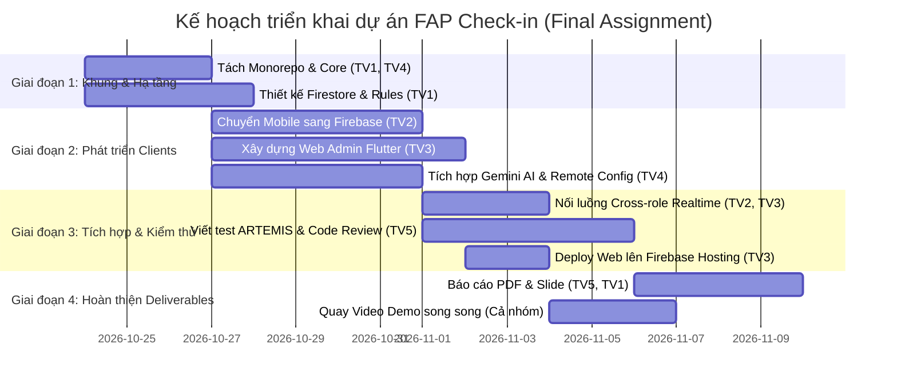

Dựa trên thang điểm 10 của **PRM393 Final Assignment** và yêu cầu bắt buộc: *"Git history must show work over time... in teams, every member's commits are visible"* (mọi thành viên đều phải có commit rõ ràng trên Git theo thời gian), dưới đây là **bản phân công chi tiết cho nhóm 5 người**.

Bản phân công này đảm bảo **khối lượng công việc đồng đều**, **không giẫm chân lên nhau**, và **phủ kín 100% tiêu chí chấm điểm**.

---

### BẢNG TỔNG QUAN PHÂN CÔNG VAI TRÒ

| STT | Thành viên | Vai trò chính | Trọng tâm công việc |
|:---:|:---|:---|:---|
| **1** | **Thành viên 1** *(Lead)* | **Architecture & Firebase Backend** | Cấu trúc Monorepo, Data Model, Security Rules + Tests, Firebase App Check |
| **2** | **Thành viên 2** | **Mobile App Core & Firebase Services** | Chuyển đổi Mobile sang Firestore, 6 dịch vụ Firebase, Inbox thông báo, UI Semantics |
| **3** | **Thành viên 3** | **Web Admin (Flutter Web)** | Xây dựng 4 màn hình Web Admin + Form thông báo, Deploy Firebase Hosting |
| **4** | **Thành viên 4** | **AI Feature (Gemini) & Shared Core** | Tích hợp Gemini (Level 2 Structured Output), Remote Config switch, Shared Package `packages/core` |
| **5** | **Thành viên 5** | **QA Testing (ARTEMIS) & Report/Video** | Google ARTEMIS E2E tests, AI Code Review, Viết Báo cáo PDF (10–15 tr), Slide & Video Demo |

---

### CHI TIẾT CÔNG VIỆC TỪNG THÀNH VIÊN

#### 👤 Thành viên 1: Team Leader & Firebase Backend Lead
> **Mục tiêu:** Chịu trách nhiệm về kiến trúc toàn hệ thống, bảo mật dữ liệu và cấu hình Firebase.

1. **Kiến trúc & Monorepo:**
   - Khởi tạo khung thư mục monorepo: `packages/core/`, `mobile/`, `web/`, `firebase/`, `e2e_test/`, `docs/`.
   - Cấu hình file `firebase.json` hỗ trợ cả Firestore, Hosting, Storage, Remote Config và Emulators.
2. **Data Model & Roles (RBAC):**
   - Thiết kế schema Firestore theo chuẩn đề bài: `users/{uid}` (có trường `role: "user" | "staff" | "admin"`), `classes/`, `sessions/`, `attendance_records/`, `requests/`, `announcements/`.
   - Thiết lập tài khoản Admin đầu tiên trong Firebase Console và ghi thông tin vào `README.md`.
3. **Security Rules & Emulator Testing:**
   - Viết `firestore.rules` và `storage.rules`: Tuân thủ nguyên tắc **Deny by default**, không dùng `allow read, write: if true;`, kiểm tra role và trạng thái hợp lệ.
   - Viết bộ unit test cho Security Rules trong `firebase/tests/` chạy trên **Firebase Local Emulator** (đủ case allowed và denied cho từng role/collection).
4. **Tài liệu bàn giao:**
   - `docs/gap-review.md` (đánh giá khoảng cách giữa Lab 2/3 và Final).
   - `docs/data-model.md` (đặc tả toàn bộ collections, permissions và rule).

---

#### 👤 Thành viên 2: Mobile App Lead
> **Mục tiêu:** Đưa app Giảng viên hiện tại sang dùng Firebase hoàn toàn và tích hợp các dịch vụ Firebase trên thiết bị di động.

1. **Chuyển đổi Backend trên Mobile:**
   - Gỡ bỏ `ApiService` gọi Google Apps Script, thay bằng các Repository/Service tương tác trực tiếp với Cloud Firestore.
   - Tích hợp **Firebase Auth (Google Sign-In)**: Tự động điều hướng theo trạng thái đăng nhập, từ chối nếu không đúng role.
2. **Tích hợp các dịch vụ Firebase trên Mobile:**
   - **Cloud Storage:** Upload file PDF báo cáo buổi điểm danh vào thư mục `reports/{uid}/...`, hiển thị thanh tiến trình (progress) và URL tải.
   - **Cloud Messaging (FCM) & Hộp thư (Inbox):** Xin quyền thông báo (Android 13+), nhận push notification ở 3 trạng thái (Foreground, Background, Terminated), xây dựng màn hình **Inbox** để sinh viên/giảng viên đọc thông báo từ Admin.
   - **Crashlytics:** Bắt lỗi handled non-fatal từ code thật và tạo 1 nút "Test Crash" trong màn hình Profile.
3. **Phối hợp luồng Cross-role:**
   - Xây dựng màn hình gửi yêu cầu từ mobile (Ví dụ: Giảng viên/Sinh viên gửi *Đơn xin sửa điểm danh / Điểm danh bù* sang trạng thái `pending`).
   - Thêm thuộc tính `Semantics(label: ...)` vào các nút và trường quan trọng để hỗ trợ kiểm thử tự động.

---

#### 👤 Thành viên 3: Web Admin Lead (Flutter Web)
> **Mục tiêu:** Xây dựng ứng dụng Flutter Web Admin dành cho Phòng Đào tạo / Ban Quản lý và deploy lên Firebase Hosting.

1. **Khởi tạo & Triển khai Flutter Web (`web/`):**
   - Tạo dự án Flutter Web độc lập trong thư mục `web/`, sử dụng chung `packages/core/` (Theme tokens, ColorScheme, Reusable widgets).
   - Cấu hình và deploy lên **Firebase Hosting** (có URL thật chạy được trên chế độ ẩn danh).
2. **Xây dựng 4 màn hình bắt buộc:**
   - **Màn 1 - Sign-in:** Đăng nhập Google, kiểm tra Firestore document `users/{uid}.role`. Nếu là `user` bình thường thì chặn lại và báo lỗi rõ ràng.
   - **Màn 2 - Management:** Quản lý danh mục (Lớp học / Môn học / Ca học): Tìm kiếm, xem danh sách, thêm, sửa, lưu trữ (archive).
   - **Màn 3 - Review Queue (Trung tâm Cross-role):** Hiển thị danh sách các đơn/yêu cầu sửa điểm danh gửi lên từ Mobile theo thời gian thực → Nút **Approve** / **Reject** kèm ô nhập lý do.
   - **Màn 4 - Dashboard:** Thống kê chuyên cần trường (ít nhất 3 chỉ số từ Firestore aggregation query: tổng số ca, tỷ lệ đi học %, số ca vắng bất thường) + 1 biểu đồ trực quan (`fl_chart`).
3. **Form gửi thông báo (Announcement Form):**

- Tạo form đăng thông báo mới ghi trực tiếp vào collection `announcements` để đẩy về Mobile Inbox.

---

#### 👤 Thành viên 4: AI Gemini Lead & Shared Core
> **Mục tiêu:** Xây dựng gói dùng chung (`packages/core`) và tính năng AI Gemini đạt chuẩn Level 2 (Structured Output).

1. **Xây dựng Shared Core (`packages/core/`):**
   - Tách các Models (`UserModel`, `ClassModel`, `SessionModel`, `AttendanceModel`, `RequestModel`), Firestore Services và Design System (Theme, Button, Dialog, Card) vào `packages/core/` để cả Mobile và Web cùng import.
2. **Tích hợp Tính năng AI Gemini (Level 2):**
   - **Nghiệp vụ:** Trích xuất minh chứng (OCR & Phân tích đơn xin nghỉ/minh chứng): Người dùng tải ảnh giấy khám bệnh/đơn xin phép -> Gemini trích xuất ra JSON (Mã SV, Ngày nghỉ, Lý do) -> Tự động điền vào Form yêu cầu.
   - **Cấu hình qua Remote Config:**
     - Lấy tên model (`gemini-1.5-flash`), prompt template và **cờ bật/tắt (`enable_gemini_ocr: true/false`)** từ Firebase Remote Config.
     - **Graceful Fallback:** Khi tắt cờ trên console hoặc mất mạng/hết quota, hệ thống chuyển sang cho phép người dùng nhập tay bình thường, không làm sập luồng.
   - **Quy tắc bảo mật:** Không gửi PII (tên, email cá nhân) trong prompt. Giao diện phải gắn nhãn *"Gợi ý bởi AI"* và cho phép người dùng sửa đổi trước khi gửi.
   - **Ghi log Analytics:** Bắn các event `ai_request`, `ai_result_accepted`, `ai_error`.
3. **Tài liệu:**
   - Viết `docs/ai-feature.md` (mô tả tính năng, 3 mẫu input/output thực tế và 1 kịch bản xử lý lỗi fallback).
   - Phối hợp thành viên 2 và 3 hoàn thiện `docs/cross-role-flow.md` (vẽ sequence diagram bằng Mermaid).

---

#### 👤 Thành viên 5: QA Testing, AI Code Review & Report/Video Lead
> **Mục tiêu:** Đảm bảo chất lượng hệ thống, chạy tự động hoá E2E, thực hiện AI code review và hoàn thiện toàn bộ sản phẩm truyền thông nộp bài.

1. **Automated E2E Testing với Google ARTEMIS (`e2e_test/`):**
   - Thiết lập môi trường Python 3.12+, uv, ADB và thư viện `google-artemis` (hoặc SDK tương đương).
   - Viết **ít nhất 10 test cases** bằng `pytest` bao quát: Đăng nhập Google, luồng mở phiên điểm danh, xem lịch sử, xuất PDF, kịch bản lỗi (empty/error state), và tương tác native (popup xin quyền/chọn tài khoản).
   - Chạy mỗi test case tối thiểu **3 lần**, thống kê tỷ lệ pass rate. Chạy 1 phiên exploratory testing 15–30 phút.
2. **AI-Assisted Code Review:**
   - Dùng công cụ AI (GitHub Copilot review / CodeRabbit / SonarCloud) quét mã nguồn.
   - Ghi nhận **ít nhất 5 findings** thuộc các loại: bug, security, vi phạm MVVM, performance.

   - Lập bảng quyết định (Accept / Modify / Reject) có giải thích lý do kỹ thuật.
   - **Tạo ít nhất 3 commits riêng biệt** để sửa 3 lỗi đã accept (đặt tên commit theo ID lỗi, ví dụ: `fix(review): resolve CR-01 MVVM violation`).
3. **Hồ sơ nộp bài & Video:**
   - Tổng hợp `docs/test-report.md`.
   - Viết **Final Report PDF (10–15 trang)** theo dàn ý chuẩn của trường.
   - Soạn **Slide thuyết trình (12–15 slide PDF)**.
   - Quay và biên tập **Video Demo (8–12 phút)**: Trình chiếu song song màn hình Mobile và Web Admin, demo luồng Cross-role real-time, demo tính năng AI (kèm thao tác tắt Remote Config để chứng minh fallback).

---

### KẾ HOẠCH PHỐI HỢP THEO GIAI ĐOẠN (TIMELINE)

> **Mẹo quan trọng khi chấm điểm:**
> Giảng viên sẽ kiểm tra Git Log để xem mỗi thành viên có đóng góp liên tục trong nhiều ngày hay không. Hãy đảm bảo mỗi bạn tạo branch riêng và commit đều đặn tương ứng với phần việc được phân công ở trên.