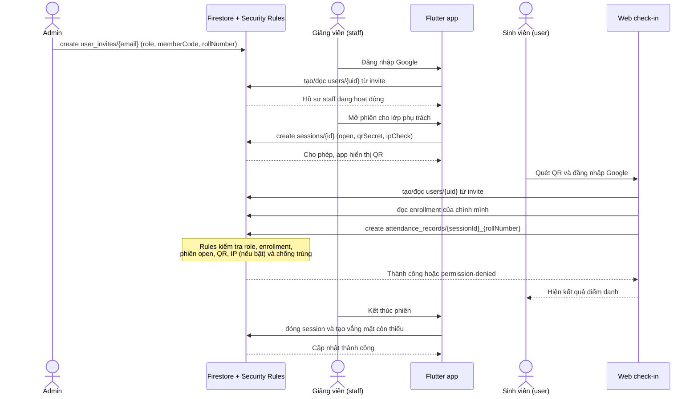

# Luồng cross-role — FAP Check-in

## 1. Mục đích

Tài liệu mô tả quyền và luồng dữ liệu giữa ba vai trò của hệ thống:

- `admin`: cấp quyền truy cập và quản trị dữ liệu tham chiếu.
- `staff`: giảng viên quản lý lớp được phân công và phiên điểm danh.
- `user`: sinh viên điểm danh cho chính mình.

Các quyền được thực thi ở **Firestore Security Rules**, không chỉ ở giao diện. Chi tiết điều kiện rule nằm trong [08-security-rules.md](08-security-rules.md).

## 2. Ma trận trách nhiệm

| Nghiệp vụ | Admin | Giảng viên (`staff`) | Sinh viên (`user`) |
|---|---|---|---|
| Cấp quyền đăng nhập lần đầu | Tạo `user_invites` | — | Đọc invite của email chính mình khi đăng nhập lần đầu |
| Quản lý hồ sơ / vai trò | Quản lý tài khoản | Đọc hồ sơ bản thân | Đọc hồ sơ bản thân |
| Quản lý lớp và ghi danh | Tạo/sửa dữ liệu quản trị | Đọc lớp được phân công; nhận lớp hợp lệ qua OCR | Chỉ đọc enrollment của bản thân |
| Mở/đóng phiên điểm danh | Có quyền quản trị theo Rules | Mở, làm mới QR và đóng phiên của lớp mình | Không có quyền |
| Điểm danh QR | Đọc/điều chỉnh theo quyền admin | Điểm danh thủ công lớp mình | Chỉ tạo bản ghi của chính mình, một lần cho mỗi phiên |
| OCR thời khóa biểu | Có thể quản trị | Upload ảnh của mình và gọi Function | Không có quyền |

## 3. Sequence diagram: admin cấp quyền → giảng viên mở phiên → sinh viên check-in

## 4. Kiểm soát bảo mật trong luồng

1. Client không tự gán role: tài khoản lần đầu chỉ được tạo hồ sơ từ invite đã có.
2. Sinh viên không đọc được `sessions`, nên không thể lấy QR secret ngoài mã QR đang được giảng viên hiển thị.
3. Record ID cố định theo `{sessionId}_{rollNumber}` và rule chỉ cho `create`; điều này chặn check-in trùng.
4. Giảng viên luôn bị giới hạn vào lớp có `teacherMemberCode` của chính mình.
5. Ảnh OCR chỉ được đọc trong thư mục Storage của người upload và Function xóa ảnh sau xử lý.

## 5. Phạm vi chưa triển khai

Luồng **đơn nghỉ phép/sửa điểm danh → admin duyệt hoặc từ chối** chưa có implementation end-to-end trong repository hiện tại:

- `web/admin/` là UI prototype, đang dùng mock data và chưa kết nối Firebase.
- Chưa thấy collection `requests` cùng Rules/test triển khai cho workflow `pending → approved/rejected`.

Vì vậy sequence diagram ở trên phản ánh luồng cross-role đang chạy thực tế: cấp quyền, mở phiên và check-in QR. Khi bổ sung workflow duyệt đơn, cần thêm schema `requests`, Rules, repository/service Web Admin và test Emulator trước khi ghi nhận là hoàn thành.
