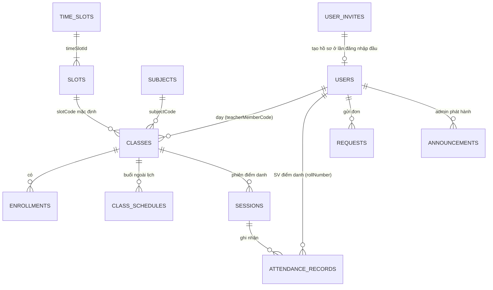

[← Mục lục](README.md)

# Data model — đặc tả collection, quyền và rule

Tài liệu bàn giao tổng hợp **toàn bộ collection Firestore**, **quyền theo role** và **Security Rules** của FAP Check-in. Đây là bản tóm tắt để tra nhanh; nguồn chuẩn vẫn là code:

| Nội dung | Nguồn chuẩn |
|---|---|
| Rules | [`firebase/firestore.rules`](../firebase/firestore.rules), [`firebase/storage.rules`](../firebase/storage.rules) |
| Index | [`firebase/firestore.indexes.json`](../firebase/firestore.indexes.json) |
| Test Rules | [`firebase/tests/`](../firebase/tests) |
| ERD | [db-erd.mermaid](db-erd.mermaid) |
| Model phía client | [`packages/core/lib/models/`](../packages/core/lib/models) |

Giải thích chi tiết hơn: [03 Dữ liệu Firestore](03-du-lieu-firestore.md), [05 Xác thực & phân quyền](05-xac-thuc-va-phan-quyen.md), [08 Security Rules & kiểm thử](08-security-rules.md).

## 1. Roles (RBAC)

Role lưu ở `users/{uid}.role`. Client **không tự đặt được** role: hồ sơ chỉ được tạo khi khớp một tài liệu `user_invites/{email}` do admin cấp trước.

| Role | Vai trò | Nền tảng |
|---|---|---|
| `user` | Sinh viên | Trang web check-in (`web/checkin/`) |
| `staff` | Giảng viên | App Flutter (`mobile/`) |
| `admin` | Quản trị | Web Admin (`web/admin/`), script Admin SDK |

Mọi quyền đều yêu cầu đăng nhập, `email_verified == true` và tài khoản `active`. Admin đầu tiên được tạo ngoài ứng dụng (`firebase/scripts/seed-admin.mjs`, xem [README](../README.md#tài-khoản-admin-đầu-tiên)).

## 2. Sơ đồ thực thể



## 3. Collections

Kiểu dữ liệu: mã/khóa/phòng là chuỗi; `credits`, `studentCount` là số; `active`, `ipCheck`, `syncedToFap` là boolean; ngày `yyyy-MM-dd`; giờ `HH:mm`; các thời điểm (`createdAt`, `checkinTime`, `updatedAt`, `resolvedAt`) là `Timestamp`.

### 3.1 Tài khoản

**`users/{uid}`** — hồ sơ, `uid` là Firebase Auth uid.

| Trường | Kiểu | Ghi chú |
|---|---|---|
| `memberCode` | string | Mã GV/SV, lấy từ invite |
| `fullName` | string | |
| `email` | string | |
| `role` | string | `user` \| `staff` \| `admin` |
| `rollNumber` | string | Chỉ SV |
| `active` | bool | Tài khoản bị khóa khi `false` |
| `createdAt` | timestamp | |

**`user_invites/{email viết thường}`** — tài khoản cấp trước: `role`, `memberCode`, `fullName`, `rollNumber`. Chỉ admin ghi.

### 3.2 Dữ liệu tham chiếu

| Collection | Id | Trường chính |
|---|---|---|
| `subjects` | `{subjectCode}` | `subjectName`, `credits` |
| `timeSlots` | `A-1`, `A-2`, `P-1`, `P-2` | `period`, `slotInPeriod`, `daySlotNo`, `startTime`, `endTime` |
| `slots` | `A1`…`A6`, `P1`…`P6` | `timeSlotId`, `weekdays` |

Quy tắc slot A/P: [03 §3](03-du-lieu-firestore.md#3-quy-tắc-lịch-slot-ap).

### 3.3 Lớp và ghi danh

| Collection | Id | Trường chính |
|---|---|---|
| `classes` | `{classCode}` | `subjectCode`, `subjectName`, `credits`, `room`, `studentCount`, `teacherMemberCode` (rỗng = chưa có GV), `slotCode` |
| `enrollments` | `{classCode}_{rollNumber}` | `classCode`, `rollNumber`, `teacherMemberCode`, `fullName`, `email` |
| `class_schedules` | `{teacherMemberCode}_{requestId}` | `classCode`, `teacherMemberCode`, `scheduleDate`, `slotCode`, `room`, `lessonType`, `teachingMethod`, `note`, `status` |

### 3.4 Điểm danh

| Collection | Id | Trường chính |
|---|---|---|
| `sessions` | tự sinh | `classCode`, `teacherMemberCode`, `sessionDate`, `slotCode`, `sessionStatus` (`open` \| `closed`), `qrSecret`, `ipCheck`, `teacherIp` |
| `attendance_records` | `{sessionId}_{rollNumber}` | `sessionId`, `rollNumber`, `qrToken` (chỉ lúc check-in), `classCode`, `teacherMemberCode`, `status`, `checkinTime`, `networkVerificationResult`, `ipAddress`, `note`, `syncedToFap`, `updatedAt`, `updatedBy` |

Giá trị `attendance_records.status`: `Present`, `Late`, `Absent`, `ManualByGV`, `Unchecked`.

Giá trị `networkVerificationResult`:

| Giá trị | Ý nghĩa |
|---|---|
| `Match` | IP khớp `teacherIp` |
| `Skipped` | Phiên không bật kiểm tra IP |
| `Manual` | GV sửa tay |
| `AutoAbsent` | Vắng tự sinh khi đóng phiên |
| `Mismatch` | Dữ liệu cũ, không còn tạo mới |

### 3.5 Đơn và thông báo (Web Admin)

| Collection | Id | Trường chính |
|---|---|---|
| `requests` | tự sinh | `type` (`attendance_fix` \| `leave`), `authorUid`, `reason` (1..2000 ký tự), `status` (`pending` → `approved` \| `rejected`), `resolvedBy`, `resolvedAt`, `adminNote` |
| `announcements` | tự sinh | `audience` (`all` \| `staff` \| `user`), `title`, `body`, `createdAt` |

### 3.6 Vì sao quyền tính theo `memberCode`/`rollNumber`, không theo `uid`

Lớp, phiên, ghi danh tồn tại trước khi người dùng đăng nhập lần đầu nên chưa biết `uid`. Rules đọc `users/{uid}` một lần rồi so `memberCode`/`rollNumber` với trường trên tài liệu. Do đó `teacherMemberCode` được denormalize sang `enrollments`, `sessions`, `attendance_records`, `class_schedules` (xem [03 §7](03-du-lieu-firestore.md#7-ghi-chú-thiết-kế)).

## 4. Ma trận quyền

Ký hiệu: ✔ được · ✘ bị từ chối · "own" = chỉ tài liệu của mình hoặc lớp mình phụ trách. Người chưa đăng nhập bị từ chối ở mọi collection.

| Collection | `user` (SV) | `staff` (GV) | `admin` |
|---|---|---|---|
| `users` | get own; sửa `fullName` của mình; tạo hồ sơ khi khớp invite | như SV | ✔ toàn quyền |
| `user_invites` | get invite của email mình | như SV | ✔ |
| `subjects`, `timeSlots`, `slots` | đọc | đọc | ✔ ghi |
| `classes` | ✘ | đọc own + lớp chưa có GV; **nhận** lớp chưa có GV | ✔ |
| `enrollments` | đọc own (`rollNumber`) | đọc own + lớp chưa có GV; nhận ghi danh lớp chưa có GV | ✔ |
| `class_schedules` | ✘ | create/read/update/delete own | ✔ |
| `sessions` | ✘ (tránh lộ `qrSecret`) | create (lớp mình, `open`, `qrSecret` ≥ 16 ký tự), read/update own | read/update/delete, **không create** |
| `attendance_records` | read own; **create** khi check-in hợp lệ | read own; create cho SV của lớp mình; update own (giới hạn trường) | read/update/delete, không create |
| `requests` | create (`pending`), read own, rút đơn `pending` | như SV | read; duyệt `pending` → `approved`/`rejected` |
| `announcements` | đọc `all`, `user` | đọc `all`, `staff` | ✔ |
| collection khác | ✘ | ✘ | ✘ |

Bảng đầy đủ theo từng thao tác (get/list/create/update/delete): [08 — Ma trận quyền](08-security-rules.md#ma-trận-quyền).

## 5. Rule check-in của sinh viên

SV chỉ `create` được `attendance_records/{sessionId}_{rollNumber}` khi **tất cả** điều kiện sau đúng:

1. Id khớp `{sessionId}_{rollNumber}` và `rollNumber` là của chính SV.
2. `qrToken` khớp `sessions.qrSecret` hiện tại (QR đổi mỗi 60 giây).
3. Phiên đang `open`.
4. SV có trong `enrollments` của lớp.
5. Nếu phiên bật `ipCheck`: `ipAddress` khớp `teacherIp`.
6. Tập khóa cố định, `status == 'Present'`, `checkinTime == request.time`, `syncedToFap == false`; khi `ipCheck` tắt thì `ipAddress` rỗng và `networkVerificationResult == 'Skipped'`.

Vì SV chỉ được `create`, lần ghi thứ hai bị từ chối (chống điểm danh trùng). Chi tiết: [02 Luồng điểm danh QR](02-luong-diem-danh-qr.md).

## 6. Nguyên tắc Rules

- **Deny by default**: khối `match /{document=**}` cuối cùng từ chối tất cả; không dùng `allow …: if true`.
- Mọi `create`/`update` của client giới hạn tập khóa (`hasOnly`) và giá trị hợp lệ.
- Giới hạn 10 lần `get`/`exists` mỗi request; check-in dùng 3 (`users`, `sessions`, `enrollments`).

## 7. Storage

`firebase/storage.rules`: `timetable_scans/{uid}/{file}` — `staff` tải ảnh (`image/*`, < 10 MB, chỉ thư mục của mình, không ghi đè); chủ file và `admin` đọc; mọi đường dẫn khác bị từ chối.

## 8. Index

6 composite index khai báo trong `firebase/firestore.indexes.json` cho `sessions` (2), `class_schedules`, `requests` (2) và `announcements`. Truy vấn chỉ gồm điều kiện bằng nhau không cần index.

## 9. Kiểm thử

```bash
cd firebase
npm ci
npm test        # tự bật Firestore + Storage Emulator, chạy test rồi tắt
```

Cần Java 21 và `firebase-tools`. Mỗi collection có test cả trường hợp được phép và bị từ chối cho từng role ([08 — Test](08-security-rules.md#test)). CI chạy bộ này mỗi lần push.

## 10. Quy trình khi đổi schema hoặc Rules

1. Sửa `firebase/firestore.rules` và viết test allowed + denied trong `firebase/tests/`.
2. Cập nhật tài liệu này, [03](03-du-lieu-firestore.md) và [db-erd.mermaid](db-erd.mermaid).
3. `npm test` xanh rồi mới merge; deploy bằng `./scripts/deploy.ps1 -Only firestore`.
