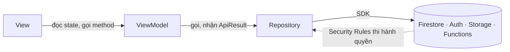

[← Mục lục](README.md)

# Quick Start — Pattern MVVM + Repository trên Firebase

Cách viết code cho app GV (Flutter MVVM) khi dữ liệu nằm hoàn toàn trên Firebase. Đọc kèm [01](01-kien-truc-tong-the.md) và [04](04-kien-truc-app-va-web.md).

## 0. Khác gì so với hướng Apps Script cũ

| Cũ | Mới |
|---|---|
| `ApiService.postAction('getClasses', …)` → HTTP tới `script.google.com` | Repository gọi **Cloud Firestore SDK** trực tiếp |
| Envelope `{success, data, error}`, `ApiResponse<T>` | Không còn envelope; Repository trả `ApiResult<T>` |
| Phân quyền trong code Apps Script (`requireTeacher`) | Phân quyền bằng **Security Rules** + lọc `teacherMemberCode` ở mọi truy vấn |
| Token phiên tự cấp (`sessionToken`) | Firebase Auth (`uid`), hồ sơ `users/{uid}` |
| View/ViewModel/Model | **Giữ nguyên** |

## 1. Chạy toàn bộ môi trường cục bộ

```bash
# 1) Emulator (Auth 9099, Firestore 8085, Storage 9199, Functions 5001, Hosting 5000, UI 4000)
cd firebase && npm ci && cd ..
firebase emulators:start --project demo-fapcheckin

# 2) Dữ liệu mẫu (terminal khác)
cd firebase
node scripts/seed-reference.mjs --emulator
node scripts/seed-admin.mjs --emulator --email admin@fpt.edu.vn --password Passw0rd!
```

Mở Emulator UI tại <http://localhost:4000> để xem Auth/Firestore. Test: `cd firebase && npm test` (Rules), `cd packages/core && flutter test`, `cd mobile && flutter test`, `cd e2e_test && npm test`.

## 2. Result pattern — `ApiResult<T>`

Repository không ném exception cho lỗi nghiệp vụ — nó trả `ApiResult<T>` để ViewModel xử lý tường minh.

`packages/core/lib/result/api_result.dart`:

```dart
abstract class ApiResult<T> {}
class ApiSuccess<T> extends ApiResult<T> { final T data; ApiSuccess(this.data); }
class ApiFailure<T> extends ApiResult<T> { final ApiError error; ApiFailure(this.error); }  // error.code, error.message
```

`guardApi` (cùng thư mục, `guard.dart`) bọc thân phương thức: `ApiException(code, message)` và mọi lỗi Firebase được đổi thành `ApiFailure`, nên Repository không bao giờ ném.

## 3. Repository mẫu

```dart
class TeacherRepository {
  TeacherRepository({required this.currentUser, FirebaseFirestore? firestore, DateTime Function()? now});
  final CurrentUser currentUser;                 // memberCode của GV đang đăng nhập

  Future<ApiResult<String>> rotateQr({required String sessionId}) => guardApi(() async {
    final session = await _session(sessionId);   // kiểm tra phiên tồn tại và thuộc GV
    if (session['sessionStatus'] != 'open') {
      throw ApiException('SESSION_NOT_FOUND', 'Phiên đã đóng, không thể làm mới QR.');
    }
    final secret = randomSecret();
    await _db.collection('sessions').doc(sessionId).update({'qrSecret': secret});
    return secret;
  });
}
```

Quy tắc khi viết Repository mới:

1. **Luôn lọc theo `teacherMemberCode`** (`where('teacherMemberCode', isEqualTo: memberCode)`) khi truy vấn `classes`, `enrollments`, `sessions`, `attendance_records`, `class_schedules` — Rules từ chối truy vấn không chứng minh được quyền sở hữu.
2. Ghi nhiều tài liệu cùng lúc bằng `WriteBatch` (≤ 500 thao tác; dùng `commitInBatches`) hoặc `runTransaction` khi cần so sánh-rồi-ghi.
3. Thời điểm ghi bằng `FieldValue.serverTimestamp()`; khi đọc, `docToJson` đổi `Timestamp` → chuỗi ISO để model dùng lại `fromJson`.
4. Giữ mã lỗi nghiệp vụ ổn định (`FORBIDDEN`, `CONFLICT`…); View phụ thuộc vào chúng ([06](09-repository-api.md)).
5. Thêm test trong `packages/core/test/` bằng `fake_cloud_firestore`, và test Rules cho mọi quyền mới ([08](08-security-rules.md)).

## 4. Base ViewModel — trạng thái màn hình chuẩn hoá

ViewModel extend `ChangeNotifier`, dùng `ViewStatus { idle, loading, success, error }` để View xử lý loading/error theo cùng một cách (xem `mobile/lib/viewmodels/live_session_viewmodel.dart`):

```dart
Future<void> loadClasses() async {
  _status = ViewStatus.loading;
  notifyListeners();
  final result = await _repository.getClasses(teacherMemberCode: _memberCode);
  switch (result) {
    case ApiSuccess(:final data): _classes = data; _status = ViewStatus.success;
    case ApiFailure(:final error): _errorMessage = error.message; _status = ViewStatus.error;
  }
  notifyListeners();
}
```

## 5. View — chỉ hiển thị theo `status`

```dart
Consumer<DashboardViewModel>(
  builder: (context, vm, _) => switch (vm.status) {
    ViewStatus.loading => const CircularProgressIndicator(),
    ViewStatus.error   => Text(vm.errorMessage ?? 'Lỗi không xác định'),
    _                  => ClassList(classes: vm.classes),
  },
)
```

View **không** gọi Repository hay Firebase trực tiếp, không parse JSON — chỉ đọc state của ViewModel qua `Consumer`/`Selector`. Ngoại lệ có chủ đích: hai hộp thoại (`create_class_dialog`, `import_timetable_dialog`) lấy `ScheduleRepository`/`TimetableRepository` từ `Provider` để tách khỏi ViewModel.

## 6. Quy ước đặt tên

| Loại | Quy ước | Ví dụ |
|---|---|---|
| Model | `xxx_model.dart`, `XxxModel` | `session_model.dart` → `SessionModel` |
| Repository | `xxx_repository.dart`, `XxxRepository` | `teacher_repository.dart` |
| ViewModel | `xxx_viewmodel.dart`, `XxxViewModel` | `live_session_viewmodel.dart` |
| View | `xxx_screen.dart` / `xxx_body.dart` | `login_screen.dart` |
| Collection / trường Firestore | `snake_case` số nhiều cho collection, `camelCase` cho trường | `attendance_records.checkinTime` |
| Mã lỗi (`code`) | `SCREAMING_SNAKE_CASE` | `SESSION_ALREADY_OPEN` |
| Import mã dùng chung | `package:fapcheckin_core/…` | `package:fapcheckin_core/models/user_model.dart` |

## 7. Luồng phụ thuộc tóm tắt



- **View**: không biết `ApiResult`/Firebase tồn tại.
- **ViewModel**: không biết Firebase tồn tại — chỉ biết `ApiResult<T>` và model.
- **Repository**: nơi duy nhất biết tên collection, truy vấn, batch/transaction và chuyển lỗi Firebase → `ApiFailure`.
- **Security Rules**: hàng rào thật sự; Repository chỉ là cách dùng đúng.

[← Mục lục](README.md)
