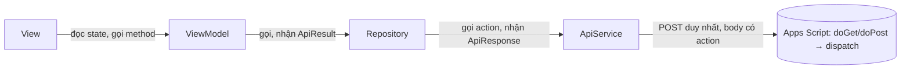

[← Mục lục](README.md)

# Quick Start — Pattern kết nối App GV (Flutter MVVM) ↔ Backend Apps Script

Tài liệu này chốt **quy ước code** dùng chung cho cả nhóm khi implement app GV ([04](04-kien-truc-app-va-web.md)), để không ai tự sáng tạo format riêng giữa chừng. Không đổi kiến trúc đã chốt (View ↔ ViewModel ↔ Repository ↔ Data Source) — đây là cách hiện thực hoá 4 lớp đó bằng code cụ thể, đúng với giới hạn thật của Google Apps Script Web App.

## 0. Vì sao không dùng REST chuẩn

Apps Script Web App **không đáp ứng được REST đầy đủ** — đây là giới hạn nền tảng, không phải lựa chọn thiết kế:

| Yêu cầu REST chuẩn | Thực tế Apps Script |
|---|---|
| Đủ HTTP verb (GET/POST/PUT/PATCH/DELETE) | Chỉ có `doGet(e)` / `doPost(e)`. Không có `doPut`/`doDelete`/`doPatch`. |
| Status code phản ánh kết quả (200/400/401/404/409...) | `ContentService` luôn trả **200** (hoặc redirect nội bộ). Không set status code tuỳ ý được. |
| URL theo resource (`/sessions/123`, `/students/45`) | Chỉ có **một URL cố định** (URL exec của script) — không có path routing thật. |
| CORS preflight cho request phức tạp (JSON, custom header) | `application/json` từ trình duyệt → preflight OPTIONS → Apps Script xử lý kém/không ổn định. |

**Hệ quả bắt buộc cho thiết kế:**

1. **Routing giả REST bằng field `action`** — không dùng path, không dùng verb để phân biệt nghiệp vụ. Mọi request đọc dữ liệu → `doGet(e)` + query `?action=...`; mọi request ghi/hành động → `doPost(e)` + body JSON có field `"action"`.
2. **Không bao giờ đọc HTTP status code** — kết quả/lỗi luôn nằm trong body JSON (envelope ở mục 1), vì status luôn là 200.
3. **App GV (Flutter, `dio`) không bị ảnh hưởng bởi CORS** — CORS chỉ áp dụng cho trình duyệt. Chỉ `checkin-web` (SV) cần né preflight: gửi `Content-Type: text/plain;charset=utf-8` thay vì `application/json`, backend tự `JSON.parse(e.postData.contents)`.

## 1. Chuẩn Request — action-based

Mọi request (đọc lẫn ghi) đều mang một field `action` để backend tự định tuyến trong `doGet`/`doPost` — đây là "endpoint" thay cho path REST.

```json
// GET  ?action=getClasses&teacherId=T001
// POST body (Content-Type: text/plain, backend tự JSON.parse)
{
  "action": "checkin",
  "qrToken": "abc123",
  "studentIp": "203.0.113.5"
}
```

| `action` | Verb | Dùng khi |
|---|---|---|
| `login` | POST | Đăng nhập, đổi idToken Google lấy session token |
| `getClasses` | GET | GV lấy danh sách lớp mình dạy |
| `startSession` | POST | GV mở phiên điểm danh (sinh `qrSecret`, ghi `teacherIp`) |
| `checkin` | POST | SV gửi điểm danh (kèm `qrToken`, `studentIp`) |
| `manualCheckin` | POST | GV điểm danh tay dự phòng |
| `getRoster` | GET | GV xem danh sách đã điểm danh (real-time) |
| `getStats` | GET | GV xem % chuyên cần |

## 2. Chuẩn Response — envelope JSON

Mọi `action` trả về **cùng một envelope**, dù thành công hay lỗi — vì status code không dùng được:

```json
// Thành công
{
  "success": true,
  "data": { "sessionId": "S001", "qrToken": "abc123" },
  "error": null
}

// Thất bại
{
  "success": false,
  "data": null,
  "error": {
    "code": "IP_MISMATCH",
    "message": "IP của bạn không khớp với mạng của lớp học."
  }
}
```

- `success`: luôn có, quyết định cách client parse — **client luôn đọc field này, không đọc HTTP status**.
- `data`: object hoặc `null`. Không bọc thêm tầng nào khác (không `data.result.value`).
- `error`: `null` khi `success = true`. Khi lỗi, luôn có `code` (SCREAMING_SNAKE_CASE, để client so sánh/switch) và `message` (tiếng Việt, hiển thị thẳng cho người dùng).

### Mã lỗi chuẩn hoá (mở rộng dần trong `core/constants`)

| `code` | Khi nào |
|---|---|
| `UNAUTHORIZED` | Thiếu/sai session token |
| `DOMAIN_NOT_ALLOWED` | Email đăng nhập không đúng domain trường |
| `UNKNOWN_ACTION` | `action` không khớp handler nào ở backend |
| `SESSION_NOT_FOUND` | `sessionId`/`qrToken` không tồn tại hoặc đã hết hạn |
| `IP_MISMATCH` | `studentIp != teacherIp` |
| `ALREADY_CHECKED_IN` | SV đã điểm danh phiên này rồi |
| `NOT_ENROLLED` | SV không thuộc lớp của phiên |
| `VALIDATION_ERROR` | Thiếu field bắt buộc trong request |

## 3. Phía Backend — dispatch theo `action` (Apps Script)

`apps-script/Code.gs` chỉ có 2 hàm entry point, mỗi hàm dispatch qua `action`, luôn trả `ContentService` với envelope ở mục 2 (không bao giờ throw thẳng ra ngoài):

```javascript
function doGet(e) {
  return dispatch(e.parameter.action, e.parameter);
}

function doPost(e) {
  var body = JSON.parse(e.postData.contents); // text/plain để né CORS preflight
  return dispatch(body.action, body);
}

function dispatch(action, params) {
  var handlers = {
    getClasses: handleGetClasses,
    startSession: handleStartSession,
    checkin: handleCheckin,
    // ...
  };

  try {
    var handler = handlers[action];
    if (!handler) return jsonResponse({ success: false, data: null, error: { code: 'UNKNOWN_ACTION', message: 'Không rõ hành động: ' + action } });

    var data = handler(params);
    return jsonResponse({ success: true, data: data, error: null });
  } catch (err) {
    return jsonResponse({ success: false, data: null, error: { code: err.code || 'UNKNOWN', message: err.message } });
  }
}

function jsonResponse(payload) {
  return ContentService.createTextOutput(JSON.stringify(payload))
    .setMimeType(ContentService.MimeType.JSON);
}
```

> `doGet(e)` còn kiêm nhiệm vụ trả trang HTML cho SV khi `?page=checkin` (xem [01](01-kien-truc-tong-the.md), [04.2](04-kien-truc-app-va-web.md)) — tách nhánh `page` ra khỏi nhánh `action` ngay đầu `doGet`.

## 4. Model — `ApiResponse<T>` (phía Flutter)

`lib/data/models/api_response.dart`:

```dart
class ApiResponse<T> {
  final bool success;
  final T? data;
  final ApiError? error;

  const ApiResponse({required this.success, this.data, this.error});

  factory ApiResponse.fromJson(
    Map<String, dynamic> json,
    T Function(Map<String, dynamic> json) fromJsonT,
  ) {
    return ApiResponse<T>(
      success: json['success'] as bool,
      data: json['data'] == null ? null : fromJsonT(json['data'] as Map<String, dynamic>),
      error: json['error'] == null ? null : ApiError.fromJson(json['error'] as Map<String, dynamic>),
    );
  }
}

class ApiError {
  final String code;
  final String message;

  const ApiError({required this.code, required this.message});

  factory ApiError.fromJson(Map<String, dynamic> json) =>
      ApiError(code: json['code'] as String, message: json['message'] as String);
}
```

Mỗi model nghiệp vụ (`session_model.dart`, `attendance_model.dart`, ...) chỉ có `fromJson`/`toJson` của riêng nó — **không** biết gì về envelope. `ApiResponse<T>` là lớp bọc chung, generic theo `T`.

## 5. `ApiService` — nơi duy nhất biết `action` là gì

`lib/core/services/api_service.dart`. Đây là lớp duy nhất gọi `dio`, luôn gửi kèm `action`, luôn parse qua `ApiResponse<T>`:

```dart
class ApiService {
  final Dio _dio; // baseUrl = URL exec của Apps Script, interceptor đính session token

  ApiService(this._dio);

  Future<ApiResponse<T>> call<T>({
    required String action,
    Map<String, dynamic> params = const {},
    required T Function(Map<String, dynamic> json) fromJsonT,
  }) async {
    final response = await _dio.post(
      '', // một URL duy nhất, không có path
      data: {'action': action, ...params},
      options: Options(contentType: 'text/plain;charset=utf-8'), // né CORS preflight
    );
    return ApiResponse.fromJson(response.data as Map<String, dynamic>, fromJsonT);
  }
}
```

> App GV luôn POST (kể cả đọc dữ liệu) để dùng chung một code path — Apps Script không phân biệt "đọc/ghi" theo verb nên không có lý do tách GET riêng ở phía app. `checkin-web` (JS thuần) mới cần cân nhắc GET cho trang HTML tĩnh.

## 6. Result pattern — `ApiResult<T>` (dùng trong Repository)

Repository không ném exception cho lỗi nghiệp vụ (sai IP, hết hạn QR...) — nó trả về một `ApiResult<T>` để ViewModel xử lý tường minh, không cần `try/catch` rải khắp nơi.

`lib/core/utils/api_result.dart`:

```dart
sealed class ApiResult<T> {
  const ApiResult();
}

class ApiSuccess<T> extends ApiResult<T> {
  final T data;
  const ApiSuccess(this.data);
}

class ApiFailure<T> extends ApiResult<T> {
  final String code;
  final String message;
  const ApiFailure({required this.code, required this.message});
}
```

Repository mẫu — `lib/data/repositories/attendance_repository.dart`:

```dart
class AttendanceRepository {
  final ApiService _api;

  AttendanceRepository(this._api);

  Future<ApiResult<AttendanceModel>> checkIn({
    required String qrToken,
    required String studentIp,
  }) async {
    final response = await _api.call(
      action: 'checkin',
      params: {'qrToken': qrToken, 'studentIp': studentIp},
      fromJsonT: AttendanceModel.fromJson,
    );

    return switch (response) {
      ApiResponse(success: true, :final data?) => ApiSuccess(data),
      ApiResponse(:final error?) => ApiFailure(code: error.code, message: error.message),
      _ => const ApiFailure(code: 'UNKNOWN', message: 'Đã có lỗi xảy ra.'),
    };
  }
}
```

> Chỉ Repository được import `ApiService`/`ApiResponse`. ViewModel chỉ import Repository + model nghiệp vụ + `ApiResult` — không biết `action` là gì.

## 7. Base ViewModel — trạng thái màn hình chuẩn hoá

Mọi ViewModel extend `BaseViewModel` để View luôn xử lý loading/error theo cùng một cách.

`lib/viewmodels/base_view_model.dart`:

```dart
enum ViewStatus { idle, loading, success, error }

abstract class BaseViewModel extends ChangeNotifier {
  ViewStatus _status = ViewStatus.idle;
  String? _errorMessage;

  ViewStatus get status => _status;
  String? get errorMessage => _errorMessage;
  bool get isLoading => _status == ViewStatus.loading;

  Future<void> runCatching(Future<void> Function() action) async {
    _status = ViewStatus.loading;
    _errorMessage = null;
    notifyListeners();

    try {
      await action();
      _status = ViewStatus.success;
    } catch (e) {
      _status = ViewStatus.error;
      _errorMessage = e.toString();
    }
    notifyListeners();
  }
}
```

ViewModel mẫu — `lib/viewmodels/teacher_session_viewmodel.dart`:

```dart
class TeacherSessionViewModel extends BaseViewModel {
  final AttendanceRepository _repository;
  SessionModel? session;

  TeacherSessionViewModel(this._repository);

  Future<void> startSession(String classId) => runCatching(() async {
        final result = await _repository.startSession(classId);
        switch (result) {
          case ApiSuccess(:final data):
            session = data;
          case ApiFailure(:final message):
            throw Exception(message);
        }
      });
}
```

## 8. View — chỉ hiển thị theo `status`

```dart
class StartSessionScreen extends StatelessWidget {
  const StartSessionScreen({super.key});

  @override
  Widget build(BuildContext context) {
    return Consumer<TeacherSessionViewModel>(
      builder: (context, vm, _) => switch (vm.status) {
        ViewStatus.loading => const CircularProgressIndicator(),
        ViewStatus.error => Text(vm.errorMessage ?? 'Lỗi không xác định'),
        _ => QrView(session: vm.session),
      },
    );
  }
}
```

View **không** gọi `ApiService`/`Repository` trực tiếp, không tự parse JSON, không biết `action` — chỉ đọc field của ViewModel qua `Consumer`/`Selector` (`provider`, xem [04](04-kien-truc-app-va-web.md)).

## 9. Quy ước đặt tên

| Loại | Quy ước | Ví dụ |
|---|---|---|
| Model | `xxx_model.dart`, class `XxxModel` | `session_model.dart` → `SessionModel` |
| Repository | `xxx_repository.dart`, class `XxxRepository` | `attendance_repository.dart` → `AttendanceRepository` |
| ViewModel | `xxx_viewmodel.dart`, class `XxxViewModel` | `teacher_session_viewmodel.dart` → `TeacherSessionViewModel` |
| View | `xxx_screen.dart`, class `XxxScreen` | `start_session_screen.dart` → `StartSessionScreen` |
| `action` (request) | `camelCase`, động từ + danh từ | `startSession`, `getClasses` |
| Mã lỗi API (`code`) | `SCREAMING_SNAKE_CASE` | `IP_MISMATCH` |

## 10. Luồng phụ thuộc tóm tắt



- **View**: không biết `ApiResult`/`ApiResponse`/`action` tồn tại.
- **ViewModel**: không biết `dio`/HTTP/JSON/`action` tồn tại — chỉ biết `ApiResult<T>`.
- **Repository**: nơi duy nhất chuyển `ApiResponse<T>` (hình dạng HTTP) → `ApiResult<T>` (hình dạng nghiệp vụ), và là nơi duy nhất biết tên `action`.
- **Backend**: một URL, hai hàm entry (`doGet`/`doPost`), dispatch nội bộ theo `action` — thay cho routing REST thật. Đây cũng là nơi duy nhất đổi khi hạ tầng đổi (xem [10 · Định hướng mở rộng](10-dinh-huong-mo-rong.md)).

[← Mục lục](README.md)
