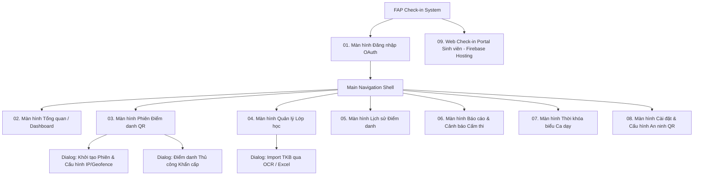
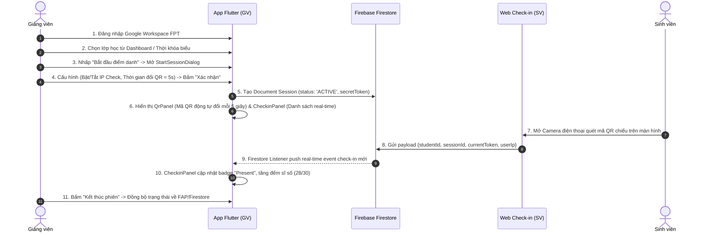
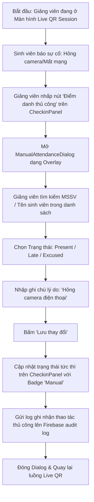
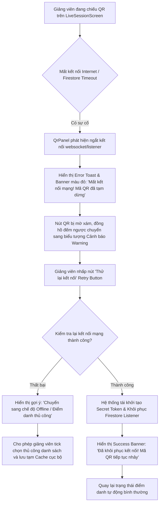

# PRM323 Lab 2 - Information Architecture & User Flows

## 1. Kiến trúc thông tin (Information Architecture / Sitemap)

Hệ thống **FAP Check-in** được thiết kế chuẩn Material 3 cho Flutter Desktop/Mobile App (Giảng viên) và PWA Web Portal (Sinh viên). 

### Sitemap Tổng thể (>= 8 Màn hình chính)

---

## 2. Ba luồng người dùng chi tiết (Three Detailed User Flows)

### Flow 1: Luồng Chính - Khởi tạo & Chiếu mã QR điểm danh (Happy Path)
*Mục tiêu*: Giảng viên mở phiên điểm danh nhanh và sinh viên check-in tự động thành công.

---

### Flow 2: Luồng Thay Thế - Điểm danh thủ công khẩn cấp (Alternate Path)
*Mục tiêu*: Xử lý trường hợp sinh viên bị hỏng camera, hết dung lượng 4G hoặc gặp sự cố điện thoại.

---

### Flow 3: Luồng Lỗi & Phục Hồi - Sự cố mất mạng / Mất kết nối Token QR (Error & Recovery Path)
*Mục tiêu*: Tự động phát hiện lỗi ngắt kết nối mạng hoặc hết hạn Token QR, hỗ trợ Giảng viên khôi phục phiên mà không làm gián đoạn lớp học.

---

## 3. Bảng ánh xạ Flow - Screen (Flow to Screen Mapping Table)

| Luồng người dùng (User Flow) | Màn hình & Component tham gia | Vai trò của Màn hình / Component |
| :--- | :--- | :--- |
| **Flow 1: Live QR Session (Happy Path)** | `01. LoginScreen` `02. DashboardScreen` `03. LiveSessionScreen` └─ `StartSessionDialog` └─ `QrPanel` └─ `CheckinPanel` `09. StudentWebPortal` | Authenticate giảng viên -> Chọn ca dạy -> Mở modal chọn tham số -> Hiển thị QR động -> Cập nhật danh sách SV quét thành công real-time. |
| **Flow 2: Manual Override (Alternate Path)** | `03. LiveSessionScreen` └─ `CheckinPanel` └─ `ManualAttendanceDialog` | Giảng viên bấm nút điểm danh tay -> Modal tra cứu MSSV -> Đổi trạng thái sang Present/Late -> Đóng modal & cập nhật UI. |
| **Flow 3: Error & Recovery Path** | `03. LiveSessionScreen` └─ `QrPanel` (Error State) `05. AttendanceHistoryScreen` (Offline Cache) | Xử lý lỗi ngắt kết nối -> Hiển thị Banner Error & Retry Button -> Khôi phục token hoặc chuyển sang lưu Offline Cache. |
